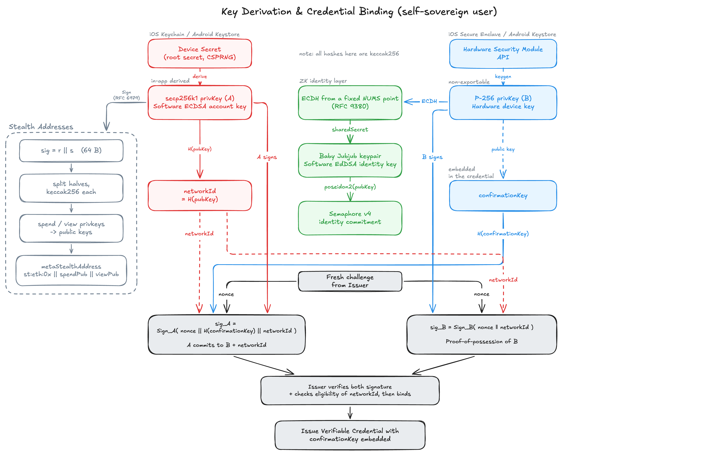
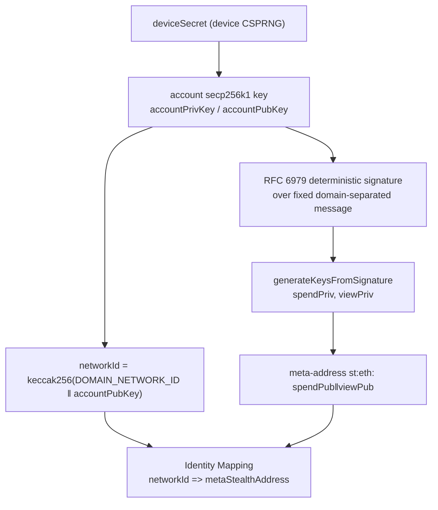
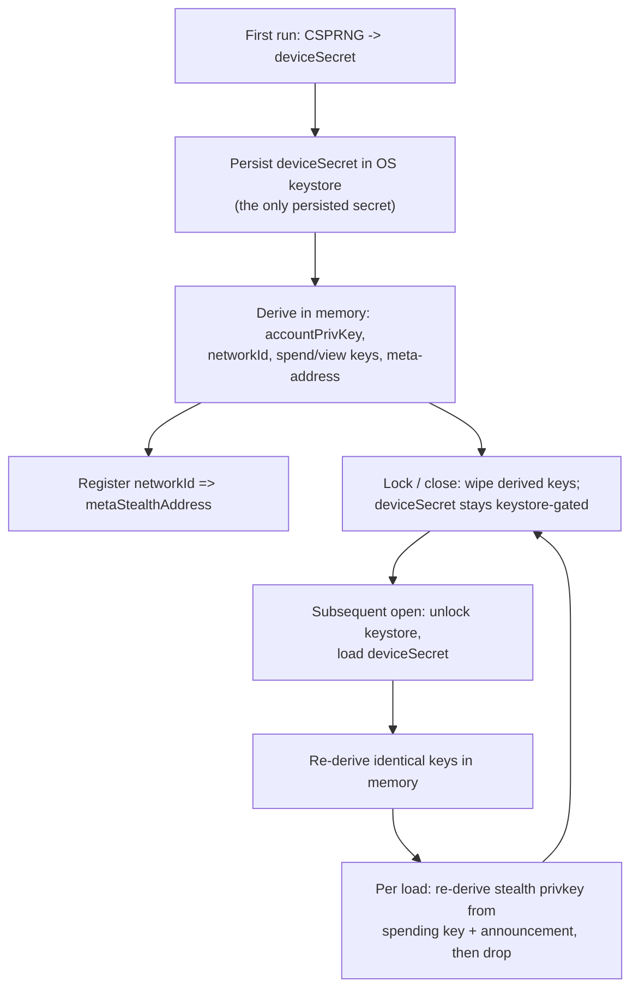
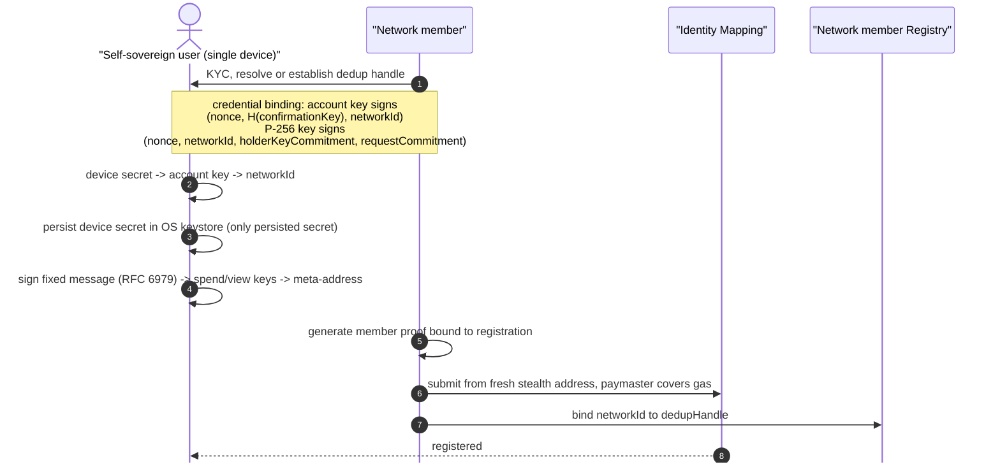
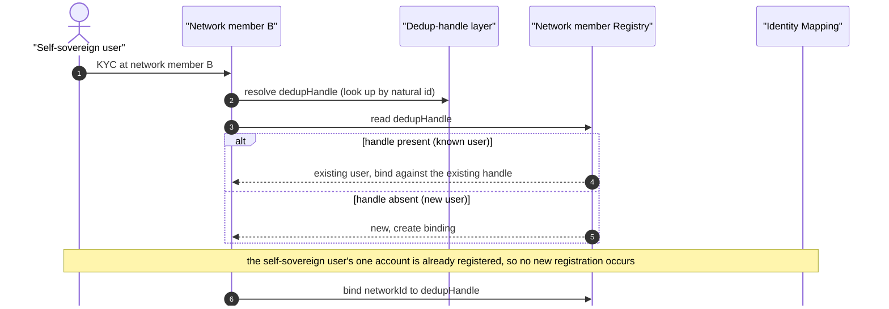
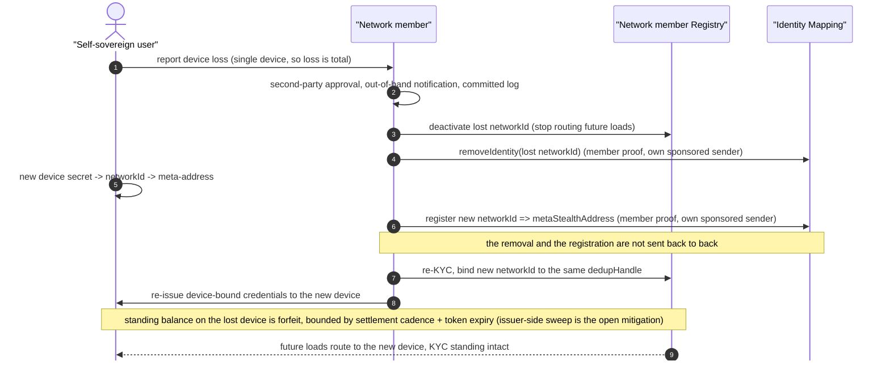

# Self-Sovereign User Specification

## Executive Summary

This document is the finalized specification of the **self-sovereign user account** for the coordination network: the account model, identity derivation, registration, deduplication, and recovery for self-sovereign users who hold their own keys.

- **In scope:** the mobile device, account and identity derivation, registration of the identity mapping, deduplication, and recovery.
- [**Out of scope**](#out-of-scope), and covered here only by reference to the specification that owns it: the scoped-token value flows (transfer, receiving loads, spending, and settlement, in the [Stealth spec's flows](05-stealth-addresses.md#flows)); the stealth-address construction and the execution and gas model (in [Stealth Addresses](05-stealth-addresses.md), the Stealth spec); credential issuance, verification, and revocation (in [VC Issuance and Verification](03-vc-issuance.md) and [Revocation in Coordination Network](04-revocation.md)).

One idea organizes the design: **the account is the device**. The self-sovereign user's single device generates its identity from its own entropy, and the key-derived EOA that results is the self-sovereign user's one account. The initial release fixes **one self-sovereign user, one account, one device**; multi-device support (or account-linking functions) is deferred to a future phase and recorded, non-normatively, in [Multi-Device Extension (future phase)](#multi-device-extension-future-phase).

The network member registers the account's identity mapping with an anonymous Semaphore membership proof bound to that exact update. It may submit from a fresh stealth address, with the paymaster covering gas. Where the account must originate anything itself, execution follows the sponsored-execution model (EIP-7702 + ERC-4337 + paymaster).

Sponsored sends leave a visible EIP-7702 delegation on stealth receiving accounts, distinguishing them from undelegated custodied accounts. WS1 accepts this difference; the spending design will be revisited in WS2.

Deduplication and discovery live in a separate, registry-level per-user handle, never on the address.

> **Actor model:** The **self-sovereign user** holds its own keys; where a property holds specifically because this actor is a KYC'd institutional entity (KYC, R-PRV-08 linkability, capable hardware), that is flagged where it matters. The **delegated user** is the network-member-custodied actor, characterised by holding no device, low entropy, and needing OPRF to deduplicate. The **network member** is the issuing and verifying party in the network.

## Conventions

The key words MUST, MUST NOT, SHOULD, SHOULD NOT, and MAY in this document are to be interpreted as described in RFC 2119 and RFC 8174, and only when shown in capitals.

A note on one collision this document must live with: a **delegated user** is the network-member-custodied actor, per the generalization note above. An account carrying an EIP-7702 delegation is always written **"7702-delegated account"**, never "delegated account", so the two senses cannot be confused.

## Problem Statement

Self-sovereign users are the network's first on-chain actors. They are **KYC'd institutional entities** redeeming value for goods. Unlike a **delegated user** (network-member-custodied, holds no device), a self-sovereign user has capable hardware and can hold its own keys. We want a user account the user controls, not a network member, built from primitives that reuse cleanly onto the delegated user and zkID side later.

A self-sovereign user may in reality run several locations, several phones, and dealings with several network members. The initial release deliberately does not model that: it fixes **one device per self-sovereign user**, which makes the self-sovereign user's one account the device's account, and defers multi-device support (or account-linking functions) to a future phase. The deferral keeps the account layer simple for now, and [Multi-Device Extension (future phase)](#multi-device-extension-future-phase) records the two candidate paths for lifting it later. Within that frame, the problems this specification answers are:

1. How does the device generate an account from its own entropy, with no coordination server and no shared secret?
2. How does the network recognize one business across device rotations, and later across network members, without putting identity on-chain?
3. How is the account's identity mapping registered, authorized, and paid for?
4. What does containment mean when the self-sovereign user has exactly one device, so that the loss of that device is total loss by construction?
5. How does the user **recover** after losing its device, given that self-sovereign users are already KYC'd, without a backup key that would reintroduce a master secret?

### Constraints

- **Public chain:** every transaction and account is public.
- **No on-chain PII:** no name, identifier, or biometric (including hashed PII) may touch the chain.
- **No master key:** there MUST NOT be a single key whose compromise hands an attacker more than the self-sovereign user's own account.
- **Visible account structure:** sponsored sends can leave delegation designators on stealth receiving accounts. WS1 accepts this difference from undelegated custodied accounts (see [Limitations](#limitations)).
- **User authority:** a network member MAY attest a user's identity (KYC), but the account itself is a keypair the user controls.
- **Self-sovereign:** the self-sovereign user holds its own keys. This is the opposite of the delegated-user flow, where the network member custodies keys.
- **Deployment target:** Ethereum mainnet. The execution prerequisites (EIP-7702 active, EntryPoint v0.8 deployed) and the zero-gas paymaster sponsorship are the Stealth spec's execution layer.

## Approach

1. **Identity is device-generated.** Keys come from the device CSPRNG. The device derives an ECDSA keypair over the secp256k1 curve from a high-entropy device secret (device CSPRNG, OS secure RNG, NIST SP 800-90A/B) and sets `networkId = keccak256(DOMAIN_NETWORK_ID ‖ pubKey)`, where `DOMAIN_NETWORK_ID` is a fixed domain-separation tag. Network members do not share this derivation: their id is the plain `keccak256(pubKey)`, as the Stealth spec describes. secp256k1 is the curve of Ethereum EOAs, ERC-5564 scheme 1, the stealth spending key, and the EIP-7702 authorization signature, so identity, stealth, and delegation share one curve. The same device secret regenerates the same `networkId`, so re-registration of that device is caught by a mapping read.
2. **The account is the device identity, and there is exactly one.** The account is the plain key-derived EOA of the single device. There is no account factory, no counterfactual CREATE2 address, and no KYC-commitment-derived address. One self-sovereign user holds one account in the initial release.
3. **Registration is network-member-gated; account execution follows the Stealth spec's model.** An approved network member registers `networkId => metaStealthAddress` with an anonymous Semaphore membership proof bound to the action, payload, registry and chain. The contract reads neither a user signature nor `msg.sender`; the member may submit from a fresh stealth address with paymaster sponsorship. Semaphore's nullifier prevents proof replay. Registration rejects an existing entry, while separately proved update and removal operations support correction and recovery respectively. Any origination by the account itself follows the sponsored-execution model in the Stealth spec.
4. **Deduplication is a separate layer, decoupled from the account.** One per-user **dedup handle** resolves the self-sovereign user's account (and its predecessors across device rotations) back to one business. This handle is the registry entry for WS1, not the account. It is never an address and never receives value. [Deduplication & Discovery](#deduplication--discovery) works the handle out.
5. **Receiving accounts can spend.** Inbound value arrives at fresh ERC-5564 stealth addresses. Sponsored sends delegate the sending account under the [Stealth spec](05-stealth-addresses.md#gas-sponsorship), leaving a visible designator.
6. **Recovery is re-KYC re-enrollment, with normative controls.** With one device, loss of the device is total loss. The network member deactivates the lost `networkId`, the self-sovereign user's new device generates a fresh identity, and re-KYC re-binds it to the same dedup handle. No secret is stored anywhere. The recovery process carries three normative controls (payout-account-of-record separation, a default cap on recovery-enrolled authority, and a real audit mechanism), specified in [Device loss & recovery](#device-loss--recovery) and [Requirements](#requirements).

### Why this approach

The design is kept as simple as the constraints allow: a key-derived EOA, plus a separate dedup handle for the linkage the address layer no longer carries. Fixing one device per self-sovereign user is what makes that possible. With a single device there is no account to converge across devices, so no CREATE2 factory or smart-account machinery is needed, and there is nothing to fragment across accounts. The deferred multi-device design space, and the two topology options it turns on, is recorded non-normatively in [Multi-Device Extension (future phase)](#multi-device-extension-future-phase).

The execution model that answers origination, and the rationale for choosing EIP-7702 with ERC-4337 and a paymaster, are specified in the Stealth spec. Two of its properties bear on this account layer and are noted where they land here: the delegation is on-chain visible when active (the distinguishability exception in [Limitations](#limitations)), and the account's own key remains supreme over the account (so delegator-level caps are advisory, and binding limits live at the issuer settlement layer and the paymaster policy).

## Tools & Primitives

- **Key-derived (stealth) EOA:** the self-sovereign user account, a keypair seeded from the device CSPRNG. No account factory, no counterfactual address.
- **ERC-5564 / ERC-6538:** the stealth-address scheme and meta-address registry for private receiving. Specified in the Stealth spec; reused here.
- **Semaphore-gated Identity Mapping:** approved network members authorize registration, update and removal with anonymous membership proofs bound to the exact action, payload, registry and chain. The contract does not read a user signature or `msg.sender`, so a member may submit from a fresh stealth address with paymaster sponsorship.
- **`networkId = keccak256(DOMAIN_NETWORK_ID ‖ pubKey)`** (domain-separated keccak256 over the secp256k1 public key): the account identifier, keying the Identity Mapping entry for the device's meta-stealth address. Device-bound, high mobile-CSPRNG entropy.
- **Dedup handle:** a per-user, registry-level identifier that resolves the self-sovereign user's account, and its predecessors across device rotations, to one business for deduplication and discovery. Never an address, never a receiving target. Derivation in [Deduplication & Discovery](#deduplication--discovery).
- **Hardware P-256 device key:** the device's non-exportable secure-element keys, two in number: the device signing key signs, and the device agreement key performs ECDH key agreement. As a signer the device signing key holds the credential-layer device binding (the `confirmationKey` pattern in [Issuer and verification flow](03-vc-issuance.md)) and is the candidate per-device session signer in the future multi-device extension; at issuance it is cross-bound to the account secp256k1 key by a dual proof-of-possession, so the credential's device-binding key and the account identity are provably held by one party (see [Identity & Key Derivation](#identity--key-derivation)). The device agreement key's ECDH output against a fixed nothing-up-my-sleeve point roots the device's Baby Jubjub EdDSA key (see [Baby Jubjub EdDSA key and Semaphore commitment](#baby-jubjub-eddsa-key-and-semaphore-commitment)). It MUST NOT seed any key by signature: hardware ECDSA uses a random per-signature nonce on both mobile platforms and neither exposes RFC 6979 deterministic signing, so a signature-derived seed is not reproducible. ECDH against a fixed point is deterministic and carries no such problem.
- **Indexer:** scans ERC-5564 announcements with a viewing key to surface the self-sovereign user's stealth accounts and balances.
- **Network member Registry:** the set of governance-approved network members and the per-user dedup-handle binding. It also anchors the execution model's pinned delegator address and paymaster policy. Referenced, not specified strongly here.
- **Scoped ERC-1155 token:** one contract per network member, with one token id per scope; defined in the [Stealth spec](05-stealth-addresses.md) (value layer, out of scope here). One property bears on recovery: token expiry bounds stranded value on device loss (see [Device loss & recovery](#device-loss--recovery)).
- **Credential / revocation layer:** the KYC credential has a fixed seven-field body whose Poseidon commitment is signed with EdDSA over Baby Jubjub and presented as one ZK proof. Issuance, verification, and revocation are out of scope here; see [Issuer and verification flow](03-vc-issuance.md) and [Revocation in Coordination Network](04-revocation.md) (R-INT-01, R-SEC-06).

## Protocol Design

### Participants & Roles

- **Self-sovereign user:** a KYC'd commercial entity that holds its own keys on a single device, which is its single account. Identified on-chain by `networkId => metaStealthAddress`; identified as a business only by the off-chain dedup handle. Properties that depend on the actor being a KYC'd institutional entity are flagged where they matter.
- **Network member (issuer):** KYCs the user, issues and controls its scoped ERC-1155 token, sends value to the user's fresh stealth addresses, burns the user's balance and pays out off-chain at settlement, and maintains the dedup-handle binding for its own users. It cannot move a user's funds (only burn its own token) and does not custody the user's account or spending key.
- **Indexer:** scans announcements with a viewing key; surfaces the self-sovereign user's stealth accounts and balances for reporting.
- **Auditor:** requests an account or dedup audit. Holds no keys or account.

### Identity & Key Derivation

Three elements, kept strictly separate: one is on-chain and identity-free, one is off-chain and carries the linkage, and one is a hardware signer that never seeds anything.



The diagram predates the single-proof credential layer; it has not been redrawn yet.

**1. The account / receiving identity.** The device generates its identity from its own entropy. A single **device secret** is the root; every other key is derived from it deterministically, so the device secret is the only thing the account layer ever stores. The derivation chain is:

1. The device draws a high-entropy **device secret** from its CSPRNG (OS secure RNG, NIST SP 800-90A/B). This is the one and only secret the account layer persists.
2. From the device secret it derives the **account secp256k1 keypair** (`accountPrivKey`, `accountPubKey`), the device's single key-derived EOA.
3. `networkId = keccak256(DOMAIN_NETWORK_ID ‖ accountPubKey)`, a `bytes32` pseudonym, where `DOMAIN_NETWORK_ID` is a fixed domain-separation tag and `accountPubKey` is the 64-byte raw concatenation `pubkeyX ‖ pubkeyY` — no `0x04` prefix, not the compressed form. Clients MUST set `networkId` to the hash of the tag followed by the public key in this exact encoding. Hashing a different serialization produces a different `networkId`. The same device secret regenerates the same account key and therefore the same `networkId`. secp256k1 is the curve of Ethereum EOAs, ERC-5564 scheme 1, the stealth spending key, and the EIP-7702 authorization signature, so identity, stealth, and delegation share one curve. The IdentityRegistry does not verify ownership of the key behind `networkId`; an approved network member authorizes the mapping update with a Semaphore proof.
4. The account key signs a fixed, domain-separated canonical message with **RFC 6979 deterministic (software) ECDSA**. Because FluidKey's `generateKeysFromSignature` splits the signature's `r‖s` halves into the spending and viewing keys, the signature MUST remain device-local. Determinism is the point, and it is why this must be a software key: the same key over the same message always yields the same 64-byte (`r‖s`) signature, so the derived keys reproduce on any future run. It is equally why the hardware P-256 key cannot seed any of this, since hardware ECDSA is randomized per signature.
5. FluidKey `generateKeysFromSignature` (https://github.com/fluidkey/fluidkey-stealth-account-kit) splits that signature into its two halves and keccak256-hashes each into the **spending** and **viewing** private keys.
6. Their public keys form the ERC-5564 **meta-address**, displayed as `st:eth:` but registered as `networkId => metaStealthAddress` in the Identity Mapping in its on-chain form — the 66-byte SEC1-compressed `spendPub ‖ viewPub`, never the `st:eth:` display string. An approved network member authorizes the registration with an anonymous Semaphore proof (see [Flows](#flows)). All of these are software keys held on the one device. None moves to another device, because there is no second device, and the only private key that leaves the device is the viewing key, which the network member's indexer scans with.



**Key storage and re-derivation (store-then-rederive).** The device secret is the only persisted account-layer secret; every other key is re-derived from it on demand and held in memory only. This fits a design that creates a fresh stealth account per value load, and it is the pattern shipping self-custodial wallets use.

- **Init (first run / provisioning):** the device draws `deviceSecret` from the CSPRNG and persists it in the OS keystore (Secure Enclave / Android Keystore-gated), the only value written to persistent storage. It then derives `accountPrivKey`, `networkId`, the spending and viewing keys, and the meta-address in memory; an approved network member registers `networkId => metaStealthAddress` with a Semaphore proof (see [Flows](#flows)). On lock or close the device wipes the derived keys from memory; the device secret stays keystore-gated.
- **Subsequent open (re-derive):** the device unlocks the keystore (biometric or passcode gate), loads `deviceSecret`, and deterministically re-derives the identical `accountPrivKey`, `networkId`, and spending and viewing keys in memory. Determinism is what makes this safe: because no derived key is ever persisted, the persisted-secret set does not grow as value loads accumulate.
- **Per load:** each per-load stealth private key is re-derived on demand from the spending key and the load's announcement, used, then dropped (the scanning and claim flow itself is out of scope; see the value-flow specification).



The Identity Mapping entry carries no real-world identity: a pseudonym mapped to a meta-address. One linkage needs stating: the same device key derives `networkId` (a domain-separated keccak256 over its public key) and serves as the transacting account, so once the account's public key appears on-chain (its first signed transaction or authorization) the self-sovereign user's entry is recomputable from, and linkable to, its account (see [Limitations](#limitations) and [Open Questions](#open-questions)). The self-sovereign user derives its own viewing key and hands it to the network member, whose indexer scans for incoming value. The keys are software keys seeded by the device CSPRNG, since the viewing key must be usable in software to scan; containment therefore comes from structure (one device, one account), not from hardware non-exportability. The spending key is derived and held on the device; its uses, recovering the per-load stealth private keys and authorizing settlement, are out of scope here and specified in the Stealth spec and the value-flow specification (see [Out of Scope](#out-of-scope)).

**2. The dedup handle (per user).** A single per-user value lives at the registry/credential layer and resolves the self-sovereign user's account, current and past (across device rotations), back to one business. It is `bytes32`, it is not an address, it never receives value, and it never appears as a stealth recipient. Its derivation is worked out in [Deduplication & Discovery](#deduplication--discovery). The split means the on-chain account layer carries no business identity at all: an observer reading the Identity Mapping sees only a pseudonym mapped to a meta-address, while the linkage that lets the network deduplicate lives in the separate handle layer (the dedup handle commits only to a network-issued high-entropy id, so it carries no business identity and MAY live on-chain).

**3. The hardware P-256 device key.** The device's secure-element keys (Secure Enclave / Android Keystore, non-exportable) are two keys: the device signing key signs, and the device agreement key performs ECDH key agreement. The device signing key's role is credential holder binding, following the `confirmationKey` pattern of [Issuer and verification flow](03-vc-issuance.md): the credential layer proves possession of the device key at issuance and challenges it again at presentation. At presentation it signs `Poseidon4(PRESENTATION_DOMAIN, challenge, audience, credentialCommitment)`, and the circuit verifies it as one of three possession statements. At issuance the P-256 key signs `nonce || networkId || holderKeyCommitment || requestCommitment`, and the account key signs `nonce || H(confirmationKey) || networkId`, cross-binding the hardware key, holder key and account identity. `requestCommitment` commits the signature to the issuer and the scope the user consented to ([Issuer and verification flow](03-vc-issuance.md)). The device MUST sign the `networkId` it derives locally from its own account key, never a `networkId` taken from the issuance request. This proves one party holds the bound keys and lets the network member check the holder's eligibility against the asserted `networkId` before it issues. The account key's issuance signature is its only role in the credential flow; the full protocol stays with the credential layer ([Issuer and verification flow](03-vc-issuance.md)). The device signing key's future role is the candidate per-device session signer if the multi-device extension takes the signer-set path. It MUST NOT be used to derive the account seed or any secp256k1 key: hardware ECDSA is randomized per signature on both mobile platforms, neither platform exposes RFC 6979 deterministic signing, and Android Keystore has no secp256k1 support at all, so a hardware-signature-derived seed cannot be reproduced.

The device agreement key roots the device's Baby Jubjub EdDSA key: the secure element computes a shared secret by ECDH against a fixed public point, and that secret seeds the EdDSA keypair whose Semaphore v4 commitment identifies the device in zero-knowledge contexts. The restriction above bars signature-derived seeds and secp256k1 derivation, not key agreement, and the ECDH peer is a fixed published constant rather than a value a counterparty supplies. The two roles are separate keys in the same secure element. The device signing key (`PURPOSE_SIGN` in Android Keystore terms; it is the credential's `confirmationKey`) needs the user (biometric, or device PIN, pattern or password) for every single use. The device agreement key (`PURPOSE_AGREE_KEY` only) needs user authentication within a 10-second window. Per-use user authentication on Android needs a BiometricPrompt CryptoObject per operation, and a KeyAgreement CryptoObject is available only from Android 16 QPR2, so one key cannot be both per-use and usable for ECDH on the phones the wallet supports (Android 12 and newer). Both keys require a secure lock screen, and removing it invalidates both. The wallet then makes new keys and the person's credentials must be re-issued; registration and `networkId` are unaffected, since they derive from the device secret. Formula in [Baby Jubjub EdDSA key and Semaphore commitment](#baby-jubjub-eddsa-key-and-semaphore-commitment).

That rooting makes the EdDSA key the single exception to store-then-rederive: it cannot be recomputed from the device secret, and losing the hardware key permanently loses this device's Semaphore commitment. The account, spending, viewing, and auth keys and the `networkId` stay recoverable from the device secret. See [Device loss & recovery](#device-loss--recovery).

**The delegation relationship.** When the account carries an execution delegation, that delegation changes none of the above: the account address stays the key-derived EOA address, the device secret and the FluidKey-derived stealth keys are untouched, and delegation only attaches execution logic for origination. Stealth receiving accounts also carry this visible delegation when used for sponsored sends.

### Data Structures

- **Device secret:** a high-entropy secret generated by the device CSPRNG. Held on the device as the only persisted account-layer secret, keystore-gated at rest; never on-chain, never shared.
- **`networkId`:** `keccak256(DOMAIN_NETWORK_ID ‖ pubKey)` (domain-separated keccak256 over the secp256k1 public key), a `bytes32` pseudonym. The Identity Mapping key for the account's meta-address. One active per self-sovereign user; predecessors accumulate across device rotations.
- **Stealth meta-address:** the `st:eth:` form is a display/interchange encoding only. What the Identity Mapping actually stores is the 66-byte SEC1-compressed `spendPub ‖ viewPub` (`META_STEALTH_ADDRESS_LENGTH`), derived from the device secret via the FluidKey kit (secp256k1).
- **Spending key / viewing key:** the meta-address's two secrets, the secp256k1 spending and viewing private keys `generateKeysFromSignature` splits from the device's signature. Both are re-derived on demand from the device secret and never persisted. Their uses (recovering stealth private keys, authorizing settlement) are out of scope; see [Out of Scope](#out-of-scope).
- **Stealth account:** the per-load EOA value is received at, `P_stealth = P_spend + h(s)·G`. Defined in the Stealth spec. Never delegated. Its private key is recomputed on demand from the spending key and the announcement, not stored.
- **Dedup handle:** a `bytes32` per-user registry value. Resolves `dedupHandle => [networkId, ...]`, the self-sovereign user's active account and its rotation history. The handle is the keccak256 of a network-issued high-entropy id: it commits to no natural-person input and MAY be written on-chain. Derivation in [Deduplication & Discovery](#deduplication--discovery).

### On-chain State

- **Identity Mapping:** `mapping(bytes32 networkId => bytes metaStealthAddress)`, keyed by `networkId` (not by registrant address, as standard ERC-6538). One entry per account. Shared with the Stealth spec. A delegated user's entry is indistinguishable from any other; the self-sovereign user's entry is linkable to its account (see [Identity & Key Derivation](#identity--key-derivation) and [Limitations](#limitations)).
- **Network member Registry** (the shared cross-member registry): governance-approved network members and the per-user dedup-handle binding, and the anchor for the execution model's pinned delegator and paymaster policy. The dedup handle carries no PII and MAY be written on-chain as `dedupHandle => [networkId, ...]`, which makes the self-sovereign user's account history public by construction (accepted under R-PRV-08); if the binding is instead carried in the credential layer it is held off-chain, where resolver access control bounds who can read it. Under either carrier the dedup match is enforced by the onboarding network member's resolution at the KYC step, not by the chain (see [Limitations](#limitations)). Referenced, not specified strongly. This, not the account, is WS1's user registry entry.
- **ERC-5564 Announcer** (singleton): the stealth-payment announcement log scanned during receiving; defined in the Stealth spec (out of scope here).
- **Scoped ERC-1155 token:** one contract per network member, with one token id per scope; defined in the [Stealth spec](05-stealth-addresses.md) (value layer, out of scope here).

The execution-layer on-chain state (EntryPoint v0.8, the delegator smart contract, the network paymaster contract) lives in the Stealth spec. There is no account factory and no counterfactual address; the account is a plain key-derived EOA. The indexer is an off-chain service.

### Flows

#### Account establishment & enrollment

1. The network member KYCs the user (or reuses an existing KYC). The dedup handle for this user is resolved or established (see [Deduplication & Discovery](#deduplication--discovery)).
2. The user's device generates a device secret from its CSPRNG, persists it in the OS keystore (the only persisted secret), and derives the account secp256k1 keypair, `networkId`, spending/viewing keypairs, and meta-stealth address (the full chain is in [Identity & Key Derivation](#identity--key-derivation)). The device's hardware P-256 key is enrolled at the credential layer for device binding: the P-256 key signs `nonce || networkId || holderKeyCommitment || requestCommitment` and the account key signs `nonce || H(confirmationKey) || networkId`, cross-binding the device, holder and account keys (see [Identity & Key Derivation](#identity--key-derivation) and [Issuer and verification flow](03-vc-issuance.md)).
3. The network member generates an anonymous Semaphore membership proof bound to the registration and submits `networkId => metaStealthAddress` from a fresh stealth address with paymaster sponsorship.
4. The network member binds the `networkId` to the user's dedup handle in the registry (or via the KYC credential).



#### Value flows are specified in the value-flow specification

The scoped-token value flows (value load and receive, spend, and settlement burn-to-payout) are specified in the [Stealth spec](05-stealth-addresses.md#flows) and are not covered here; this spec covers only the identity, account, registration, dedup, and recovery flows (see [Out of Scope](#out-of-scope)). Stealth receiving accounts can be delegated for sponsored sends, as specified in the [Stealth spec](05-stealth-addresses.md#gas-sponsorship).

> **Note:** The WS2 diagrams still say ERC-20. The token is now ERC-1155, as defined in the [Stealth spec](05-stealth-addresses.md).

#### Cross-member onboarding & deduplication

When a second network member onboards a user that the first network member has already onboarded, the second network member must recognize the same business without the two network members sharing raw personal data. Both network members derive the **same** dedup handle for the user (mechanism in [Deduplication & Discovery](#deduplication--discovery)) and read it against the shared registry: present means already in the network (bind against the existing handle), absent means new. Only the handle links the self-sovereign user across members.



#### Device loss & recovery

With one device, loss of the device is total loss by construction: the device secret, the stealth spending and viewing keys, and the hardware P-256 key are all gone, and no backup of any of them exists (a backup would be a master-key-like, exfiltratable artifact that undercuts the no-master-key property).

- **Deactivation:** the network member deactivates the lost `networkId` at the registry and issuer layer, so no future loads route to it.
- **Re-establishment:** the self-sovereign user's new device generates a fresh device secret, hence a fresh `networkId` and meta-address; re-KYC re-binds the new `networkId` to the user's existing dedup handle. Rotating to a new device never invalidates the self-sovereign user's KYC standing (the device-side analogue of R-SEC-06), but device-bound credential artifacts (the `confirmationKey` binding) are welded to the lost hardware key and MUST be re-issued to the new device; any privacy effect is scoped to the affected user and auditable (R-FNC-14). The identity key is welded to the lost hardware key in the same way. It comes from that key by ECDH and is not recoverable from the device secret, so losing the hardware ends the ability to present any credential. The new device presents an unrelated Semaphore commitment, and anything that referenced the old one MUST be re-established against it. Device replacement already implies a fresh identity here, but the commitment would stay unrecoverable even in a future phase that restored the device secret from backup (see [Baby Jubjub EdDSA key and Semaphore commitment](#baby-jubjub-eddsa-key-and-semaphore-commitment)).
- **Unlinkability:** the removal of the lost `networkId` and the registration of the new one are both public, and a shared sender or adjacent blocks pair them. The network member MUST clear the old entry with `removeIdentity` and register the new one, never repoint it with `updateIdentity`, which keeps the `networkId` and pairs both meta-addresses under it. It MUST submit both writes through the sponsored path, each from its own disposable sender and through a bundler shared across members or a public one, since a bundle's `tx.from` is the bundler's account. It MUST NOT submit them back to back. This hides the pair only among the registrations in between, so at low registration volume an observer can still link the two identities. An on-chain dedup-handle binding, if that carrier is chosen, links them by design.
- **Standing balance:** the lost device still controls its own stealth keys, so any standing balance on its stealth accounts is forfeit, bounded by the settlement cadence and the scoped token's expiry. The _Stranded-value sweep_ open question carries the candidate issuer-side recovery settlement that would reclaim it: at re-KYC the issuer authenticates against the dedup handle or KYC credential rather than the dead device's key, reconstructs the stranded balances from its own send records, burns them, and pays out off-chain to the KYC account. Because the initial release has exactly one device per self-sovereign user, this gap is the headline recovery limitation, and the sweep decision is correspondingly load-bearing.
- **The delegation:** the lost account's execution delegation, if any, needs no revocation step for safety (the thief gains nothing spendable; see the threat model), but the registry deactivation MUST NOT depend on any action by the lost key.

Recovery carries four process controls and stated as requirements in [Security (MUST)](#security-must):

1. **Payout-account-of-record separation.** The self-sovereign user's payout account on record MUST be set and changed through a channel separate from recovery, with a different approver, a cooling-off period, and out-of-band confirmation to the self-sovereign user. Without this, a fabricated recovery could both take over the account and redirect the payout, which is exactly the fraud pattern payout-pinning otherwise closes.
2. **Default cap on recovery-enrolled authority.** The authority recovery re-establishes MUST be capped by explicit default policy, not network-member discretion. Because delegator-level caps are advisory under the residual key, the cap is enforced where it binds: the issuer settlement layer (claim limits in the initial window after recovery) and the paymaster sponsorship policy.
3. **A real audit mechanism.** Every recovery event MUST produce a mandatory out-of-band notification to the self-sovereign user, a second-party approval step, and a committed log a DPO can review independently of program staff (R-FNC-14 made concrete, not asserted).
4. **A published stranded-value bound, with a recorded divergence.** A published, short settlement cadence MUST bound the standing balance at risk on device loss. The recovery analysis further conditions sufficiency, for a topology that forfeits balances, on the stranded-value sweep being **built rather than left open**, with a reconstruction independently verifiable from on-chain mint and transfer events rather than solely from the issuer's internal ledger.



## Deduplication & Discovery

A `networkId = keccak256(DOMAIN_NETWORK_ID ‖ pubKey)` is a deterministic, domain-separated hash of the account public key, not linkable to the account address until that public key is published. Until then the self-sovereign user's account carries no on-chain evidence of which business it belongs to, a rotated device's new account carries no link to its predecessor at the account layer beyond what its registry writes reveal (see [Device loss & recovery](#device-loss--recovery); an on-chain dedup-handle binding, if that carrier is chosen, links them at the registry layer by design), and a newly onboarded user carries no on-chain evidence that it is not a duplicate of an existing one. Deduplication and discovery therefore live in a separate per-user handle, and the handle's design has to deliver dedup without putting identity on-chain and without sharing raw personal data between network members.

**Within one network member.** The network member KYCs the user, so it knows which business the account belongs to at enrollment time. It maintains the binding `dedupHandle => [networkId, ...]`: the active account plus the deactivated predecessors from device rotations. A duplicate onboarding attempt resolves to the same handle and is caught by the registry read.

**Cross-member.** Two network members must arrive at the **same** dedup handle for the same user, without sharing raw KYC data between themselves directly, so that a read of the shared registry deduplicates the user across the network.

The mechanism is a network-issued high-entropy id, hashed: the network issues one random, high-entropy identifier per user at first onboarding and sets `dedupHandle = H(id)` (keccak256). The handle preimage is not grindable, because the id is high-entropy. It is carried either by a bare registry write or in the user's KYC credential (the VC-layer transport); under the credential carrier the dedup match MUST still be enforced by the onboarding network member resolving the handle from the KYC step, not by trusting the handle as read off the presented credential, otherwise a user could withhold or substitute it to dodge the match. The step that matters is resolution: a second network member onboarding the same user holds only its natural KYC attributes, so to reach the same `id` it MUST look the user up in the shared registry or credential layer by its natural KYC identifier. That makes the resolver an actively-queried linker keyed on the user's natural identifier: the natural id is presented to the shared resolver on each cross-member read, so the no-raw-PII property holds for the `H(id)` derivation but not for the resolution that precedes it.

In deployments where members are expected to know and link the user, this is the right default and not a privacy gap. Self-sovereign users are KYC'd institutional entities, and network members are meant to know and link the self-sovereign user, so a shared resolver keyed on the self-sovereign user's natural identifier is appropriate by design (R-PRV-08). It also does not bind where exercising cross-member dedup is out of scope (the network member is the sole settling member, see [Out of Scope](#out-of-scope)).

**Deduplication strength and Sybil resistance.** Deduplication is only as strong as the KYC gate. Uniqueness is enforced at issuance: the network issues one high-entropy id per entity, so one-id-per-entity is a namespace property the network controls, and a second network member resolving the same user against the registry reaches the same id. A user MUST NOT be able to evade the match by withholding or substituting its dedup-handle credential at a second network member: because the handle is network-member-resolved from the KYC step, a withheld credential does not produce a missed match. Within this gate, a duplicate onboarding resolves to the same handle and is caught by the registry read (the user analogue of R-FNC-01/02).

**Generalized use cases: vOPRF dedup for unlinkable subjects.** The default handle works for the reference deployment because the self-sovereign user is meant to be known: a shared resolver that links the self-sovereign user to its natural identifier is acceptable. That assumption fails for the generalized use cases this design is meant to reuse onto: the non-cooperating subject, the delegated-user phase (low-entropy secrets), cross-member unlinkability, and Access-Layer / zkID reuse. There no network member may hold a resolver that knows the subject, so the dedup handle MUST be derived without a queryable real-world-to-handle linker. The approach for those cases is vOPRF over the subject's natural id or low-entropy secret (the _vOPRF-on-KYC-id_ handle of the Terminology table), as planned for the WS2 vOPRF network: the handle is the OPRF nullifier `network_id = hash("nullifier", query, N0.x, N0.y)` with `query = hash(context, raw_data)` (Poseidon2 over Baby Jubjub). It is deterministic per person, irreversible to the raw input without the threshold key `k`, and grinding-resistant, since computing a nullifier for any candidate input requires querying the live, authenticated, rate-limited network. Do not overclaim the privacy: the nullifier remains pseudonymous personal data under GDPR, so a vOPRF handle binding MUST stay off-chain and is flagged for DPO review wherever it is used. The cost is the dependency: every network member must run or query the OPRF MPC network. This is out of scope for the reference deployment and is the dedup path the delegated-user phase reuses.

## Multi-Device Extension (future phase)

**This section is non-normative.** The initial release is one self-sovereign user, one account, one device. Multi-device support (or account-linking functions) is deferred to a future phase; this section records the deferred design space so the later decision starts from the analysis already done, and it decides nothing. No requirement elsewhere in this specification depends on it.

Two candidate paths exist:

**Path A: a signer set on the delegator smart contract.** The self-sovereign user keeps one account (the existing key-derived EOA, 7702-delegated), and additional devices enroll as session signers in the delegator's validation logic: each device's hardware P-256 key becomes an individually revocable signer with a per-device cap (`cap = {dimension, value, window}`), enrollment is authorized by an already-enrolled device within its cap, and revocation respects a cooldown and a last-signer floor. On an RIP-7212 chain a P-256 session-signer verification costs about 3.4k gas; without the precompile a Solidity verifier costs 200k gas or more. Two structural caveats temper this path. First, the **residual key**: the account's own secp256k1 key always bypasses the signer set, so per-device caps are advisory at the account layer; binding enforcement stays at the issuer and paymaster layers. Second, the **shared receiving secret returns**: other devices need the viewing key (and for full capability the spending key) to scan and claim, so the account seed must be provisioned across devices over encrypted transport, the acknowledged soft master key for the receiving plane. A signer set also reintroduces enrollment and revocation as an attack surface (enrollment or revocation abuse), a threat class the single-device release does not carry.

**Path B: additional per-device accounts linked by the dedup handle.** Each new device generates its own device secret, `networkId`, and meta-address, exactly as the first did, and the registry binding grows: `dedupHandle => [networkId, ...]` with several accounts active at once. Containment is structural (a stolen device exposes only its own account), no key is shared across devices, and the additional accounts, if left undelegated, are indistinguishable from delegated-user accounts. The costs are fragmentation (per-location balances, off-chain consolidation via the Indexer) and per-device stranded value on loss.

**Decision axes to weigh at the future gate**, recorded, not decided: recovery semantics (Path A can preserve a standing balance across the loss of one device; Path B forfeits per device), containment (Path B structural; Path A advisory under the residual key), receiving-key sharing (Path A shares; Path B does not), indistinguishability (Path B's extra accounts can stay designator-free; Path A concentrates all activity on the one designated account), gas (Path A pays session-signer verification; Path B pays nothing new), and delegated-user-phase reuse (a signer-set account resembles the network-member-as-signer custody model; bare per-device EOAs do not).

## Cryptographic Details

- **Account identity:** `networkId = keccak256(DOMAIN_NETWORK_ID ‖ pubKey)` (domain-separated keccak256 over the secp256k1 public key). The device derives the keypair over secp256k1 from a high-entropy device secret (device CSPRNG, NIST SP 800-90A/B posture for mobile entropy), so identity shares the curve of Ethereum EOAs, ERC-5564 scheme 1, the stealth spending key, and the 7702 authorization signature.
- **Stealth-address scheme:** ERC-5564 scheme 1 (secp256k1, keccak256), as in the Stealth spec, not restated here. Stealth account `P_stealth = P_spend + h(s)·G`.
- **Dedup handle:** `dedupHandle = H(id) = keccak256(id)` over a network-issued high-entropy id. The handle is `bytes32` and never an address. No OPRF or MPC derivation is used in the reference deployment.
- **P-256 scope:** the hardware P-256 device key appears in the credential layer (the `confirmationKey` device binding), as the ECDH root of the identity key a presentation proves possession of (below), and as the candidate future session signer of [Multi-Device Extension (future phase)](#multi-device-extension-future-phase). The device signing key signs and the device agreement key performs key agreement; neither seeds a key by signature. At issuance the P-256 device key signs `nonce || networkId || holderKeyCommitment || requestCommitment` and the account secp256k1 key signs `nonce || H(confirmationKey) || networkId`, cross-binding the hardware key, holder key and account identity. The `networkId` in the device signature MUST be the value the wallet derives locally from its own account key, never one supplied in the issuance request. This lets the network member check eligibility against the asserted `networkId`. At presentation the P-256 key signs `Poseidon4(PRESENTATION_DOMAIN, challenge, audience, credentialCommitment)`. The two contexts are structurally separated. No on-chain P-256 verification exists in the initial release.

### Baby Jubjub EdDSA key and Semaphore commitment

The device holds one Baby Jubjub EdDSA keypair, the identity key, alongside the secp256k1 account layer. Its Semaphore v4 commitment is the device's identifier in zero-knowledge contexts, and the credential body commits to it as `holderKeyCommitment`. The secp256k1 account, spending, viewing, and auth keys keep their derivations and their values.

The key is rooted in the device agreement key, not in the device secret:

```
DOMAIN_EDDSA      = "coordination-network/identity/v1/eddsa"
DOMAIN_EDDSA_PEER = "coordination-network/identity/v1/eddsa/peer"

Q = hashToCurve(utf8(DOMAIN_EDDSA_PEER))    # RFC 9380, P256_XMD:SHA-256_SSWU_RO_, suite-default DST
  = 0x045db1cabf31539848bf802ad49a94ad8f8e3d52e75bb53aa4552d7cf836eba054213badca0cf4ba6daf8c146d3415d9ae1905440781dc5f08e6e946a471af99e9

ecdhSharedSecret = X(hwPriv · Q)                                   # 32 big-endian bytes, computed in the secure element
eddsaSeed        = keccak256(utf8(DOMAIN_EDDSA) || ecdhSharedSecret)
secretScalar     = deriveSecretScalar(eddsaSeed)
publicKey        = derivePublicKey(eddsaSeed)                       # [x, y] on Baby Jubjub
commitment       = poseidon2([publicKey[0], publicKey[1]])          # Semaphore v4 identity commitment
```

`hwPriv` is the private key of the device agreement key, a hardware P-256 key generated for key agreement only and separate from the device signing key that produces the credential device-binding signature. `X(...)` is the x-coordinate of the ECDH output, which is what a platform key-agreement primitive returns. `Q` is a 65-byte uncompressed P-256 point, pinned above and recomputable from its RFC 9380 provenance so reviewers can confirm it was not hand-picked.

**Hardware rooting.** `hwPriv` never leaves the secure element (the device agreement key is generated non-exportable with `PURPOSE_AGREE_KEY` only), so computing `ecdhSharedSecret` requires that specific piece of hardware and the EdDSA key cannot be reproduced by software alone. The secp256k1 core, by contrast, is a pure function of the device secret.

**`Q` MUST be a nothing-up-my-sleeve point.** ECDH is symmetric, so anyone holding the discrete log of `Q` could compute the same shared secret from the device's public key without touching the secure element, and the hardware rooting would be worthless. Deriving `Q` by hash-to-curve from a fixed published tag, with no chosen input, means nobody knows that discrete log, including whoever chose the tag.

**ECDH rather than a second hardware signature.** Hardware ECDSA is randomized, so signing the same message twice returns two different signatures and cannot seed a stable key. Key agreement against a fixed peer point is the one deterministic operation a non-exportable hardware key can perform.

**Unrecoverability (normative).** The keypair is NOT re-derivable from the device secret. Losing the hardware key, by device reset, keystore wipe, or a replaced secure element, permanently loses the ability to recompute this device's commitment even while the device secret is still held; a new hardware key yields an unrelated EdDSA key. The secp256k1 core and the `networkId` are unaffected.

The system uses three Baby Jubjub EdDSA keys with different holders: the identity key specified here, the network member's credential signing key held in its key service, and the per-credential revocation identity the device generates for each credential ([Issuer and verification flow](03-vc-issuance.md)).

The identity key and the per-credential revocation secret stay separate identities. The credential body commits to `holderKeyCommitment` and `revocationCommitment` independently, so the identity key identifies the device across the network while a revocation secret is scoped to one credential (`packages/identity/DERIVATION.md` §7).

## Requirements

### Functional (MUST)

- The system MUST derive the self-sovereign user's account identity from a device-generated secret as `networkId = keccak256(DOMAIN_NETWORK_ID ‖ pubKey)`, with exactly one active `networkId` per self-sovereign user in the initial release.
- The system MUST resolve the self-sovereign user's account, and its deactivated predecessors across device rotations, to one user via a per-user dedup handle that is never an address and never receives value.
- The system MUST be capable of deduplicating a user across network members by dedup-handle presence in the shared registry, deriving the same handle for the same user without sharing raw KYC data between network members directly (user analogue of R-FNC-01/02). Exercising cross-member dedup is out of scope for the reference deployment, since the network member is the sole settling member, so the reference deployment builds the cross-member primitive without running it (see [Out of Scope](#out-of-scope)). A second network member presents the user's natural identifier to the shared resolver to reach the handle, so the no-raw-PII property holds for the handle derivation but not for that resolution step (see [Deduplication & Discovery](#deduplication--discovery) and the _Dedup without data sharing (between members directly)_ guarantee); a fully PII-free cross-member resolution is out of scope for the reference deployment.
- Stealth receiving accounts MAY carry an EIP-7702 delegation for sponsored sends, as specified in the [Stealth spec](05-stealth-addresses.md#gas-sponsorship).
- Registration, update and removal of `networkId => metaStealthAddress` MUST require an approved network member's anonymous Semaphore proof bound to the exact action, payload, registry and chain. The contract MUST NOT authorize a write from a user signature or `msg.sender`; a member may submit from a fresh stealth address with paymaster sponsorship.
- The system MUST provide a documented recovery path for a user who has lost its device. Recovery delivers the "resume receiving value" half of R-FNC-13 in full, via registry deactivation of the lost `networkId` and re-issuance to a fresh device re-bound to the same dedup handle. The "regain access to undelivered value" half is delivered only partially: the lost device's standing balance is written off, bounded by settlement cadence and token expiry. This is a documented accepted gap, not a foreclosed property, since burn is issuer-only and the payout settles off-chain to the self-sovereign user's KYC account, so an issuer-side recovery settlement authenticated at re-KYC could close it (see [Limitations](#limitations), [Decisions (resolved)](#decisions-resolved), and the _Stranded-value sweep_ open question). (R-FNC-13: _in-text MUST; the requirements-table label reads MAY; trust the text_; partial conformance noted.)

### Privacy (MUST)

- PII MUST NOT touch the chain in any form, including hashed PII. The on-chain `networkId` commits to a random device secret. The dedup handle lives off the account layer and carries no natural-person input: it is the keccak256 of a network-issued high-entropy id, so it MAY be written on-chain without putting PII on chain (R-PRV-01). The real-world-to-id linker stays off-chain, in the registry resolver or the credential layer.
- WS1 accepts visible delegation designators on spent stealth accounts as a limitation of R-PRV-01. Account structure, transaction links and amounts remain observable.
- Recovery MUST scope any privacy degradation to the affected user and make it auditable (R-FNC-14).
- Recovery MUST replace the lost entry with `removeIdentity` and a fresh `registerIdentity`, never `updateIdentity`, and MUST submit the two writes through the sponsored path from separate disposable senders and a shared or public bundler, not back to back.

### Security (MUST)

- There MUST be no key whose compromise exposes more than the self-sovereign user's own account. There is no cross-user key and, with one device, no shared or transported private key apart from the viewing key the network member's indexer scans with, which reveals receiving but grants no spending authority. (The account's own secp256k1 key is, unavoidably, master over that one account under the residual-key property.)
- Compromise of the device MUST be contained to the self-sovereign user's own account and standing balance (the cross-member isolation requirement R-SEC-05 sits at the issuer layer, see the threat model).
- The device secret MUST be the only persisted account-layer secret, held keystore-gated at rest. The spending and viewing keys and per-load stealth private keys MUST be re-derived on demand and MUST NOT be written to persistent storage on the device.
- Any limit that must bind (a spend cap, a post-recovery authority cap) MUST be enforced at the issuer settlement layer (claim validation) or the paymaster sponsorship policy, because delegator-level controls are advisory under the residual key.
- Deduplication MUST be gated so that one real-world entity yields one handle; a user MUST NOT be able to obtain two handles to evade dedup within the KYC gate.
- Rotating to a new device MUST NOT invalidate the self-sovereign user's KYC standing (the user-device-side analogue of R-SEC-06): device-bound credential artifacts are welded to the lost hardware key and are re-issued to the new device, while the underlying KYC relationship and the dedup-handle binding survive unchanged.
- The self-sovereign user's payout-account-of-record MUST be set and changed through a channel separate from the recovery path, with a different approver, a cooling-off period, and out-of-band confirmation to the self-sovereign user.
- The authority re-established by recovery MUST be capped by explicit default policy, enforced at the issuer settlement layer and the paymaster sponsorship policy.
- Every recovery event MUST produce an out-of-band notification to the self-sovereign user, a second-party approval, and a committed log independently reviewable by the DPO (R-FNC-14 as a mechanism, not an assertion).
- A published, short settlement cadence MUST bound the standing balance at risk on device loss (the fourth recovery condition; the associated stranded-value sweep stays open as a recorded divergence, see [Device loss & recovery](#device-loss--recovery) and [Open Questions](#open-questions)).

### Operational (MUST)

- The deployment chain MUST be Ethereum mainnet. The execution prerequisites (EIP-7702 active, EntryPoint v0.8 deployed) and zero-gas paymaster sponsorship are the Stealth spec's.
- The flow MUST run on capable self-sovereign user hardware with online point-of-sale terminals, the self-sovereign user analogue of R-OPS-01/02, whose delegated-user constrained-device and low-connectivity constraints do not bind here. It SHOULD support the online verification at self-sovereign user or field locations that R-OPS-02 calls for.
- Presentation proving MUST run within a measured time and memory budget on the target handset, since the proof is generated live at the counter (R-OPS-01/02).
- Self-sovereign users MUST be KYC'd as institutional actors (R-REG-01). R-INT-01, alignment of credentials with W3C VC/DID standards, is not met, because a presentation is a ZK proof; the Integration section of [Wallet Specification](02-wallet.md) owns what that costs.

### Out of Scope

- The execution and gas model: EIP-7702 delegation, ERC-4337 execution, the network paymaster, and the sponsored-execution eligibility gate live in the Stealth spec, along with the concrete delegator implementation and delegation-based recovery modules.
- The value flows: token transfer, value load and receive, spend, and settlement (burn-to-payout) are specified in the [Stealth spec](05-stealth-addresses.md#flows). The settlement claim that authorizes settlement is not specified yet.
- The delegated-user flow: delegated users are network-member-custodied (the Stealth spec).
- On-chain user-to-third-party sends: receive plus settlement only; confirm whether any self-sovereign user in a given deployment needs supplier transfers.
- Multi-device support and account-linking functions: deferred to a future phase; the design space is recorded non-normatively in [Multi-Device Extension (future phase)](#multi-device-extension-future-phase).
- The credential layer: verifiable credential issuance and verification, and the credential data model and schemas ([VC Issuance and Verification](03-vc-issuance.md)); the revocation pattern ([Revocation in Coordination Network](04-revocation.md)).
- Hiding amount and asset type on-chain: inherited from the Stealth spec, so visible.
- Real stablecoin settlement: mocked, as in the Stealth spec.
- Per-(device × network-member) account fragmentation: not applicable in the one-device release; noted as a delegated-user-reuse hardening seam.
- Exercising cross-member deduplication: where a deployment has a single settling member, the cross-member registry resolver is built and documented but not exercised against a second settling network member. The PII-free cross-member path for unlinkable subjects (vOPRF) is documented as the generalized-use-case approach (see [Deduplication & Discovery](#deduplication--discovery)) but is out of scope here.

## Security & Privacy Model

This section covers the account-identity layer's own adversaries and properties. The execution-layer threats and guarantees (phished authorization, residual key, on-chain designator classification, and the paymaster/bundler sponsorship path) belong to the Stealth spec; the distinguishability consequence for this account is carried in [Limitations](#limitations) below.

### Threat Model

| Adversary                                                        | Capabilities                                                                                                                                                                                                                                                                                                                                                                         | Mitigations                                                                                                                                                                                                                                                                                                                                                                                                                                                                                                                                                                                                                                                                                                                                                                                           |
| ---------------------------------------------------------------- | ------------------------------------------------------------------------------------------------------------------------------------------------------------------------------------------------------------------------------------------------------------------------------------------------------------------------------------------------------------------------------------ | ----------------------------------------------------------------------------------------------------------------------------------------------------------------------------------------------------------------------------------------------------------------------------------------------------------------------------------------------------------------------------------------------------------------------------------------------------------------------------------------------------------------------------------------------------------------------------------------------------------------------------------------------------------------------------------------------------------------------------------------------------------------------------------------------------- |
| **Stolen / hacked self-sovereign user's device**                 | Holds the self-sovereign user's only device: the account key, the stealth spending and viewing keys, and the hardware P-256 credential key. Can read balances, attempt settlement claims, and sign authorizations re-pointing the account's execution delegation to attacker code. Cannot authorize an Identity Mapping change without an approved network member's Semaphore proof. | Value-layer theft is defanged by the settlement design (the payout pays only to the self-sovereign user's KYC account on record, issuer-only burn; see the value-flow specification), so a thief cannot redirect funds. Real exposures are forced premature settlement, on-chain balance disclosure, and denial of service. The network member deactivates the `networkId` at the registry layer (an action that MUST NOT require the lost key); standing balance is bounded by settlement cadence and token expiry. The residual non-funds risk is named, not waved away: re-delegation to attacker code gains nothing spendable but is possible.                                                                                                                                                    |
| **Deduplication evasion / Sybil**                                | A user may try to present two KYC ids, or withhold or substitute its dedup-handle credential at a second network member, to obtain two handles and evade dedup.                                                                                                                                                                                                                      | The network issues one high-entropy id per entity, so uniqueness is a namespace property it controls. The handle is always network-member-resolved from the KYC step, so withholding a credential does not produce a missed match. A duplicate onboarding resolves to the same handle and is caught by the registry read. Residual strength is bounded by KYC quality.                                                                                                                                                                                                                                                                                                                                                                                                                                |
| **Cross-member handle grindability and registry read**           | An adversary may try to grind the dedup-handle input to forge or locate a handle, or to read the handle layer directly.                                                                                                                                                                                                                                                              | Two surfaces. Handle preimage: un-grindable, since `H(id)` is over a network-issued high-entropy id. Resolution and read: the cross-member resolution keys on the user's low-entropy natural id, which is grindable against the resolver, so the mitigation there is access control and rate limiting on the resolver, not entropy. Under the off-chain carrier, a member read or leaked snapshot of the registry exposes the `dedupHandle => [networkId, ...]` history with no grinding, so confidentiality there rests on resolver access control; the on-chain carrier makes that history public by construction. For self-sovereign users all of this is accepted (R-PRV-08); the clustering leak is the residual to design against when the construction is carried to the delegated-user phase. |
| **Curious / colluding network member**                           | Any network member that derives or reads a user's dedup handle can enumerate that user's account history (the active `networkId` plus deactivated predecessors) across every network member that onboarded it.                                                                                                                                                                       | Bounded and accepted. The shared binding is `dedupHandle => [networkId, ...]`, so a handle holder gets the user's account history, not merely a presence bit. This is intended: linking a user's accounts is the handle's function, and R-PRV-08 licenses transparency for KYC-bound institutional actors. Per-load receiving stays viewing-key-protected and no delegated-user identities are exposed. Under the off-chain carrier, registry read-access MAY be restricted to onboarding members; the on-chain carrier forgoes that restriction by design.                                                                                                                                                                                                                                           |
| **Issuing network member (compromised or malicious, own users)** | Performs recovery and controls or influences settlement and the paymaster policy, so it can deny sponsorship to a live account, deactivate a `networkId` to deny service, or stall service for its own users. A fabricated recovery combined with a payout-detail change is the theft pattern that binds.                                                                            | Accepted for the reference deployment: the issuer is trusted for its _own_ users' availability and settlement integrity (trusted KYC'ing network members, the sole settling member). The payout cannot be redirected while the payout-account-of-record control holds: the account on record is changed only through a channel separate from recovery, with a different approver, cooling-off, and out-of-band confirmation (a normative requirement here), so a malicious issuer can withhold, mistime, or deny, but not steal to itself. Recovery is second-party approved, out-of-band notified, and DPO-auditable by mechanism. The blast radius is that network member's own users and tokens (R-SEC-05).                                                                                        |
| **Cross-member issuer compromise**                               | A compromised member may try to deanonymize another member's delegated users or forge enrollments.                                                                                                                                                                                                                                                                                   | R-SEC-05: viewing keys and tokens are per-network-member, so compromise does not cross members; enrollment forgery is bounded by the one-handle-per-entity dedup check.                                                                                                                                                                                                                                                                                                                                                                                                                                                                                                                                                                                                                               |
| **Indexer (viewing-key holder)**                                 | Holds the self-sovereign user's viewing key for scanning and reporting, so it sees the self-sovereign user's full receiving history and balances off-chain.                                                                                                                                                                                                                          | Accepted, deliberate disclosure scoped per self-sovereign user, as in the Stealth spec: the viewing key reveals receiving, never spending authority. Keep the indexer separate from the execution trust domains; audit-side disclosure is carried in the _Audit-side scanning_ open question.                                                                                                                                                                                                                                                                                                                                                                                                                                                                                                         |
| **Post-quantum (harvest-now)**                                   | Records on-chain material now to break later.                                                                                                                                                                                                                                                                                                                                        | Token and credential expiry bounds the fund-theft exposure. Retroactive deanonymization of recorded announcements is not bounded by expiry; it is accepted for the intentionally linkable self-sovereign user and is a liability to revisit for delegated-user-phase reuse. The reference identity is ECDSA over secp256k1; a post-quantum migration path is future work.                                                                                                                                                                                                                                                                                                                                                                                                                             |

### Guarantees

| Property                                                  | Description                                                                                                                                                                                                                                                                                                                                                                                                                                                                                                                                       |
| --------------------------------------------------------- | ------------------------------------------------------------------------------------------------------------------------------------------------------------------------------------------------------------------------------------------------------------------------------------------------------------------------------------------------------------------------------------------------------------------------------------------------------------------------------------------------------------------------------------------------- |
| **Containment to one self-sovereign user**                | No key, account, or secret spans self-sovereign users; compromise of the self-sovereign user's device is bounded to that self-sovereign user's own account and standing balance.                                                                                                                                                                                                                                                                                                                                                                  |
| **No master key across accounts, no shared spending key** | No single key controls more than the self-sovereign user's own account, and with one device no spending key is ever shared or transported; the viewing key goes only to the network member's indexer (see [Threat Model](#threat-model)). Within its own account the residual key is, unavoidably, supreme (see [Self-Sovereign User Specification](#security-must)).                                                                                                                                                                             |
| **Fresh stealth receiving addresses**                     | Each load uses a fresh stealth address. Sponsored spending can leave a visible delegation designator; account structure is not indistinguishable.                                                                                                                                                                                                                                                                                                                                                                                                 |
| **Dedup without data sharing (between members directly)** | A user is deduplicated across network members by a dedup-handle read, disclosing no raw personal data between network members directly. A second network member resolves the handle by querying the shared registry on the user's natural id, so the natural id is presented to the shared resolver (not to the other member); a fully resolver-free path is out of scope for the reference deployment. Accepted, since exercising cross-member dedup is out of scope and self-sovereign users are cooperating institutional actors per R-PRV-08. |
| **User authority (with two trust caveats)**               | The account is a keypair the user controls; the network member attests identity and binds the dedup handle but does not custody the account or spending key. Two dependencies temper this: the issuer is trusted for its own users' settlement and availability (settlement is issuer-driven; see WS2), and execution availability depends on the paymaster's sponsorship policy. Neither dependency lets the issuer or paymaster move or redirect funds.                                                                                         |

### Limitations

| Limitation                                                | Impact                                                                                                                                                                                                                                                                        | Mitigation / future work                                                                                                                                                                                                                                                                                                                       |
| --------------------------------------------------------- | ----------------------------------------------------------------------------------------------------------------------------------------------------------------------------------------------------------------------------------------------------------------------------- | ---------------------------------------------------------------------------------------------------------------------------------------------------------------------------------------------------------------------------------------------------------------------------------------------------------------------------------------------- |
| **Single device is a single point of loss**               | Loss of the self-sovereign user's one device is total loss: identity, stealth keys, and device-bound credentials all go with it, and the standing balance on its stealth accounts is forfeit.                                                                                 | Bounded by settlement cadence and scoped-token expiry; recovery re-establishes receiving on a fresh identity re-bound to the same dedup handle. The issuer-side stranded-value sweep is the open mitigation for the balance. This is the headline limitation of the one-device release, and it is the price of deferring multi-device support. |
| **Account structure is visible**                          | Execution delegations are visible on the user account and on stealth accounts used for sponsored sends. Observers can distinguish them from undelegated custodied accounts. Once the user account's public key appears on-chain, its Identity Mapping entry is also linkable. | Accepted for WS1. Revisit the spending design in WS2 before reuse for delegated users.                                                                                                                                                                                                                                                         |
| **Dedup depends on an external handle layer**             | Deduplication is enforced by the onboarding network member's resolution at the KYC gate, not by the chain; it depends on the handle layer and on KYC quality.                                                                                                                 | One-handle-per-entity at the KYC gate; the handle binding needs Network-member-Registry alignment.                                                                                                                                                                                                                                             |
| **Cross-member account linkability for users**            | Any network member that derives or reads the handle can enumerate a user's account history across every network member that onboarded it, and the registry resolver holds the real-world-to-id linker.                                                                        | Accepted: self-sovereign users are intentionally linkable institutional actors (R-PRV-08). Under the off-chain carrier, registry read-access control is part of the confidentiality boundary; the on-chain carrier makes the binding public by design.                                                                                         |
| **Transaction history can link accounts**                 | Transfers expose amounts and account relationships. Spending several accounts together can cluster them, even if their account structure matches.                                                                                                                             | Accepted for WS1. WS2 must assess transaction-graph leakage alongside account structure.                                                                                                                                                                                                                                                       |
| **Issuer is the recovery authority and can deny service** | The issuer runs recovery and influences settlement and paymaster policy, so it can deny service, stall, or mistime settlement for its own users; a fabricated recovery plus a payout-detail change is the binding theft pattern.                                              | Accepted for the reference deployment (trusted KYC'ing network members, sole settling member); it cannot redirect the payout while the payout-account-of-record control holds (normative here); the blast radius is its own users (R-SEC-05); recovery is auditable by mechanism and flagged for DPO review at the M2 gate.                    |

## Decisions (resolved)

1. **Topology: one self-sovereign user, one account, one device.** The initial release fixes a single device whose key-derived EOA is the self-sovereign user's single account; multi-device support (or account-linking functions) is deferred to a future phase, with the two candidate paths recorded non-normatively in [Multi-Device Extension (future phase)](#multi-device-extension-future-phase).
2. **Execution and gas: a sponsored-execution model** (EIP-7702 + ERC-4337 + network paymaster), owned by the Stealth spec. Identity Mapping changes are submitted by an approved network member from a fresh stealth address with paymaster sponsorship.
3. **Deployment target: Ethereum mainnet.** This specification adopts Ethereum mainnet as the deployment target.
4. **Keys: software secp256k1 throughout the account layer.** Identity and stealth keys derive from the device CSPRNG via FluidKey `generateKeysFromSignature`. The hardware P-256 device key signs the credential device binding (the `confirmationKey` pattern, cross-bound to the account and holder keys at issuance) and is the candidate future session signer; it MUST NOT seed any key by signature. Baby Jubjub is the credential layer's signing curve, and the identity key on it is one of the three possession keys a presentation proves, alongside the P-256 device key and Baby Jubjub revocation key. That key is explicitly versioned and rooted in the hardware P-256 key by ECDH, and it carries the device's Semaphore v4 commitment without changing the secp256k1 account layer (formula in [Baby Jubjub EdDSA key and Semaphore commitment](#baby-jubjub-eddsa-key-and-semaphore-commitment)). Key handling is store-then-rederive: the device secret is the only persisted secret, and derived keys are reproduced on demand, in memory only. The identity key is the one exception, reproduced from the hardware key instead. Persisting derived keys was rejected because fresh per-load stealth accounts would make the persisted set grow without bound and widen the exfiltration surface.
5. **Dedup handle: `keccak256(network-issued high-entropy id)`**, separate from `networkId`; the registry binds `dedupHandle => [networkId, ...]` (one active entry per self-sovereign user plus rotation history). No OPRF or MPC in the reference deployment; vOPRF is retained as the documented generalized-use-case and delegated-user-phase path.
6. **Recovery: re-KYC re-enrollment, no stored secret.** A fresh device identity is re-bound to the same dedup handle; the standing balance is forfeit, bounded by a published, short settlement cadence and token expiry, with the issuer-side sweep carried as the open mitigation (a recorded divergence from the recovery analysis, resolved at the DPO / M2 gate). The recovery controls (payout-account-of-record separation, default cap on recovery-enrolled authority, audit mechanism, published settlement cadence) are normative.
7. **WS1 spending: keep sponsored sends from stealth receiving accounts.** Accept the visible delegation and revisit the spending design in WS2.
8. **`networkId` derivation is settled: domain-separated hash of the public key, uncompressed.** `networkId = keccak256(DOMAIN_NETWORK_ID ‖ pubkeyX ‖ pubkeyY)`, the tag followed by the 64-byte raw concatenation of the X and Y coordinates with no `0x04` prefix and no compression. Network members use the plain `keccak256(pubkeyX ‖ pubkeyY)` instead, as the Stealth spec describes. The registry does not recover a user signature or enforce the relationship between `networkId` and the account address; an approved network member authorizes the mapping change.
9. **Registry mutability is settled: approved-member register, update and removal.** `AlreadyRegistered` rejects a registration while an entry exists; separately proved update and removal operations support correction and recovery respectively. Every operation requires an anonymous approved-network-member proof bound to its exact payload.

## Open Questions

- **Stranded-value sweep.** Whether to build the issuer-side recovery settlement for a lost device's standing balance (at re-KYC the issuer authenticates against the dedup handle or KYC credential, reconstructs the stranded balances in a way independently verifiable from on-chain mint and transfer events rather than solely from its own internal ledger, burns them, and pays out off-chain to the KYC account, closing the "undelivered value" half of R-FNC-13), or accept the settlement-cadence and token-expiry bound. Sharper in the one-device release, because every loss is total.
- **Audit-side scanning.** Whether an auditor gets a scoped viewing key or network-member-mediated disclosure, as left open in the Stealth spec.
- **Dedup-handle carrier.** Whether the handle binding is carried by a bare registry write or via the VC-layer transport, and how the shared cross-member resolver is access-controlled and rate-limited. Needs Network-member-Registry alignment.
- **WS2 spending design.** Revisit sponsored sends from receiving accounts versus keeping them undelegated with separate origination. Check transaction-graph leakage under both options.
- **Multi-device path selection.** Path A (signer set on the delegator) versus Path B (per-device accounts linked by the dedup handle), decided at the future-phase gate on the axes recorded in [Multi-Device Extension (future phase)](#multi-device-extension-future-phase).

## Verification / Conformance

Pass/fail checks, each tied to the guarantee or requirement it exercises.

1. **Dedup and re-bind drill.** The same user onboarded by two network members (the second simulated, since cross-member dedup is not exercised in the reference deployment) arrives at the same dedup handle; after a device rotation, the fresh `networkId` binds to the same handle and the old one is deactivated (Guarantee _Dedup without data sharing (between members directly)_; the functional MUSTs on handle resolution and recovery).
2. **Receiving-account structure.** Check the code of a stealth account before and after a sponsored send. Record its delegation designator and the visible difference from an undelegated custodied account.
3. **Delegation audit.** Enumerate all accounts carrying execution delegations, including stealth accounts used for sponsored sends, and document their public footprint.
4. **Semaphore-gated Identity Mapping.** An approved network member proves and submits a registration from a fresh stealth address, with the paymaster covering gas. Reusing the proof fails, changing its payload fails, and separately proved update and removal operations succeed (the functional MUST on registration).
5. **Total-loss recovery drill.** Simulate loss of the single device: the `networkId` is deactivated without the lost key, a fresh identity re-binds to the same handle, device-bound credentials are re-issued, the standing-balance forfeiture is documented, and the recovery audit trail (out-of-band notification, second-party approval, committed log) is produced and reviewable (the functional recovery MUST and the three recovery controls).
6. **DPO / M2 gate.** The dedup, recovery, designator-exception, and threat-model treatment clears DPO review at the M2 GO/NO-GO gate.

## CROPS Evaluation

**CROPS alignment** is a property this design must hold. The rows below MUST be reconciled with the deploying organisation's actual CROPS definitions before any assessment here is relied on.

| CROPS property                                                    | How the finalized design scores                                                                                                                                                                                                                       | Points to watch                                                                                                                                                                                                                                                                                                                                                                        |
| ----------------------------------------------------------------- | ----------------------------------------------------------------------------------------------------------------------------------------------------------------------------------------------------------------------------------------------------- | -------------------------------------------------------------------------------------------------------------------------------------------------------------------------------------------------------------------------------------------------------------------------------------------------------------------------------------------------------------------------------------- |
| **Self-sovereign use of funds**                                   | Strong on the account layer. The account is a keypair the user controls, with no network-member custody of the account or spending key; only the viewing key is shared, with the member's indexer.                                                    | Self-sovereignty covers the account and receiving, not settlement or execution. Settlement is issuer-driven (issuer-only burn, off-chain payout to the KYC account), and origination depends on paymaster sponsorship, a new availability dependency. Be wary of presenting this as full fund-sovereignty.                                                                             |
| **Replicable**                                                    | Strong. No MPC dependency, no account factory, no cross-member address-convergence test vectors to maintain. The identity, stealth, and ERC-1155 token stack drops onto a new deployment unchanged.                                                   | New per-deployment dependencies come from the execution model (a chain with EIP-7702 active and EntryPoint v0.8 deployed, a funded paymaster, the pinned delegator). The shared cross-member resolver remains the other residual (hosting and access control per deployment).                                                                                                          |
| **Thin customization boundary ("only contracts are customized")** | Mostly aligned. The per-deployment customization is the scoped ERC-1155 token plus the paymaster policy and the pinned delegator address; identity, stealth, and indexer layers are fixed and reusable.                                               | Paymaster policy is genuinely per-deployment configuration beyond "only contracts." If CROPS reads that phrase strictly, the policy and the handle/credential plumbing should be templated, not bespoke per network.                                                                                                                                                                   |
| **Delegated-user-reuse path**                                     | Strong on the primitives, with two documented swaps. Device-secret identity, identity-free accounts, and the stealth receiving plane reuse onto the delegated-user build; the reference dedup handle swaps to the vOPRF path for unlinkable subjects. | Two named liabilities. The delegation designator must not be inherited by the delegated-user phase unexamined (delegated-user accounts are network-member-custodied and never originate, so they should never carry one). And delegated users hold no device, so self-sovereignty does not carry: the network-member-custodied flow remains their most CROPS-aligned achievable shape. |

## Terminology

| Term                             | Definition                                                                                                                                                                                                                                                                                                 |
| -------------------------------- | ---------------------------------------------------------------------------------------------------------------------------------------------------------------------------------------------------------------------------------------------------------------------------------------------------------- |
| **Self-sovereign user**          | The actor that holds its own keys and authorizes its own claims (a KYC'd institutional entity).                                                                                                                                                                                                            |
| **Delegated user**               | The network-member-custodied actor, whose keys the network member holds and acts on behalf of. Unrelated to "7702-delegated account".                                                                                                                                                                      |
| **Network member**               | The issuing and verifying party: it KYCs users, issues and controls its scoped ERC-1155 token, settles by burn plus off-chain payout, and maintains the dedup-handle binding.                                                                                                                              |
| **Device secret**                | A high-entropy secret generated by the device CSPRNG; the root of the self-sovereign user's account. Held on the device, never on-chain, never shared.                                                                                                                                                     |
| **`networkId`**                  | `keccak256(DOMAIN_NETWORK_ID ‖ pubKey)` (domain-separated keccak256 over the secp256k1 public key); the `bytes32` account pseudonym keying the Identity Mapping. One active per self-sovereign user.                                                                                                       |
| **Dedup handle**                 | A `bytes32` per-user registry value that resolves the self-sovereign user's account, and its predecessors, to one business for deduplication and discovery. Never an address, never a receiving target.                                                                                                    |
| **Semaphore-gated registration** | An approved network member authorizes an Identity Mapping registration with an anonymous Semaphore proof bound to the action, payload, registry and chain. The member may submit from a fresh stealth address with paymaster sponsorship.                                                                  |
| **Hardware P-256 device key**    | The device's two non-exportable secure-element keys. The device signing key signs the credential `confirmationKey` binding and is the candidate future session signer; the device agreement key roots the Baby Jubjub EdDSA key by ECDH against a fixed point. Neither seeds a key by signature.           |
| **Software ECDSA account key**   | The secp256k1 keypair derived from the device secret. Its public key sets the `networkId`, and a one-time signature over a domain-separated message roots the stealth spending and viewing keys and the auth key. Held in software, re-derived on demand and kept in memory only.                          |
| **Software EdDSA identity key**  | The Baby Jubjub keypair rooted in the device agreement key by ECDH, carrying the device's Semaphore v4 commitment. Not re-derivable from the device secret; see [Baby Jubjub EdDSA key and Semaphore commitment](#baby-jubjub-eddsa-key-and-semaphore-commitment).                                         |
| **Stealth meta-address**         | The account's long-lived handle senders derive fresh receiving accounts from (ERC-5564 / ERC-6538). Displayed as `st:eth:`. Registered on-chain as the 66-byte SEC1-compressed `spendPub ‖ viewPub`, never the display form.                                                                               |
| **Spending key / viewing key**   | The meta-address's two secrets, re-derived on demand from the device secret. Their uses (recovering stealth keys, authorizing settlement) are out of scope; see [Self-Sovereign User Specification](#out-of-scope).                                                                                        |
| **Identity Mapping**             | The on-chain `mapping(bytes32 networkId => bytes metaStealthAddress)`. A delegated user's entry is indistinguishable from any other; the self-sovereign user's entry is linkable to its account (see [Self-Sovereign User Specification](#identity--key-derivation)).                                      |
| **Settlement**                   | The issuer burns the account's balance and pays out off-chain. Out of scope here; see [User: offramp / settlement](05-stealth-addresses.md#user-offramp--settlement) in the Stealth spec.                                                                                                                  |
| **Self-sovereign**               | The self-sovereign user holds its own keys and authorizes its own claims, the opposite of the network-member-custodied delegated-user flow.                                                                                                                                                                |
| **DPO / M2 gate**                | The legal and data-protection GO/NO-GO review (by the Data Protection Officer) at the M2 milestone: the gate that recovery, dedup, and the designator exception must clear. M1, the architecture gate, is closed by this specification's topology decision.                                                |
| **WS1**                          | Workstream 1, self-sovereign-user onboarding: the workstream this account layer belongs to.                                                                                                                                                                                                                |
| **vOPRF-on-KYC-id**              | A dedup-handle derivation that evaluates the OPRF network over a low-entropy or KYC id, giving a cross-member, grinding-resistant handle with no queryable real-world-to-handle linker. The documented generalized-use-case and delegated-user-phase dedup approach, not used in the reference deployment. |

## References

- [ERC-5564: Stealth Address Scheme](https://eips.ethereum.org/EIPS/eip-5564)
- [ERC-6538: Stealth Meta-Address Registry](https://eips.ethereum.org/EIPS/eip-6538)
- [ERC-1155: Multi Token Standard](https://eips.ethereum.org/EIPS/eip-1155)
- [EIP-7702: Set Code for EOAs](https://eips.ethereum.org/EIPS/eip-7702)
- [RIP-7212: Precompile for secp256r1 (P-256) signature verification](https://github.com/ethereum/RIPs/blob/master/RIPS/rip-7212.md)
- [FluidKey Stealth Account Kit, audited by Dedaub (May 2024)](https://github.com/fluidkey/fluidkey-stealth-account-kit)
