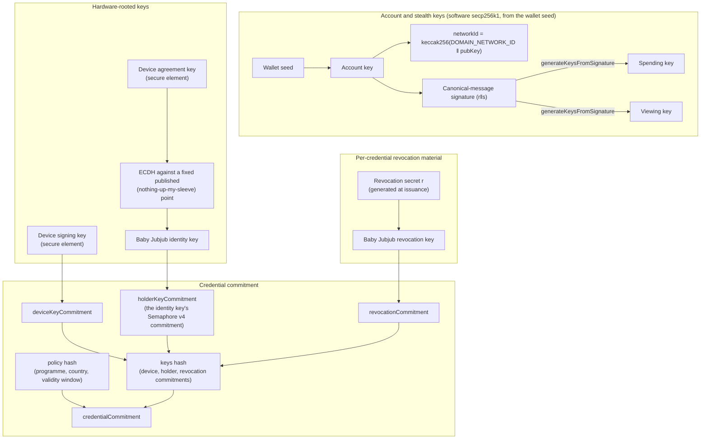
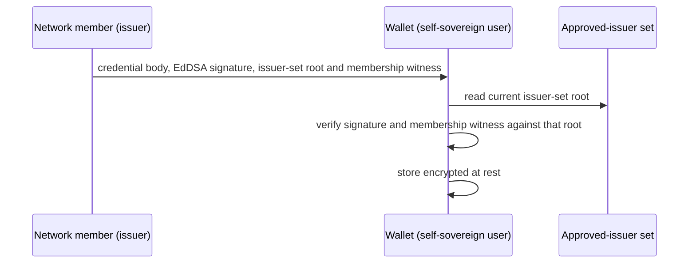
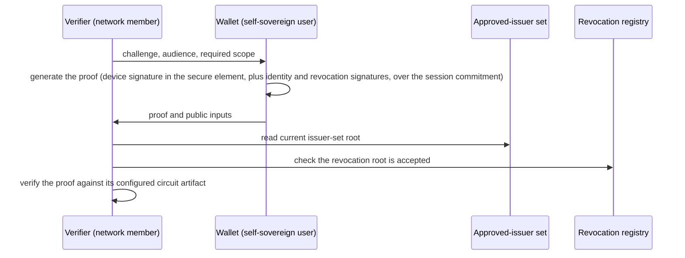
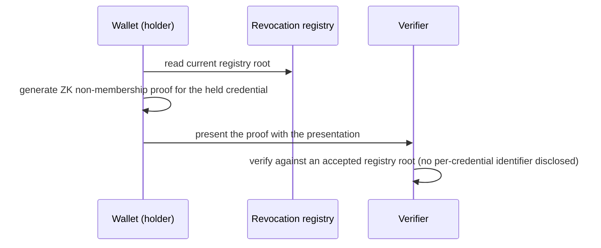
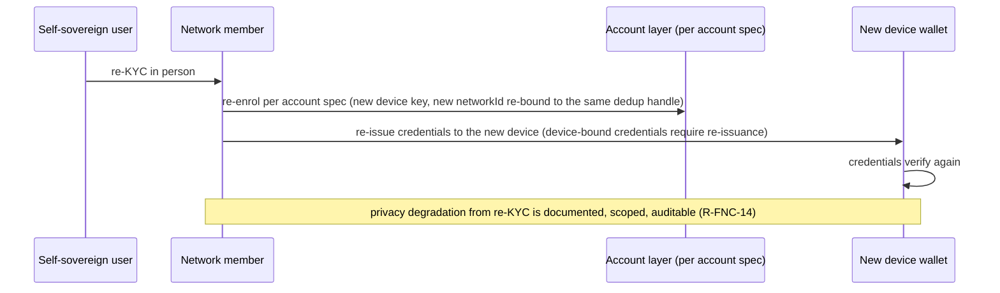

# Wallet Specification

## Executive Summary

This document specifies the wallet for a self-sovereign user in the coordination network: the holder-side component that stores credentials, binds them to the keys the user already controls, and produces verifier-bound zero-knowledge presentations. The self-sovereign user is a KYC'd institutional entity, the network member is the issuer, and the relying party is another network member performing private discoverability. The wallet is the credential half of Workstream 1 (self-sovereign-user onboarding), and in the reference deployment it is the credential half of the self-sovereign user mobile application described in the design proposal: once a self-sovereign user holds an approval credential certifying that it is admitted and in scope, the wallet lets the self-sovereign user prove that standing without a central credential server. The same mobile application also performs key generation and stealth address derivation, and hands the viewing key to the network member, whose indexer scans announcements with it; those functions are owned by the account and stealth-address specifications and are cited here, not restated. Carrying further attestations, such as transaction history for an external credit story, is a future-reuse capability rather than a deliverable here, and the design proposal logs that use out of scope.

The wallet is deliberately thin. The key and account topology (the device-secret network identity `networkId = keccak256(DOMAIN_NETWORK_ID ‖ pubKey)`, the stealth spend and view keys, the EIP-7702 delegation and paymaster-sponsored execution, and recovery) is defined by [Self-Sovereign User Specification](01-self-sovereign-user.md) and is referenced here, not restated. Credential issuance, the verifier-side verification procedure, and the revocation mechanism are owned by their sibling specifications in this folder. What this document owns is credential storage, the binding between a credential and the user's keys, presentation, holder-side credential status and the wallet's part in revocation checking and key rotation, recovery after device loss, and offline operation.

## Conventions

The key words MUST, MUST NOT, SHOULD, SHOULD NOT, and MAY in this document are to be interpreted as described in RFC 2119 and RFC 8174, and only when shown in capitals.

> **Actor model:** The **self-sovereign user** holds its own keys; where a property holds specifically because this actor is a KYC'd institutional entity (KYC, R-PRV-08 linkability, capable hardware), that is flagged where it matters. The **delegated user** is the network-member-custodied actor, characterised by holding no device, low entropy, and needing OPRF to deduplicate. The **network member** is the issuing and verifying party in the network.

## Problem Statement

A self-sovereign user must hold credentials that prove it is an admitted, in-scope participant, and must present them to network members and, later, to outside verifiers, without routing every check through a central directory. The credentials and the keys that bind them live on the user's own device.

The problem breaks down into:

1. How does the wallet store credentials and bind them to keys the user already holds, without minting a second root of trust.
2. How does the user present a credential so that a relying party learns only what its decision needs, and cannot replay the presentation elsewhere.
3. How does a relying party confirm a credential has not been revoked, and remain correct across issuer key rotation, without the wallet leaking which credential is in play.
4. How does a user who loses the device regain its credentials, and what privacy does that cost.
5. How does the wallet work when the device is offline.

### Constraints

- **Public chain, no private data on-chain.** WS1 is deployed and transacts on Ethereum mainnet, the account specification's deployment target, with no permissioned layer and no member-hosted nodes, so the wallet's privacy reasoning assumes every party, including any network member, has only the same public read access as any external observer. The wallet MUST NOT write personally identifiable information, including any deterministic function of it such as a hash, to that public ledger (R-PRV-01). The public `networkId` to `metaStealthAddress` mapping (the design proposal) is a deliberate on-chain identifier owned by the identity-mapping and account specifications and governed by Risk 7, not a wallet write.
- **No PII off the device by default.** The credential-holding and presentation flows the wallet owns MUST NOT transmit PII off the device (R-PRV-05); the one sanctioned crossing of this boundary is the re-KYC recovery path, whose privacy cost is documented, scoped, and auditable (R-FNC-14).
- **No central credential server.** Credentials live with the user; relying parties verify them peer to peer.
- **No exportable master key.** The account specification establishes a no-master-key posture. The wallet inherits it: there is no single exportable secret that reconstitutes the user.

## Approach

1. A credential is a fixed seven-field body, committed with Poseidon and signed by the issuer with EdDSA over Baby Jubjub, held in a device-local store that is encrypted at rest behind the device keystore the account specification already uses.
2. The holder binding key reuses the user's device key material from the account specification. The wallet does not introduce a key of its own.
3. The credential body carries no institutional or subject identifier: only the approval policy and the device, identity, and revocation key commitments are signed. The subject's `networkId` and a random credential id live in the issuer's off-chain issuance record, not in the signed body; identifier resolution there is owned by the issuer/verification specification. A linkable institutional anchor at the issuer is acceptable, and the linkable settlement anchor is what R-PRV-08 contemplates. For the deferred delegated-user case the institutional anchor is dropped in favour of a non-persistent identifier; that case is out of scope here.
4. A presentation is one ZK proof bound to the verifier's `challenge` and `audience`, so a captured presentation does not verify against another verifier or session (R-SEC-04), and two presentations are unlinkable (R-PRV-06).
5. Revocation is checked against the mechanism owned by [Revocation in Coordination Network](04-revocation.md). Each credential carries a revocation commitment whose secret stays on the device, the wallet performs its own holder-side status check, and the presentation proof establishes non-membership in the revoked set without identifying the credential (R-SEC-03).
6. Recovery rides the account specification's re-KYC re-enrolment path. The wallet restores or has the network member re-issue credentials, and the privacy cost of recovery is documented and scoped (R-FNC-14).

### Why this approach

Keeping the wallet a thin holder layer over the existing account, value, and identity primitives avoids duplicating the account topology and avoids a second source of truth that could drift from it. The credential format and the proof that secures it are settled in [VC Issuance and Verification](03-vc-issuance.md), so the three documents stay consistent.

## Tools and Primitives

- **Seven-field credential body, Poseidon-committed and signed with EdDSA over Baby Jubjub.** The credential the wallet stores. Its fields and their commitment structure are owned by [VC Issuance and Verification](03-vc-issuance.md).
- **Noir, Barretenberg UltraHonk over BN254.** The proof system the wallet presents with. The circuit interface is owned by [VC Issuance and Verification](03-vc-issuance.md).
- **Off-chain issuance identifiers.** The random credential id and the subject `networkId` the issuer keeps in its own issuance record; neither is part of the signed credential body. Resolution is owned by the issuer/verification specification.
- **Device key material and keystore-gated storage.** Defined by the account specification. The wallet reuses the device's ECDSA (secp256k1) account and stealth keys, plus the hardware P-256 device key for credential holder binding, and the same at-rest protection, rather than defining its own. At issuance the account key, the device key, and the per-credential revocation key are cross-bound by a proof of possession, so the credential's device-binding key and revocation secret are provably held by the party that controls the account identity (see [Identity and Key Binding](#identity-and-key-binding)).
- **Session binding.** A verifier-supplied challenge and audience that the presentation proof commits to.

## Protocol Design

### Participants and Roles

| Role                         | Actor                                                   | Responsibility                                                                                                                 |
| ---------------------------- | ------------------------------------------------------- | ------------------------------------------------------------------------------------------------------------------------------ |
| Holder / self-sovereign user | Self-sovereign user (a KYC'd institutional entity)      | Holds credentials and keys on its device; builds presentations.                                                                |
| Issuer                       | Network member (the issuer, or a second network member) | KYCs the user, issues the approval credential, can revoke, can rotate its own keys.                                            |
| Verifier / relying party     | Another network member                                  | Requests a presentation, verifies the proof against the circuit artifact its deployment supplies, checks the roots it accepts. |
| On-chain registries          | N/A                                                     | The member registry, the approved-issuer set, and the revocation status registry, all read-only to the wallet.                 |

The issuer and verifier roles may each be filled by any admitted network member, and the wallet holds credentials from several issuers at once (see [Functional requirements](#functional-must)). The issuance procedure, the verification procedure, and the revocation mechanism are owned by [VC Issuance and Verification](03-vc-issuance.md). This document describes only the wallet's side of each interaction.

### Identity and Key Binding

The self-sovereign user's network identity is `networkId = keccak256(DOMAIN_NETWORK_ID ‖ pubKey)` (domain-separated keccak256 over the secp256k1 public key), derived from a device secret. The account key is an ECDSA keypair over the secp256k1 curve, derived from that device secret, which the device CSPRNG (OS secure RNG, NIST SP 800-90A/B) generates. It is a software key, re-derived on demand and held in memory only; what is stored is the device secret, encrypted at rest under a device-keystore-gated wrapping key (iOS Keychain, Android Keystore-wrapped; neither platform keystore can hold a secp256k1 key directly). secp256k1 is the curve of Ethereum EOAs, ERC-5564 scheme 1, and the stealth spending key, so the identity and stealth layers share one curve.

Key derivation follows the FluidKey stealth-account kit ([https://github.com/fluidkey/fluidkey-stealth-account-kit](https://github.com/fluidkey/fluidkey-stealth-account-kit)), secp256k1 throughout. A single self-sovereign user wallet holds the account secp256k1 key; that wallet signs a fixed, domain-separated canonical message with its account key, and `generateKeysFromSignature` deterministically splits that 64-byte (r‖s) ECDSA signature into two halves and keccak256-hashes each to produce the spending and viewing private keys, whose public keys form the ERC-5564 `st:eth:0x<spendingPubKey><viewingPubKey>` meta-address (registered in the Identity Mapping), and `networkId = keccak256(DOMAIN_NETWORK_ID ‖ pubKey)` keys the Identity Mapping. The network member's indexer receives the viewing private key itself, not a derived child key; per-load ephemeral keys are generated by the sender per ERC-5564. Derivation is deterministic from the wallet seed: given that seed, the same spending and viewing keys are reproduced on the same device. There is one enrolled device; a replacement device generates fresh keys and is re-bound to the self-sovereign user through re-KYC, and no key is ever transported between devices. Network members never hold the account or spending key: they are issuers and verifiers, and the member's indexer holds only the viewing key, which reads the user's incoming payments but cannot spend them. They resolve the self-sovereign user through the dedup handle and the `networkId => metaStealthAddress` Identity Mapping.

The wallet proves holder control of a presented credential with the device key material above. It does not mint a key of its own. The credential body carries no subject identifier; the subject's `networkId` lives only in the issuer's off-chain issuance record ([VC Issuance and Verification](03-vc-issuance.md)).

The wallet's two key types are generated independently. The secp256k1 account key comes from the device secret and derives the `networkId` and the stealth meta-address; the hardware P-256 confirmation key, the device signing key, is generated in the secure element and signs the credential holder binding, while a second hardware key, the device agreement key, roots the wallet's Baby Jubjub EdDSA identity key by ECDH (see [Key inventory and custody](#key-inventory-and-custody)). On its own, neither key proves that a single party holds both, and neither proves possession of the per-credential revocation secret the wallet generates at issuance. Issuance therefore ties all four keys together with proofs of possession over the issuer's fresh challenge `nonce`. The confirmation key signs `nonce || networkId || holderKeyCommitment || requestCommitment`, where `holderKeyCommitment` is the Poseidon commitment to the identity key and `requestCommitment` commits to the issuer and the programme and country the user consented to; this both proves possession of the device-binding key and commits it, in the same signature, to the `networkId`, to the identity key the credential will name, and to the issuer and scope it is issued for. The secp256k1 account key signs `nonce || H(confirmationKey) || networkId`, which commits the account key to that confirmation key and to the same `networkId`. The Baby Jubjub holder key signs the issuer nonce, proving control of the key named by `holderKeyCommitment` before issuance. A fourth signature, from the per-credential Baby Jubjub revocation key over the issuer's nonce, sent with the revocation commitment and the key's public key, proves the device holds the revocation secret `r` behind the commitment it wants embedded: the issuer recomputes the commitment from the verified public key and rejects any that does not match, so a holder cannot smuggle in someone else's commitment or one that can never be revoked. Because the confirmation key's and the account key's signatures name the same `networkId`, the binding between them is mutual and structural (`verifyCredentialBinding`): a signature from one cannot be relayed out of its session and paired with an unrelated signature from the other, since the two would then name different network identities and fail verification. The confirmation key MUST sign the `networkId` and `holderKeyCommitment` the wallet derives and holds locally, and the `requestCommitment` for the issuer and scope the consent screen showed, never values supplied in the issuance request. The wallet also rejects a returned credential whose programme or country differs from the consented scope, before storing it. The issuer verifies all three signatures before it binds the credential, so one holder is shown to control the device-binding key, the account and stealth identity, and the revocation secret, and the issuer can check the holder's eligibility against the asserted `networkId` before it issues. The full issuance and verification protocol is owned by [VC Issuance and Verification](03-vc-issuance.md); the wallet's part is to produce the three signatures at issuance.

At presentation the circuit verifies three signatures over one session commitment, `Poseidon4(PRESENTATION_DOMAIN, challenge, audience, credentialCommitment)`: a P-256 signature from the confirmation key, an EdDSA signature from the identity key, and an EdDSA signature from the per-credential revocation key. Binding the credential's own commitment into the session message, not just the verifier's challenge and audience, ties the presentation to this specific credential, so a session signature cannot be moved to a different one. Possession of the device, identity and revocation keys is therefore proven afresh in every presentation. The account key does not sign at presentation; the account binding is established once, at issuance.

A credential is presentable from the self-sovereign user's one enrolled device. Replacing the device means re-issuance to the new device: credentials are device-bound through the hardware P-256 confirmation key, and the registry-level dedup handle only re-links the new device to the same user for discovery and deduplication; it does not transport the credential or make it presentable. Credential availability across several devices is deferred together with the account specification's multi-device extension.

### Data Structures

All structures are held off-chain by the wallet.

- **Credential record.** What the wallet stores for one credential: the seven-field credential body, the issuer's EdDSA signature over its Poseidon commitment, the issuer's public key, the issuer's Merkle path into the approved-issuer set, and the revocation secret `r` with its non-membership witness material. The body's fields and their commitment structure are owned by [VC Issuance and Verification](03-vc-issuance.md), and they carry the approval scope, the validity window, and the device, identity, and revocation key commitments, with no subject identifier. The revocation secret `r`, generated at issuance, derives the per-credential Baby Jubjub revocation key that signs alongside the device and identity keys at presentation (see [Identity and Key Binding](#identity-and-key-binding)). Authorised token scopes carried here are advisory eligibility metadata; the authoritative, enforced scope lives in the value layer (the scoped ERC-1155 token and issuer-authorised transfers per the Stealth Address and value-flow specifications). Additional attestations such as transaction history are a future-reuse extension, out of scope here.
- **Credential store.** The on-device collection of credential records with an index for selection, encrypted at rest behind the device keystore (account specification). Records are indexed per issuer, and the wallet exposes to any one issuer no linkage to credentials from another.
- **Presentation request.** From a verifier: a fresh `challenge`, an `audience` identifier, and the scope it requires.
- **Presentation.** The proof with its public inputs, built for one verifier and session.
- **Holder binding.** A reference to the device key material used to demonstrate holder control; not a new secret. At issuance the P-256 confirmation key, the secp256k1 account key, and the per-credential revocation key are cross-bound by a proof of possession (see [Identity and Key Binding](#identity-and-key-binding)), so the holder-binding key and the revocation secret are provably held by the same party as the account identity.

### On-chain and Off-chain State

| On-chain, read-only to the wallet                                                                  | Off-chain, held by the wallet                                                  |
| -------------------------------------------------------------------------------------------------- | ------------------------------------------------------------------------------ |
| Approved-issuer set (members' signing keys, per [VC Issuance and Verification](03-vc-issuance.md)) | The credential body, its commitment, the issuer signature, and the Merkle path |
| Revocation status registry (mechanism per [Revocation in Coordination Network](04-revocation.md))  | The keys the wallet binds to (per account spec)                                |
| Member registry (admission status of issuers and verifiers)                                        | The revocation secret and witness material, and recovery material              |

The wallet writes nothing private to the chain. A presentation's public inputs MUST NOT encode personally identifiable information, consistent with R-PRV-01.

### Flows

Overview of the wallet's key derivation and the credential commitment it binds. At issuance, the account, device, identity and revocation keys each sign; at presentation the device, identity and revocation keys sign: at issuance the device key's signature also commits to `holderKeyCommitment` and to the issuer and scope shown at consent, and the revocation key separately proves possession of `r`; at presentation all three sign the session commitment together, per [Identity and Key Binding](#identity-and-key-binding) and [Cryptographic Details](#cryptographic-details).

**Credential provisioning into the wallet.** Holding, presenting, and showing the status of the approval credential is the primary user-facing action of the self-sovereign user app (the design proposal). The authoritative issuance procedure is in [VC Issuance and Verification](03-vc-issuance.md), and the issuer side runs the reference implementation's VC-issuance SDK, which hands back the signed credential body together with a Merkle path into the approved-issuer set and the root it was built against; the wallet's part is to verify and store. In the reference deployment the credential reaches the wallet on the stealth-address rail, addressed to a fresh stealth address and surfaced by announcement scanning, a channel owned by the stealth-address specification.

**Private discoverability and presentation.** A network member discovers and verifies a counterparty self-sovereign user.

A check yields acceptance or rejection, as fixed by [VC Issuance and Verification](03-vc-issuance.md): a verifier can distinguish a public-input mismatch from an invalid proof, but a failed private circuit constraint is normally reported only as proof generation or verification failure, so which internal statement failed is not recoverable from the result.

**Revocation status check.** Owned by [Revocation in Coordination Network](04-revocation.md); shown here for the wallet boundary. The check confirms non-revocation at verification time without identifying which specific credential is checked (R-SEC-03): the holder generates a ZK non-membership proof against the on-chain registry of revoked commitments, and the verifier checks the proof against an accepted registry root.

In addition to the verifier-side check, the wallet performs a holder-side status check: it refreshes the status of its held credentials, shows each credential's status (valid, revoked, or expired) to the user, and refuses to select a revoked or expired credential when building a presentation (the design proposal). When online this status is reflected in real time; when offline the wallet falls back to the last cached status and marks it as cached (R-OPS-02).

**Recovery after device loss.** The account layer restores account access; the wallet restores or re-obtains credentials.

## Cryptographic Details

- **Credential and presentation format.** A seven-field body committed with a two-level Poseidon hash and signed with EdDSA over Baby Jubjub, presented as one ZK proof, per [VC Issuance and Verification](03-vc-issuance.md).
- **Unlinkable presentation.** Two presentations of one credential share no value beyond the public inputs the verifier supplied, so no verifier can link them (R-PRV-06).
- **Scope proven by equality.** A verifier supplies the required programme hash and country code as public inputs, and the proof establishes that the credential's signed fields equal them. A successful proof therefore discloses the credential's programme and country to the verifier and to anyone holding the transcript; the other claim fields stay private.
- **Proof verification.** The proof is verified off-chain by the SDK against the verifying key derived from the circuit artifact its deployment supplies. There is one live circuit, so prover and verifier must be given compatible artifacts, and a circuit change is rolled out by redistributing that artifact. Verification itself costs no gas.
- **Session binding.** The presentation proof commits to the verifier-supplied `challenge` and `audience`, so a presentation captured against one verifier and session does not verify against another (R-SEC-04).
- **At-rest protection.** The credential store and the bound keys are protected by the device keystore, per the at-rest parameters set in [Key and Wallet Security](#key-and-wallet-security) below.

## Key and Wallet Security

This section is about the security of the wallet's keys, distinct from the credential-disclosure and verifier-replay threats already covered in the [Threat Model](#threat-model) below. The account specification owns the account topology and the delegation and recovery lifecycle; what follows is the wallet-side custody, generation, signing, and recovery posture for the key material the wallet binds to and stores.

### Key inventory and custody

The wallet handles a small set of keys: four software keys derived deterministically from a single self-sovereign user wallet seed, the separate hardware P-256 device key (a device signing key and a device agreement key), and one Baby Jubjub EdDSA key that the device agreement key roots by ECDH, plus one Baby Jubjub revocation key per credential, held with that credential's record rather than in this inventory:

| Key                                                                                                                                                                                                                                                                                            | Curve             | Storage                                                                             | Exportable                                                                                                    |
| ---------------------------------------------------------------------------------------------------------------------------------------------------------------------------------------------------------------------------------------------------------------------------------------------- | ----------------- | ----------------------------------------------------------------------------------- | ------------------------------------------------------------------------------------------------------------- |
| Software ECDSA account key (the `secret` behind `networkId`)                                                                                                                                                                                                                                   | secp256k1         | Software, re-derived on demand from the wallet seed, in-memory only                 | Software; device-local, never transported (a replacement device generates fresh keys via re-KYC re-enrolment) |
| Spending key (stealth)                                                                                                                                                                                                                                                                         | secp256k1         | Software, re-derived on demand from the wallet seed, in-memory only                 | Software; device-local, never transported (a replacement device generates fresh keys via re-KYC re-enrolment) |
| Viewing key (stealth)                                                                                                                                                                                                                                                                          | secp256k1         | Software, re-derived on demand from the wallet seed, in-memory only                 | Software; handed to the network member, whose indexer scans announcements with it, never to another device    |
| Auth key                                                                                                                                                                                                                                                                                       | secp256k1         | Software, re-derived on demand from the derivation signature, in-memory only        | Software; device-local, never transported                                                                     |
| Hardware P-256 device key: the device signing key (credential holder binding via the confirmation key; candidate future ERC-4337 session signer; needs the user for every use) and the device agreement key (ECDH root of the EdDSA identity key; needs user authentication within 10 seconds) | P-256 / secp256r1 | Hardware, Secure Enclave or StrongBox                                               | Hardware non-exportable; signing key generated with an attestation challenge, chain sent at issuance          |
| Software EdDSA identity key (Baby Jubjub; the device's Semaphore v4 identity commitment)                                                                                                                                                                                                       | Baby Jubjub       | Software, re-derived on demand from the hardware ECDH shared secret, in-memory only | Software; device-local, not re-derivable from the wallet seed                                                 |

The account, spending, viewing and auth keys are software keys derived from the wallet seed: the account key directly, and the other three from one signature the account key makes over the canonical message, the spending and viewing keys per the FluidKey derivation above. There is one enrolled device and no provisioning path to any other, so none of them moves between devices, and the only one that leaves the device is the viewing key, which the wallet hands to the network member for its indexer to scan announcements with. Key handling is store-then-rederive: only the wallet seed is persisted, keystore-gated at rest, and the account, spending, viewing and auth keys, along with every per-load stealth private key, are re-derived on demand, held in memory only, and zeroized after use. This is the pattern shipping self-custodial wallets use, and it fits a design that creates a fresh stealth account per value load. The only hardware-non-exportable keys here are the two hardware P-256 keys. The device signing key signs the credential device binding (the confirmation key in [VC Issuance and Verification](03-vc-issuance.md)) and is the candidate session signer for the deferred multi-device extension. The device agreement key's ECDH shared secret against a fixed published point roots the wallet's Baby Jubjub EdDSA key and its Semaphore v4 commitment, specified in [Baby Jubjub EdDSA key and Semaphore commitment](01-self-sovereign-user.md#baby-jubjub-eddsa-key-and-semaphore-commitment). Neither key ever seeds a key by signature, since hardware ECDSA is randomized and no signature it produces can seed a reproducible key. Store-then-rederive therefore covers the EdDSA key from the device agreement key rather than the wallet seed: losing the device agreement key loses that commitment permanently, while the seed-derived keys stay recoverable.

### At-rest protection

The wallet stores the credential store and the wallet seed encrypted at rest behind the device keystore (derived keys are never persisted on the device, per the store-then-rederive policy above), following [OWASP MASVS](https://mas.owasp.org/MASVS/) key-storage requirements; the parameters below are set here, consistent with the account specification's software-key custody posture:

- On iOS, secret material is held in the [Keychain](https://developer.apple.com/documentation/security/keychain-services) with `kSecAttrAccessibleWhenUnlockedThisDeviceOnly` and a biometric `SecAccessControl`, so it is readable only on the unlocked device and only after the biometric gate.
- On Android, secret material is encrypted under an [Android Keystore](https://developer.android.com/privacy-and-security/keystore)-wrapped key, using StrongBox where the device provides it.
- On Android, that secret material is not biometric-gated. A biometric or screen-lock change invalidates a key bound to user authentication, which would make the device secret unreadable and lose the `networkId`, the account key and the stealth keys with no recovery path. The user-presence gate is the device signing key, which needs biometric or screen-lock authentication for every signature.
- Secret material is device-only. The wallet MUST NOT place account or stealth key material in iCloud or Google cloud backup, so a cloud account compromise does not yield the keys.

### Why these are software keys, and the hardware tradeoff

The viewing key and the spending key cannot be non-exportable hardware keys, for two structural reasons. The viewing key must run ECDH in software to scan every [ERC-5564](https://eips.ethereum.org/EIPS/eip-5564) announcement and recover inbound stealth accounts, which a sealed hardware key cannot do at announcement-scanning volume. The spending key performs the secp256k1 stealth arithmetic `p_stealth = p_spend + s_h` to derive each per-load stealth private key, which again requires the raw scalar in software. A non-exportable enclave key supports neither operation.

Reproducibility from the wallet seed is likewise incompatible with hardware keys: every enclave or StrongBox key is freshly generated and non-exportable, so it cannot be re-derived from the wallet seed, whereas the FluidKey derivation reproduces the same software keys from that seed on the same device. A hardware key can still root a reproducible key by ECDH against a fixed point, which is how the Baby Jubjub EdDSA key is derived, but that only reproduces the key for as long as the hardware survives and never from the wallet seed, so it does not help the stealth keys. Discovery does not need these keys reproduced at all: network members resolve the user through the dedup handle and the Identity Mapping and never hold its account or spending key, per the account specification. This reproducibility is the second reason the account and stealth keys are software secp256k1.

Hardware non-exportability (P-256 [Secure Enclave](https://support.apple.com/guide/security/secure-enclave-sec59b0b31ff/web) or StrongBox) therefore applies only to the separate P-256 device key, which is two keys with separate roles: the device signing key does credential holder binding and is a candidate ERC-4337 session signer under the deferred multi-device extension, and the device agreement key is the ECDH root of the Baby Jubjub EdDSA key. Neither seeds a secp256k1 key, scans for stealth announcements, or has a part in discovery.

### Generation

All software key material is generated from the OS secure CSPRNG, `SecRandomCopyBytes` on iOS and `SecureRandom` backed by Conscrypt on Android, consistent with the [NIST SP 800-90A](https://csrc.nist.gov/pubs/sp/800/90/a/r1/final) / [800-90B](https://csrc.nist.gov/pubs/sp/800/90/b/final) posture the account specification adopts. The wallet does not seed key material from any application-level or network-supplied entropy.

### Signing safety

ECDSA over secp256k1 (the [NIST FIPS 186-5](https://csrc.nist.gov/pubs/fips/186-5/final) signature standard) leaks the private key if the same signing nonce is reused across two different messages, so the wallet MUST sign with [RFC 6979](https://www.rfc-editor.org/rfc/rfc6979) deterministic nonces and MUST use a vetted constant-time secp256k1 implementation rather than an ad-hoc one. Settlement and other value-authorising claims the wallet signs MUST be [EIP-712](https://eips.ethereum.org/EIPS/eip-712) typed and bound so a captured signature cannot be replayed (R-SEC-04); the value-flow enforcement point is owned by the stealth-address and token specifications, and the wallet's obligation is to sign safely and bind each claim. The same discipline covers EIP-7702 authorization tuples: the wallet MUST sign one only for the governance-pinned delegator smart contract and always chain-bound, per the account specification, which owns the delegation mechanism.

### Deterministic-derivation security

The [FluidKey stealth-account kit](https://github.com/fluidkey/fluidkey-stealth-account-kit)'s `generateKeysFromSignature` is client-side and, by design, exposes the spending and viewing private keys to the caller, a point the [Dedaub audit (May 2024)](https://dedaub.com/audits/fluidkey/fluidkey-stealth-account-kit-may-24-2024/) flags. The wallet MUST run it on-device and in-memory only, on demand at each use per the store-then-rederive policy, and MUST NOT transmit the canonical-message signature or any derived key off the device, other than the viewing key, which goes to the network member for its indexer. The canonical message MUST be domain-separated so a signature produced for one purpose cannot be reused to derive keys for another. The wallet transmits neither the root seed nor the canonical-message signature, and no derived key other than that viewing key, which yields neither the signature nor the spending key, so the deterministic derivation cannot become a remote extraction vector.

### No master key, no export

The wallet inherits the account specifications' no-master-key posture: there is no single exportable secret that reconstitutes the user, and the wallet provides no exportable backup of key material, because any such backup would itself be a master-key-like artefact. The no-export sense here is absolute as well as user-facing: there is no seed phrase or master key the user copies out, or that can be exfiltrated as a unit, and no system-internal transport either, since there is one enrolled device and the only private key that leaves it is the viewing key the network member's indexer scans with. The consequence is that recovery cannot restore the original keys from a user-held backup; recovery instead runs through re-KYC re-enrolment (R-FNC-13, R-FNC-14), whose privacy degradation is documented, scoped to the affected user, and auditable.

### Device compromise, memory scrape, side channel, and the app sandbox

A lost or stolen device is contained by the at-rest encryption and the per-use authentication on the device signing key above, plus the registry-level deactivation of the lost `networkId` the account specification provides. Against a memory scrape, the wallet zeroizes derived key material after use rather than holding the spending and viewing scalars resident, and runs the constant-time signing library to limit side-channel leakage. The wallet SHOULD detect a jailbroken or rooted device and refuse to operate on it, since such a device defeats the keystore and biometric guarantees. The platform app sandbox is a security boundary: it isolates the wallet's key material from every other app on the device, including any network member's own app, so no other app can read the keys the wallet derives. This is also what lets the wallet hold credentials from several network members at once without one member reaching the wallet's keys or another member's credentials.

### Validation and conformance

| Check                                     | What it proves                                                                                                                                            | Requirement                                |
| ----------------------------------------- | --------------------------------------------------------------------------------------------------------------------------------------------------------- | ------------------------------------------ |
| Deterministic re-derivation               | The same wallet seed reproduces the same account, spending, viewing, and auth keys and the same meta-stealth address on the same device                   | (key-management hardening; no direct R-ID) |
| At-rest protection                        | No plaintext key material appears in device backups or outside the keystore                                                                               | R-PRV-01                                   |
| No derived-key persistence                | The account, spending, viewing, auth and per-load stealth keys never appear in the keystore, backups or any other device storage; only the seed is stored | (key-management hardening; no direct R-ID) |
| Biometric-gate enforcement                | Secret material is unreadable without the biometric `SecAccessControl` on an unlocked device                                                              | (device-hardening; no direct R-ID)         |
| RFC 6979 nonce determinism                | Signatures use deterministic nonces, so no nonce is ever reused                                                                                           | (key-safety hardening; no direct R-ID)     |
| No-key-egress static and dynamic analysis | The derivation signature and the account, spending and auth keys never leave the device; the viewing key goes only to the network member's indexer        | R-PRV-05                                   |
| Settlement-claim replay binding           | A captured settlement claim does not verify against another session                                                                                       | R-SEC-04                                   |
| Device-loss recovery drill                | A lost device recovers through re-KYC, with the privacy degradation logged and scoped                                                                     | R-FNC-13, R-FNC-14                         |
| Presentation unlinkability                | Two presentations of one credential share no value beyond the public inputs the verifier chose                                                            | R-PRV-06                                   |
| Issuer anonymity                          | A verified presentation yields no identifier for the issuing network member                                                                               | R-PRV-04                                   |

## Requirements

### Functional (MUST)

- The wallet MUST show each held credential's status (valid, revoked, or expired) to the user, MUST reflect a revoked or expired status in real time while online, and MUST refuse to build a presentation from, or otherwise use, a credential it determines to be revoked or outside its `nbf` to `exp` window (the design proposal). Where the approval credential gates a downstream value or settlement action, the wallet MUST NOT initiate or authorise that action from a revoked or expired credential; the enforcement point inside the value flow is owned by the stealth-address and token specifications.
- The wallet MUST hold credentials issued independently by multiple network members (for example two different network members) to the same self-sovereign user, and MUST NOT reveal to one issuer the existence of, or the user's relationship to, another issuer (the design proposal). This is a credential-layer property of the per-issuer-indexed store; at the account layer a self-sovereign user converges on one public `networkId` and mapping that any admitted member can resolve, so the unlinkability there is to real-world identity, not between members.
- The wallet MUST participate in a documented recovery path so a user who has lost access to its credential material can regain access and resume operating (R-FNC-13, whose text says MUST although the requirement is labelled MAY; this document follows the text).
- Recovery SHOULD preserve as much privacy as is operationally feasible, and where it degrades a privacy property the degradation MUST be documented, scoped to the affected user, and auditable (R-FNC-14).

### Privacy (MUST)

- The wallet MUST NOT place personally identifiable information, including any deterministic function of it such as a hash, on the public ledger (R-PRV-01).
- The wallet sends a proof and its public inputs, so a relying party learns only the public inputs the circuit declares, which are values the verifier supplied or roots it already reads from chain (R-PRV-05, R-FNC-03).
- The wallet MUST present unlinkably, so two presentations are linkable by no party other than the user (R-PRV-06). The self-sovereign user exercises this in the reference deployment.
- A presentation MUST NOT reveal which network member enrolled the user (R-PRV-04). Its anonymity set is the approved-issuer set, whose membership bounds the property (see [Limitations](#limitations)).
- Funder and regulator audit minimisation (R-PRV-07) governs the audit and dashboard surface, which this wallet does not expose; that requirement is owned by the audit/dashboard and the account/indexer specifications. The wallet's only contribution is to keep audit-relevant PII off-chain (R-PRV-01).

### Security (MUST)

- The wallet MUST treat as valid only credentials issued by an admitted network member (R-SEC-02, whose text says MUST although the requirement is labelled SHOULD; this document follows the text). The circuit proves that the key signing the credential belongs to the approved-issuer set, against a set root the verifier accepts from chain. Rotating a signing key does not invalidate credentials the old key already signed: a superseded key stays in the set, and a credential it signed keeps verifying for as long as that key remains, until the issuer explicitly retires it (R-SEC-06). A stolen key is retired with `retireIssuerKeyImmediately`, which takes effect at once: every set root the key could still be proven against stops being accepted. Removing a member is the blanket version: it retires every key that member ever published in one transaction and invalidates every set root the member's key could still have been proven against, so a removed member's credentials stop verifying without waiting out the set's ordinary root-acceptance window. Admission is resolved against the Member Registry / identity-mapping layer (the design proposal), which this spec consumes and does not define; the governance that decides admission is established outside this spec (the design proposal, Risk 7).
- The wallet MUST support a non-revocation check at verification time that does not identify the specific credential being checked (R-SEC-03).
- Presentations MUST be bound to a specific verifier and session so they cannot be replayed (R-SEC-04).

### Operational (MUST)

- Proofs are generated locally on the holder's device at presentation, so the wallet MUST present while offline, against the last roots and status it cached, and MUST label anything it shows from cache (R-OPS-02). The cache's freshness is bounded by the on-chain root-acceptance window each registry sets for its own root: the approved-issuer set and the revocation registry each expose one as a deployment parameter rather than a value this spec fixes. An offline presentation built against a cached root stops verifying once that root falls outside the accepting contract's window, so the wallet treats window expiry, not an arbitrary local timer, as the outer bound on how stale a cached presentation may be. The window is an upper bound, not a guarantee: removing a network member invalidates every superseded issuer-set root at once, so a cached presentation can stop verifying before its window elapses, and the wallet MUST be able to rebuild against the current root.
- Proof generation MUST fit the range of device classes the system targets (R-OPS-01). The KYC'd institutional self-sovereign user operates a capable managed device, and the delegated-user reuse case is the tighter constraint. The proving-time and peak-memory budget for one presentation is not yet fixed (see [Open Questions](#open-questions)).

### Integration (MUST)

- A presentation is a ZK proof, not a credential format an outside verifier can read, so R-INT-01 and R-INT-02 are deferred and not met by this design. Checking a presentation needs the network's own SDK and the verifying key it pins, which closes the external-verifier path a lender or other outside party would have used; external-verifier compatibility remains future work.

### Regulatory (MUST)

- Off-chain handling of any personally identifiable information the wallet or a network member holds MUST conform to applicable data-protection law, including lawful basis, purpose limitation, retention limits, and rights of access and erasure (R-REG-05).

### Out of scope

- The delegated-user network-member-custodied wallet. It is deferred to a later specification; the credential primitives here are designed so they can be reused for it.
- Credential issuance internals, the verifier-side verification procedure, and the revocation mechanism, which are owned by the sibling specifications in this folder.
- Announcement scanning with the viewing key to recover stealth accounts and to surface inbound credentials addressed to the user. The network member's indexer performs it with the viewing key the self-sovereign user mobile application hands the member, and it is owned by the stealth-address specification; this document owns only credential storage, presentation, and holder-side status.
- On-chain registration of the `networkId` to `metaStealthAddress` mapping: the user's EIP-712 signature is consent that the network member's server verifies off-chain, and the server submits `registerIdentity(networkId, metaStealthAddress, proof)` on the authority of its own anonymous Semaphore membership proof; the contract reads no user signature, and the self-sovereign user never pays. The same self-sovereign user mobile application triggers it, but the registry contract and submission path are owned by the identity-mapping, account, and stealth-address specifications.
- The account and key topology, the value layer, and the gas-sponsorship (paymaster) infrastructure, owned by the account, stealth-address, and token specifications.

## Security and Privacy Model

### Threat Model

| Adversary                              | Capabilities                                                                      | Mitigations                                                                                                                                                                                                                                                               |
| -------------------------------------- | --------------------------------------------------------------------------------- | ------------------------------------------------------------------------------------------------------------------------------------------------------------------------------------------------------------------------------------------------------------------------- |
| Stolen or lost device                  | Holds the device and any unlocked secrets                                         | At-rest encryption behind the device keystore; registry-level deactivation of the `networkId`, re-KYC recovery, and credential re-issuance per the account specification.                                                                                                 |
| Over-asking verifier                   | Requests more attributes than the decision needs                                  | A presentation reveals only the programme and country the verifier itself named, and no other claim value (R-PRV-05, R-FNC-03). Repeating requests with different values can narrow the scope or the validity window by elimination.                                      |
| Replaying verifier or eavesdropper     | Captures a presentation and replays it                                            | Presentations are bound to the verifier and session, so a captured presentation does not verify elsewhere (R-SEC-04).                                                                                                                                                     |
| Curious or colluding network member    | Correlates a user's presentations across interactions                             | Presentations are unlinkable, so there is nothing to correlate (R-PRV-06). R-PRV-08 separately bounds settlement transparency to the leaving side.                                                                                                                        |
| Compromised or rotated issuer key      | Issuer key changes or is compromised                                              | Set membership is proven in-circuit; a rotated key stays valid until the issuer retires it, and retiring a compromised key with `retireIssuerKeyImmediately`, or removing the member, invalidates every root that key could still be proven against (R-SEC-02, R-SEC-06). |
| Revocation-status correlator           | Watches status checks to learn which credential is in use                         | Non-revocation check does not identify the specific credential (R-SEC-03); mechanism owned by [Revocation in Coordination Network](04-revocation.md).                                                                                                                     |
| On-chain observer                      | Reads the public ledger                                                           | The wallet writes no private data on-chain, including no hashed identifiers (R-PRV-01).                                                                                                                                                                                   |
| Paymaster / bundler (sponsorship path) | Sees the sponsored operations it validates and propagates; can refuse sponsorship | Out of this document; an account-layer chokepoint and linker addressed by the account specification's EIP-7702 + ERC-4337 + paymaster model.                                                                                                                              |
| Recovery-time authority                | The network member during re-KYC                                                  | Recovery privacy degradation is documented, scoped to the affected user, and auditable (R-FNC-14); flagged for DPO review.                                                                                                                                                |

### Guarantees

| Property                              | Description                                                                                                                                                                                  |
| ------------------------------------- | -------------------------------------------------------------------------------------------------------------------------------------------------------------------------------------------- |
| Minimal claim disclosure              | A relying party learns that the credential's programme and country equal the values it asked for, and no other claim value.                                                                  |
| Unlinkable presentation               | Two presentations by the same holder cannot be linked by any party other than the holder.                                                                                                    |
| Issuer anonymity                      | A relying party learns that an approved network member issued the credential, without learning which one.                                                                                    |
| Holder-side status enforcement        | The wallet shows each credential's status to the user and refuses to present one it determines revoked or expired.                                                                           |
| Mutually-unaware multi-issuer holding | The wallet holds credentials from several network members at once and discloses no issuer's relationship to another.                                                                         |
| Verifier and session binding          | A presentation is valid only for the verifier and session it was built for.                                                                                                                  |
| Private non-revocation                | A relying party can confirm a credential is not revoked without identifying which credential it is, and a revocation event exposes no link to the self-sovereign user's transaction history. |
| Key-rotation tolerance                | Credentials remain verifiable while the key that signed them stays in the approved-issuer set.                                                                                               |
| No private data on-chain              | The wallet places no PII, hashed or otherwise, on the public ledger.                                                                                                                         |
| Documented recovery                   | A user who loses its device has a defined path back to its credentials.                                                                                                                      |
| Offline presentation                  | Credentials are stored locally and presentable without continuous connectivity.                                                                                                              |

### Limitations

| Limitation                                                                           | Impact                                                                                                                                        | Mitigation / future work                                                                                                                                                    |
| ------------------------------------------------------------------------------------ | --------------------------------------------------------------------------------------------------------------------------------------------- | --------------------------------------------------------------------------------------------------------------------------------------------------------------------------- |
| Anonymity-set size                                                                   | Issuer anonymity gives nothing while the approved-issuer set holds one member                                                                 | The set grows as members are admitted; this is a deployment property, and the reference deployment accepts it.                                                              |
| Revocation privacy depends on [Revocation in Coordination Network](04-revocation.md) | The non-revocation guarantee is only as strong as the registry's on-chain root-acceptance window and the deployed non-membership construction | This document states the wallet's requirement against that mechanism, not its implementation detail.                                                                        |
| Proof generation cost                                                                | Proving takes time and memory on the holder's device, at the moment of presentation                                                           | The KYC'd institutional self-sovereign user has capable hardware; the requirement is stated in [Operational](#operational-must), and the budget itself is an open question. |
| Self-sovereign custody only                                                          | The delegated-user custodied wallet is not specified here                                                                                     | Deferred to a later specification; primitives designed for reuse.                                                                                                           |
| Recovery degrades privacy                                                            | Re-KYC links the recovered user to the network member                                                                                         | Documented, scoped, and auditable per R-FNC-14; recovery hardening is an open question.                                                                                     |
| No exportable master backup                                                          | There is no single secret that restores the user                                                                                              | Inherited from the account specification; total loss is handled by re-issuance, and there is no backup on any path.                                                         |
| Single-device availability                                                           | Credentials are presentable only from the one enrolled device; replacing the device requires re-issuance                                      | Multi-device support is deferred to a future phase (account specification, multi-device extension).                                                                         |
| The network member's indexer holds the viewing key                                   | The member that runs the indexer sees every payment the user receives, past and future                                                        | Accepted, because scanning needs the raw key. The indexer encrypts it at rest and keeps it with no expiry, so retention is the member's own policy.                         |
| One signature yields the spending, viewing and auth keys                             | Anyone who gets the account key to sign the fixed derivation message once can spend the user's funds and read its whole receiving history     | Kept for FluidKey compatibility. The account key never reaches a general-purpose signer such as `personal_sign`.                                                            |

## Decisions

1. The wallet owns the credential layer (storage, binding, presentation, holder-side status, the wallet side of revocation and key rotation, recovery, offline operation). The account and key topology is referenced from [Self-Sovereign User Specification](01-self-sovereign-user.md), not restated.
2. Coverage is the self-sovereign user only. The delegated-user custodied wallet is deferred.
3. A credential is a seven-field body, Poseidon-committed and signed with EdDSA over Baby Jubjub, and a presentation is one ZK proof over it. The circuit verifies three signatures over that proof's session commitment: a P-256 signature from the device signing key, and EdDSA signatures from the Baby Jubjub identity and revocation keys.
4. The credential carries no issuer or subject identifier in its signed body; the issuer's off-chain issuance record holds the subject's `networkId` and a random credential id (identifier resolution owned by [VC Issuance and Verification](03-vc-issuance.md)). The holder binding reuses the user's device key material rather than minting a new root.
5. The reference wallet is delivered open source (the design proposal); the licence is the open-source-licensing item logged for Phase 1 (Risk 8). The reference implementer delivers the reference credential mobile app and the VC-issuance, revocation, and verification SDKs this wallet consumes; the network member delivers the production wallet app and per-member integration.
6. The account, stealth and auth keys are software secp256k1 keys derived from a single self-sovereign user wallet seed, the stealth keys per the FluidKey derivation, with the hardware P-256 device key signing the credential's device and holder-key binding (and standing as a candidate ERC-4337 session signer under the deferred multi-device extension) and rooting the Baby Jubjub EdDSA identity key by ECDH, never seeding a key by signature. Key custody, generation, signing safety, deterministic-derivation security, and the no-master-key recovery posture are covered in [Key and Wallet Security](#key-and-wallet-security).

## Open Questions

- Credential availability across devices under the deferred multi-device extension (future phase).
- The proving-time and peak-memory budget for one presentation (R-OPS-01): no measured figures exist yet for the presentation circuit, so the requirement stands without a number.
- Recovery hardening: which production factor strengthens the re-KYC path (for example multi-member co-signature or a time-locked challenge).

## Verification and Conformance

- **Import.** A credential is verified against the issuer's signature and its Merkle path into the approved-issuer set, and its revocation status is checked, before it is stored.
- **Replay.** A presentation built for one verifier and session is rejected when replayed against another.
- **Revocation.** A revoked credential is rejected at verification, and the non-revocation check discloses no per-credential identifier.
- **Holder-side status.** A credential revoked on-chain shows as revoked in the wallet once status refreshes and can no longer be selected for a presentation; an expired credential is blocked the same way.
- **Key rotation.** After the issuer rotates its key, a credential issued before the rotation still verifies.
- **Recovery drill.** Simulate device loss, re-KYC, restore or re-issue credentials, and confirm the credential verifies again, with the privacy degradation logged and scoped.
- **On-chain hygiene.** No wallet-initiated on-chain write carries PII or a deterministic function of it.
- **Deployment-chain end-to-end.** A real approval credential is issued to the wallet, stored, presented, verified against the live issuer-key and revocation registries on the target chain, and revoked and re-checked, demonstrating the credential half of WS1 with real transactions on the deployment chain. Local or testnet runs are development checkpoints, not the acceptance bar.
- **DPO gate.** The recovery privacy degradation clears DPO review before the recovery path is enabled in the field.

## Terminology

| Term                        | Definition                                                                                                                                                                                                                                                                                                                                       |
| --------------------------- | ------------------------------------------------------------------------------------------------------------------------------------------------------------------------------------------------------------------------------------------------------------------------------------------------------------------------------------------------ |
| Self-sovereign user         | An actor that holds its own keys and controls its account (a KYC'd institutional entity).                                                                                                                                                                                                                                                        |
| Delegated user              | A network-member-custodied actor; out of scope here.                                                                                                                                                                                                                                                                                             |
| Network member              | A party participating in the network; the issuer and the relying party.                                                                                                                                                                                                                                                                          |
| Holder                      | The role that stores credentials and builds presentations; the self-sovereign user.                                                                                                                                                                                                                                                              |
| Hardware P-256 device key   | The device's two non-exportable secure-element keys. The device signing key is the credential's `confirmationKey` and signs the device binding over the `networkId`, the credential's `holderKeyCommitment` and the consented issuer and scope; the device agreement key roots the EdDSA identity key by ECDH. Neither seeds a key by signature. |
| Software ECDSA account key  | The secp256k1 key derived from the device secret. Sets `networkId` and roots the stealth spending and viewing keys and the auth key. Held in software, re-derived on demand and kept in memory only.                                                                                                                                             |
| Software EdDSA identity key | The Baby Jubjub key rooted in the device agreement key by ECDH, carrying the device's Semaphore v4 commitment. Specified in [Baby Jubjub EdDSA key and Semaphore commitment](01-self-sovereign-user.md#baby-jubjub-eddsa-key-and-semaphore-commitment).                                                                                          |
| Credential commitment       | The two-level Poseidon commitment over a credential's seven fields (a policy hash, then a keys hash, then a domain-separated root) that the issuer signs with EdDSA over Baby Jubjub.                                                                                                                                                            |
| Presentation                | The proof and its public inputs, built for one verifier and session.                                                                                                                                                                                                                                                                             |
| Approved-issuer set         | The on-chain LeanIMT of admitted members' credential signing keys, built as in [Approved-issuer root](03-vc-issuance.md#approved-issuer-root); the circuit proves membership in it.                                                                                                                                                              |
| Unlinkable presentation     | Two presentations by the same holder that cannot be linked by any party other than the holder.                                                                                                                                                                                                                                                   |
| Revocation commitment       | The commitment that binds a credential's revocation key and whose publication revokes the credential; mechanism per [Revocation in Coordination Network](04-revocation.md).                                                                                                                                                                      |

## References

- [Noir](https://noir-lang.org/), the circuit language, with [Barretenberg](https://barretenberg.aztec.network/docs/) proving via UltraHonk over BN254 as the backend.
- [EIP-2494, the Baby Jubjub elliptic curve](https://eips.ethereum.org/EIPS/eip-2494).
- [Poseidon, a hash function for zero-knowledge proof systems](https://eprint.iacr.org/2019/458).
- [Semaphore](https://docs.semaphore.pse.dev/), the commitment scheme behind the identity key's commitment and, by the same construction, the revocation commitment.
- [ERC-5564, Stealth Addresses](https://eips.ethereum.org/EIPS/eip-5564); [ERC-6538, Stealth Meta-Address Registry](https://eips.ethereum.org/EIPS/eip-6538).
- [EIP-712, Typed Structured Data Hashing and Signing](https://eips.ethereum.org/EIPS/eip-712).
- [RFC 6979, Deterministic Usage of DSA and ECDSA](https://www.rfc-editor.org/rfc/rfc6979).
- [NIST SP 800-90A Rev. 1](https://csrc.nist.gov/pubs/sp/800/90/a/r1/final) and [SP 800-90B](https://csrc.nist.gov/pubs/sp/800/90/b/final), random bit generation.
- [NIST FIPS 186-5, the Digital Signature Standard (ECDSA)](https://csrc.nist.gov/pubs/fips/186-5/final), superseding FIPS 186-4.
- [`fluidkey/fluidkey-stealth-account-kit`](https://github.com/fluidkey/fluidkey-stealth-account-kit), with the [Dedaub audit (May 2024)](https://dedaub.com/audits/fluidkey/fluidkey-stealth-account-kit-may-24-2024/).
- [OWASP MASVS](https://mas.owasp.org/MASVS/), mobile application key-storage requirements.
- Apple [Secure Enclave](https://support.apple.com/guide/security/secure-enclave-sec59b0b31ff/web) and [Keychain Services](https://developer.apple.com/documentation/security/keychain-services) documentation; [Android Keystore system](https://developer.android.com/privacy-and-security/keystore) documentation.
- [RIP-7212, the secp256r1 (P-256) precompile](https://github.com/ethereum/RIPs/blob/master/RIPS/rip-7212.md).
- [RFC 2119](https://www.rfc-editor.org/rfc/rfc2119) and [RFC 8174](https://www.rfc-editor.org/rfc/rfc8174), requirement keywords.
