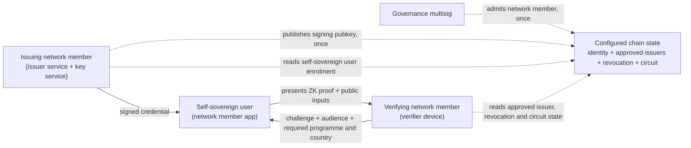
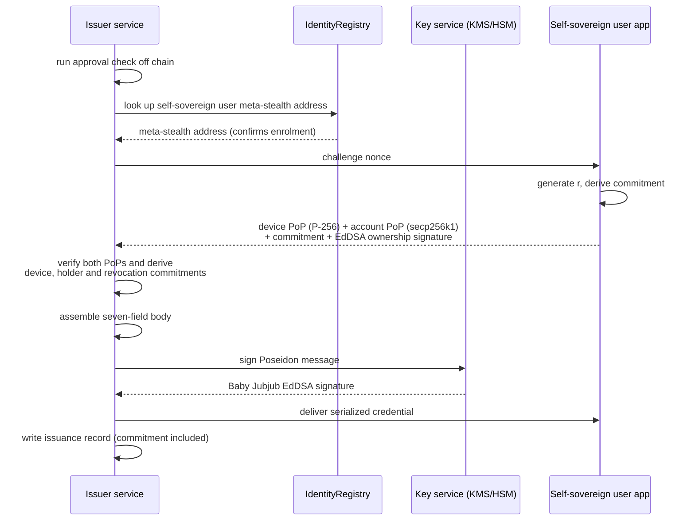
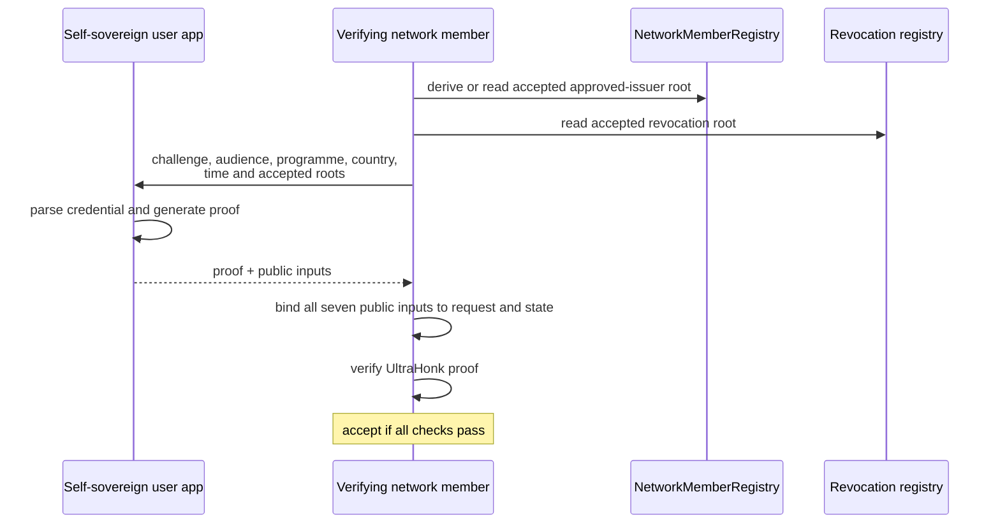

# VC Issuance and Verification

## Aim

Document the verifiable credential issuance and verification flow for the network. This covers who issues a credential, who verifies it, what format and algorithm secure it, what identifiers it carries, what the issuer backend stores, and what each side reads from chain to do its job. The revocation commitment each credential carries is specified here; the commitment based ZK non-membership design itself lives in the revocation spec.

The credential described here is the self-sovereign user approval credential: a network member certifies that a self-sovereign user is approved for its programme, and another network member verifies that standing before relying on it.

The credential is a fixed body signed with EdDSA over Baby Jubjub. A holder presents it as a ZK proof, so the verifier learns only the circuit's public inputs rather than the credential body.

Out of scope for this version: multi issuer credentials (tracked separately) and on-chain proof verification.

## Actors

Three actors:

1. Self-sovereign user. The credential holder. Holds its own keys and the credential on its device and builds presentations.
2. Issuing network member. Approves the self-sovereign user and issues and signs the credential.
3. Verifying network member. The relying party. Requests a presentation and verifies it before relying on the user's approval.



## Services

Three pieces of software implement the flow:

1. Network member app. Runs on the self-sovereign user's phone. Holds the device secret in the hardware keystore, derives the networkId, generates a P-256 device key inside the secure element, derives the Baby Jubjub holder key and revocation commitment, proves device and account possession and revocation-commitment ownership at issuance, binds the holder-key commitment, stores the credential, and builds the presentation proof.
2. Issuer service. The network member's backend. Runs the approval check, verifies the issuance signatures, assembles the credential body, signs its Poseidon message with the member's Baby Jubjub EdDSA key, delivers the credential to the app, and keeps the issuance records listed below.
3. VC SDK. One shared library used by all sides. It strictly parses the credential, constructs the signed message and circuit inputs, generates and verifies the proof, and binds the approved-issuer root and revocation root against configured chain state. The compiled circuit is supplied to it by the deployment and the verifying key is derived from that artifact, so both sides must be given the same current circuit.

## Credential format

The app stores this exact credential:

```json
{
    "body": {
        "programmeHash": "<decimal field element>",
        "countryCode": 5921370,
        "notBefore": 1756684800,
        "expiresAt": 1767225599,
        "deviceKeyCommitment": "<decimal field element>",
        "holderKeyCommitment": "<decimal field element>",
        "revocationCommitment": "<decimal field element>"
    },
    "issuerPublicKey": ["<decimal x>", "<decimal y>"],
    "signature": {
        "R8": ["<decimal x>", "<decimal y>"],
        "S": "<decimal scalar>"
    }
}
```

The parser rejects missing, additional, malformed, or non-canonical fields. `programmeHash` is `keccak256(utf8(programme)) >> 8`. `countryCode` is the three-byte big-endian encoding of an ISO 3166-1 alpha-3 code (`ZZZ` is `0x5a5a5a`, or `5921370`). Timestamps are non-negative integer seconds, and all cryptographic values are canonical decimal BN254 field elements.

The issuer signs a fixed, versioned commitment to the whole body:

```text
policy = Poseidon4(programmeHash, countryCode, notBefore, expiresAt)
keys = Poseidon3(deviceKeyCommitment, holderKeyCommitment, revocationCommitment)
credentialCommitment = Poseidon3(CREDENTIAL_DOMAIN, policy, keys)
```

The programme, device, holder and revocation commitments are therefore not supplied independently as trusted inputs. The circuit reconstructs them from the signed body and uses those same values in its policy, possession and non-membership checks. Subject and bookkeeping identifiers remain issuer-service metadata and are not circuit claims.

## Identifiers

The signed credential carries no issuer or subject URN. The stored credential contains the issuer public key so the holder can construct a private membership witness, but the key is not a public presentation input. The circuit proves that it belongs to the approved-issuer set selected by the verifier. A random credential id and the subject networkId remain in the issuer's issuance record, outside the signed body.

## Algorithm

The issuer signature is EdDSA over Baby Jubjub with Poseidon. At presentation, the hardware P-256 key, Baby Jubjub holder key and separate Baby Jubjub revocation key all prove possession by signing:

`Poseidon4(PRESENTATION_DOMAIN, challenge, audience, credentialCommitment)`

Including `credentialCommitment` prevents a valid session signature from being moved to a different credential. The P-256 verifier consumes the canonical 32-byte big-endian encoding of that field element as its digest. The device signature is compact `r || s` with low-`s` normalization.

The device public key remains private. It opens the signed `deviceKeyCommitment`, so proving hardware possession does not expose a persistent device identifier.

The presentation proof uses Noir with Barretenberg UltraHonk over BN254. Proof verification is off chain by default, so this protocol does not require an on-chain verifier contract. The compiled circuit artifact is supplied to the SDK by the deployment, and the verifying key is derived from it: there is one live circuit, and prover and verifier are expected to run the current one. Rolling out a new circuit is therefore a redistribution of that artifact, and a verifier still holding the old one cannot verify proofs built against the new one.

## Issuance flow

The device brings four keys to issuance: the P-256 device key from the secure element, the secp256k1 account key behind its networkId, the Baby Jubjub holder key, and a separate Baby Jubjub revocation key derived from the revocation secret `r`. The device and account keys prove possession, the revocation key proves ownership of its commitment, and the device signature binds the declared holder-key commitment, the issuer and the scope into the issuance request. The holder key also proves possession at issuance and again at presentation.

1. The network member runs its own approval check off chain. The check uses whatever data they normally use: identity documents, eligibility rules and programme criteria. The raw approval evidence stays outside the credential; only the hashed programme and encoded country policy are signed.
2. The issuer service looks up the self-sovereign user's meta stealth address in the IdentityRegistry to confirm the user is enrolled.
3. The issuer service sends the app a one time challenge nonce.
4. The app generates `r` (32 random bytes, held in Keychain/Keystore wrapped storage) and derives the revocation commitment. It sends the key attestation chain of its device signing key and answers the challenge with four signatures:
    - Device proof of possession: P-256, over `nonce || networkId || holderKeyCommitment || requestCommitment` (128 bytes), signed in the secure element. Proves this phone binds the account identity to the holder key committed into the credential, for this issuer and this scope only. `requestCommitment = keccak256(utf8("urn:cn:issuance-request:v1") || issuerNetworkId || be32(programmeHash) || be32(countryCode))`, where `issuerNetworkId` is the 32-byte id of the issuer the consent screen showed, `programmeHash` is the field the credential body signs for the programme and `countryCode` is the integer it signs for the country, each as a 32-byte big-endian value.
    - Account proof of possession: secp256k1, over `nonce || H(confirmationKey) || networkId`, where `H(confirmationKey)` is the device-key thumbprint. The message is signed as an EIP-191 personal sign digest with RFC 6979 deterministic ECDSA, low-s normalised.
    - Holder-key proof of possession: Baby Jubjub EdDSA over the issuer's nonce, verified against the holder public key whose commitment the device signed. This proves control of the holder key before the issuer signs the credential; the fresh challenge ties it to this issuance attempt.
    - Commitment ownership: EdDSA over the nonce, sent with the commitment and the EdDSA public key. Proves the device knows the secret behind the commitment it wants embedded, so a holder cannot smuggle in someone else's commitment, or garbage that can never be revoked.
5. The issuer service derives `networkId` from the presented account public key and recomputes `requestCommitment` from its own network id and the scope it is about to sign. It verifies both PoPs against those values, so a device signature made for another issuer or scope fails as an invalid binding. It verifies holder-key possession and revocation ownership and derives the device, holder and revocation commitments from their public keys. Unless its configured minimum is SOFTWARE, the issuer service MUST verify the attestation chain and refuse the request otherwise, after the proofs of possession are verified and without consuming the challenge. It checks that the chain leads to a pinned Google attestation root, with an RKP chain's intermediate certificates already valid and not expired before the earlier of now and the creation time the phone reports for the key, that no certificate is on Google's revocation list, and that the revocation list is no more than 72 hours old. It checks that the leaf attests the confirmation key, generated in the secure hardware (TEE or StrongBox, at or above the configured minimum) as a P-256 signing key that needs the user's authentication for every use, on a device with verified boot and a locked bootloader. The attested level, not one the wallet reports, is what the minimum applies to (TRUSTED_ENVIRONMENT by default).
6. The service assembles the seven-field body and signs its versioned Poseidon commitment with the issuer's Baby Jubjub EdDSA key.
   The service assigns a shared UTC-day validity window: `notBefore` is the start of the issuance day and `expiresAt` is the last second of the final configured validity day. Credentials issued on the same day with the same validity policy therefore carry the same signed window. The holder wallet rejects a presentation request whose `currentTime` differs from its own clock by more than 300 seconds before it signs or proves, preventing verifier-chosen times from probing that window. Credentials issued before this change retain second-level windows and need reissuance to gain the same privacy property.
7. The serialized credential is delivered to the app, which strictly parses it, verifies the issuer signature on receipt, and stores it. Neither holder private key nor `r` leaves the device. Custodial credentials require a separate profile and are out of scope here.
8. The issuer service writes an issuance record (table below).



Issuance writes nothing to the chain. The enrolment lookup in step 2 is a cacheable read, and the credential signing public key is admitted to the approved-issuer set separately from individual issuance.

### What the issuer service stores

One record per issued credential:

| Field                               | Why                                                                                                                                   |
| ----------------------------------- | ------------------------------------------------------------------------------------------------------------------------------------- |
| Credential id (`jti`)               | Primary key for records and audit.                                                                                                    |
| Subject networkId                   | Which self-sovereign user the credential names.                                                                                       |
| Approval metadata                   | Programme and country are represented in the signed body and retained in readable form for audit.                                     |
| `notBefore`, `expiresAt`, issued at | Validity window and signing time, queryable without parsing the credential.                                                           |
| Hash of the issued credential       | Enough to prove later exactly what was issued, without keeping the credential.                                                        |
| Delivery state                      | Whether the app has received it.                                                                                                      |
| Signing key identifier and version  | Which key service key signed it. After a key compromise, this selects exactly the credentials that need reissue.                      |
| Device-key commitment               | The hardware key bound at issuance and required again at presentation.                                                                |
| Holder-key commitment               | The Baby Jubjub holder identity bound at issuance.                                                                                    |
| Revocation commitment               | The commitment embedded in the credential. Publishing it to the registry is all revocation ever requires; the issuer never holds `r`. |
| Full signed credential              | Not required for self-sovereign users, for whom the hash is enough. Custodial credential profiles are out of scope.                   |

The approval evidence (identity documents, eligibility data) stays in the network member's existing systems and is not part of this record. The record links a credential id to a networkId; the network member already holds the PII to networkId link from enrolment, so the record adds no new linkage.

The raw device public key is used only while checking proof of possession and is never written to the issuance record, and neither are the attestation chain or the attested security level. The chain is checked and discarded, never stored or logged. Issuance records are deleted when the credential expires; verification outcomes are deleted after 24 hours; and issuance challenges are deleted when redeemed or after five minutes. Persistent store implementations must enforce these limits and support explicit deletion so an erasure request can be honoured.

The other two services store almost nothing. The app stores the credential, its keys, and `r` (Keychain/Keystore wrapped). The verifier device stores no credential data; at most it caches registry reads and the proof verifying key.

## Verification flow

In plain terms, here is what happens when a network member verifies the self-sovereign user's approval:

1. The verifier device sends a fresh 31-byte challenge, its audience, the required programme and country, the current time, and the approved-issuer and revocation roots.
2. The app strictly parses the credential and builds private circuit inputs from the signed body, issuer signature and membership path, device key and signature, holder and revocation keys and signatures, and revocation non-membership witness.
3. The circuit reconstructs the seven-field credential commitment and verifies the issuer EdDSA signature over it.
4. The circuit proves the same private issuer key belongs to the public approved-issuer root.
5. The circuit proves `notBefore <= currentTime <= expiresAt` and that the signed programme and country equal the verifier's public requirements.
6. The circuit proves that the private device, holder and revocation keys open their signed commitments and that all three keys signed the credential-bound session message.
7. The circuit uses the revocation commitment from that same signed body to prove non-membership against the public revocation root.
8. The app sends the proof and seven public inputs: approved-issuer root, revocation root, current time, challenge, audience, required programme hash and required country code. The credential, issuer identity, commitments and possession keys remain private.
9. The verifier independently derives every expected public input from its request and accepted state, and then verifies the UltraHonk proof with the verifying key derived from the circuit artifact it was given.

The SDK encodes the 31-byte challenge directly as a big-endian field element, hashes the UTF-8 audience and programme with `keccak256(value) >> 8`, and packs the three uppercase country characters into a three-byte integer. These encodings are part of the protocol and must be reproduced independently by the verifier.

If all checks pass, the credential is accepted. A verifier can distinguish a public-input mismatch from an invalid proof, but a failed private circuit constraint is normally reported only as proof generation or proof verification failure.



What the verifier learns from a successful check: an issuer in the accepted approved set signed the private credential body, it is valid for the required programme, country and current time, it is not revoked under the accepted root, and the presenter controls the bound device, holder and revocation keys. The verifier learns the approved-issuer root but not which issuer in that set signed the credential. The root can identify a policy set or epoch, so deployments should avoid issuer-specific roots.

The verifier does no writes. Verification is off chain and registry reads can be cached according to verifier policy. A stolen credential file alone is useless because proof generation also requires the bound hardware, holder and revocation keys and fresh session signatures.

## Where the keys live

The network member's Baby Jubjub EdDSA private key stays in its signing service. Its public key is included in the approved-issuer set and used privately by the holder to construct a membership witness. Key rotation must retain an explicit validity policy for previously issued credentials or require their re-issuance.

The self-sovereign user's P-256 key remains inside the phone's secure element and is used for both issuance binding and presentation possession. The holder and revocation Baby Jubjub private keys remain device-local. The account key (secp256k1, specified in [Self-Sovereign User Specification](01-self-sovereign-user.md)) signs only the account PoP at issuance.

## Approved-issuer root

The circuit uses a LeanIMT of issuer signing keys. Each leaf is `Poseidon3(ISSUER_LEAF_DOMAIN, issuerPublicKeyX, issuerPublicKeyY)`, each parent is `Poseidon2(left, right)`, and a node with no right sibling is promoted unchanged rather than hashed against a zero. A retired key's slot becomes a zero leaf at the same position; `leafCount` counts every slot ever written and never decreases, so whether a level has a sibling depends only on that level's width, `ceil(leafCount / 2^level)`, never on a node being zero. The tree's depth is `ceil(log2(leafCount))`; a membership path lists siblings only for the levels that have one, and its index packs the direction bits of exactly those levels. Proof depth is that path's length, at most the tree depth and at most 20, carried as a private witness alongside the issuer key and membership path; only the root is public.

The approved-issuer root is an external policy input, not something the proof can authenticate by itself. The verifier must select the accepted root independently and compare it with the proof's public input. The root producer and holder must use the same ordered issuer list. A production deployment must define the authoritative root source, deterministic ordering, update process and maximum cache age. Removing an issuer becomes effective only when verifiers stop accepting roots that still contain its key.

Superseded roots stay valid for `rootDuration` (one hour by default), as do revocation roots. An older root may list fewer issuers, so the verifier has fewer candidates for who issued the credential. From the root a proof uses, the verifier can also tell roughly when the user's wallet last fetched the issuer list. The wallet always proves against the current root, and keeping `rootDuration` short is up to governance.

## Trust model

The credential cannot decide whether its own issuer is trusted. Trust begins with configured chain state and the SDK that interprets it:

1. The verifier's SDK is configured with a chain id and the registry contract addresses. This configuration ships with the SDK and is the root of trust, the same role the CA bundle plays in a browser.
2. Governance controls which credential signing keys belong to the approved-issuer set. The verifier applies its own freshness policy to the resulting roots.
3. The circuit artifact reaches the verifier through the same distribution channel as the SDK and its configuration, so trusting the circuit reduces to trusting that channel.
4. A passing verification therefore means: the proof used the circuit the verifier was given and a key in the verifier's accepted approved-issuer root, the issuer signed the exact private body, and the signed revocation commitment is absent from the accepted revocation root. The device, holder and revocation signatures tie that credential to the request.

The residual assumptions, stated plainly:

1. The RPC endpoint. The verifier trusts whatever node answers its reads; a malicious endpoint could fake the approved-issuer or revocation state. Accepted for the reference deployment. The mitigation path is a verifier operated node, multiple independent endpoints, or light client proofs.
2. SDK, configuration and circuit distribution. Whoever ships the SDK, its contract addresses and its circuit artifact holds bootstrap trust. A verifier accepts whichever circuit artifact it is given, so that channel is the only thing standing between it and a substituted one. The planned mitigation is to publish the artifact as a versioned package whose integrity is verified at install, and to have the SDK load it from that package instead of a configured path.
3. The governance multisig. It can admit a malicious issuer. Trusting this flow ultimately reduces to trusting its admission process.

Two trust domains sit outside this chain entirely: the holder binding is only as strong as the device-local holder key, and the quality of the approval decision is the issuing network member's off-chain process, which the proof says nothing about.

## Properties of this flow

1. Issuance is one challenge round trip, four signature verifications, one signing operation and one local database write. No per-credential chain writes; the only issuance-time chain touch is the cacheable enrolment read.
2. Verification is one off-chain proof check, cacheable registry reads, and one live challenge exchange. No transaction or gas is required.
3. Revocation: the issuer publishes the stored commitment and subsequent proofs fail against the updated root once verifiers adopt it. Issuer removal is a blanket kill switch once verifiers stop accepting approved-issuer roots containing that key.
4. The circuit checks credential authenticity, anonymous approved-issuer membership, validity, required programme and country, device/holder/revocation-key control, session binding and revocation non-membership.
