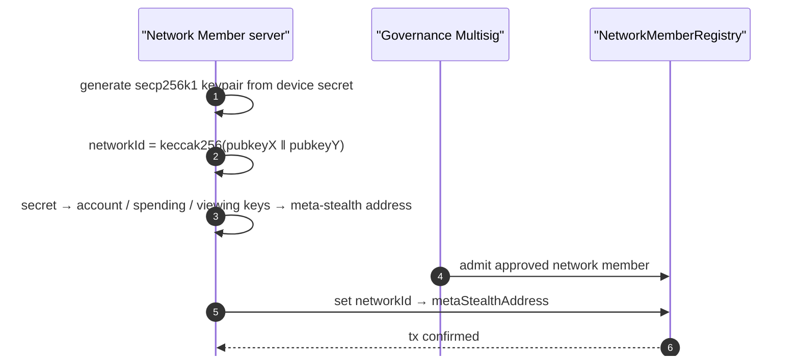
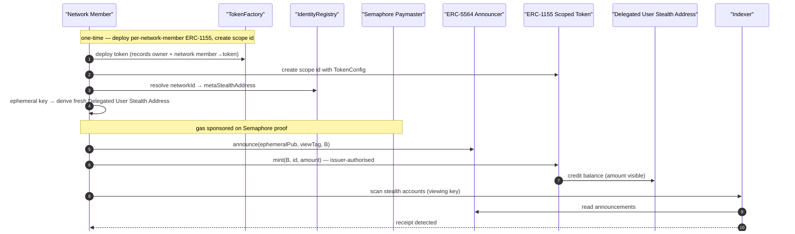
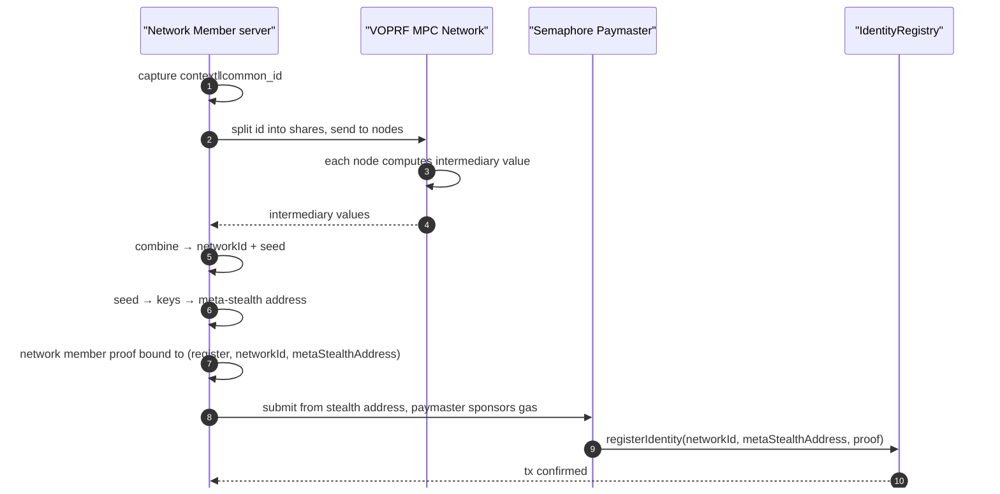
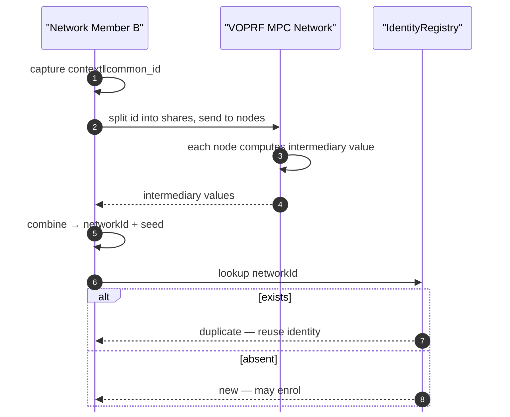
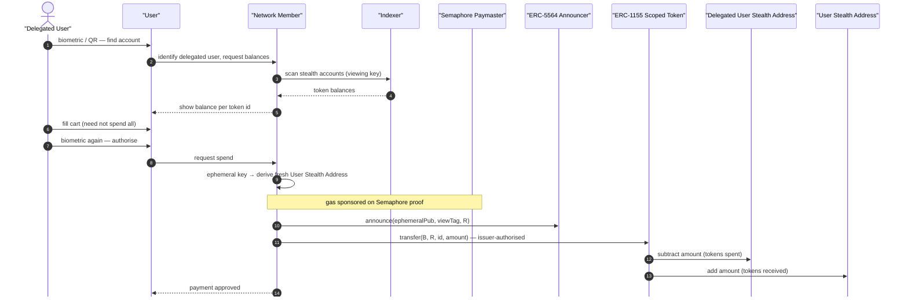
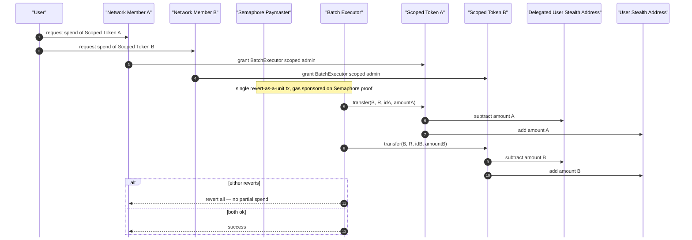
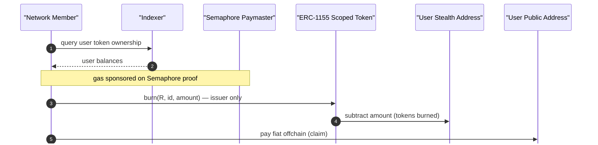
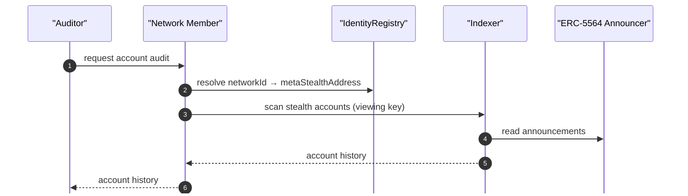
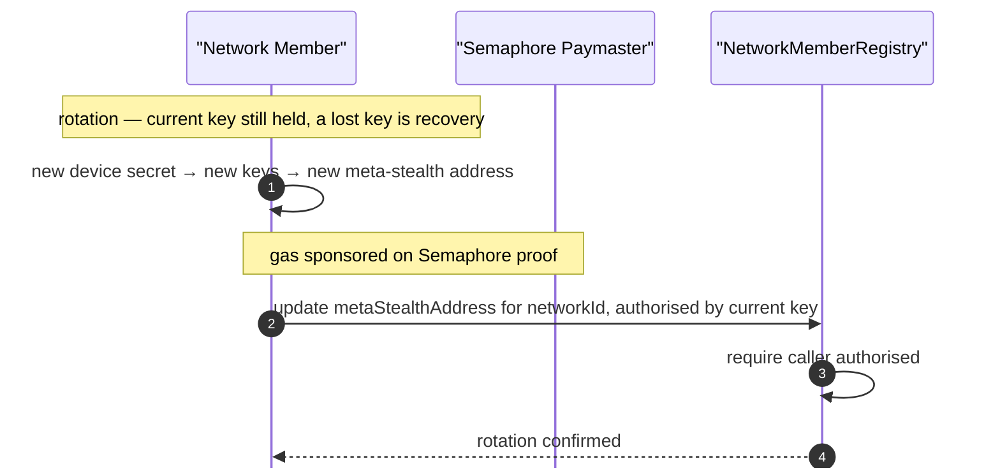
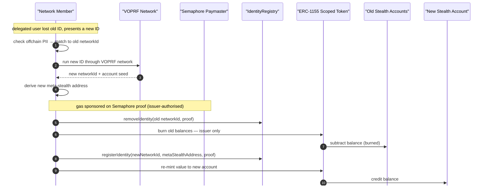

# Stealth Address Specification

## Executive Summary

The following document outlines a specification for the stealth address components of the coordination network. Stealth addresses are a well-known and battle-tested construction that can be used to break a payment link between a sender and a receiver. Transfer amounts, balances, and addresses will be visible onchain, however it will not be possible to link individual transactions with any identity on the public chain. We use stealth address accounts to provide privacy for network members, delegated users, and users.

## Conventions

The key words MUST, MUST NOT, SHOULD, SHOULD NOT, and MAY in this document are to be interpreted as described in RFC 2119 and RFC 8174, and only when shown in capitals.

## Problem Statement

Network members serving the same user base must coordinate so that an individual delegated user cannot receive the same entitlement twice across network members. Comparable systems do this today on a permissioned chain, which gives funders no public traceability and ties the design to a single operator.

We can break the higher level problem down into several problem statements:

1. How can multiple network members settle value to a shared network participant in a way that is accurate, attributable, and privacy-preserving, while operating on a common ledger.
2. Each network member records its own value owed but requires a shared mechanism to combine and settle those amounts correctly to a single recipient without duplication or double payment.
3. Settlement must support inter-network-member coordination without requiring a central intermediary.
4. How can a third party manage delegated user accounts when the delegated user does not own a device.
5. How can you check deduplication of entitlements to a single account.

### Constraints

- **Public chain**: every transaction and account is public.
- **No onchain PII:** no name, identifier, or biometric (personally identifiable information) may touch the chain, including hashed PII.
- **Limited cooperation between network members**: network members will not share delegated user personal data with one another. Identity resolution and deduplication must work without it.
- **Delegated users do not have a device**: the network member holds delegated user keys and authorises transfers.

## Approach

We use stealth addresses for entity accounts. Value is issued from one **ERC-1155 contract per network member**, where each scope (category × currency × validity × programme) is a **token id** inside that contract. ERC-5564/6538 stealth addresses give each load a fresh recipient account.

**One stealth account holds exactly one load** — one token id, one network member, one credit event. An account never accumulates a second id, so a delegated user's distinct loads (e.g. two different token ids) live in separate accounts.

The delegated user identity — a `networkId` and an account seed — is supplied by the VOPRF (verifiable oblivious pseudo-random function) network and is registered in the onchain `IdentityRegistry` as `networkId → metaStealthAddress`. The VOPRF network is out of scope of this document and has a separate specification.

The issuing network member authorises every transfer (issuer-authorised, with the token admin account signing the authorisation) and is the only party that can burn its tokens. Gas is handled by a shared Semaphore paymaster (see Gas sponsorship). Accounts, transactions, and balances are publicly viewable. Privacy comes from always using fresh stealth accounts for network member value load, distribution to delegated users, and settlement to users.

### Strategy

We hide who each stealth account belongs to by breaking the link between an identity (represented as a meta-stealth address) and the onchain activity of its individual stealth accounts. Balances and amounts stay publicly viewable.

**Stealth addresses**
Entities have a meta-stealth address and use fresh stealth accounts for most if not all interactions — an important detail: a fresh account per load. The link is underivable onchain without the viewing key, so multiple distributions to the same delegated user cannot be linked to any meta-stealth address.

**Identity input**
The VOPRF network supplies a `networkId` and account seed, enabling account generation, deduplication, and mapping without shared PII. The implementation details are out of scope (separate specification).

**ERC-1155 scoped token**
One contract per network member, each scope a token id. The issuing network member alone authorises transfers and burns of its tokens. The accounting follows established scoped-token designs, adapted to ERC-1155.

**Other components**
The full architecture also includes registries (`IdentityRegistry`, `NetworkMemberRegistry`) and a `TokenFactory` for network members, plus an optional `BatchExecutor` for atomic multi-network-member redemption.

An onchain observer sees tokens moving between unlinkable accounts, never which delegated user or user. The issuing **network member is visible** — the per-network-member contract and network-member-scoped token ids identify it — and this is intended, satisfying funder traceability and the attribution requirement. The Phase 1 announcement itself is unattributed: its `caller` is a one-time, paymaster-sponsored sender, not the network member, unless a member opts into direct delivery.

### Why This Approach

Stealth addresses are established and relatively simple. Approaches with stronger privacy guarantees exist, but are often less battle-tested, more expensive, and more complex:

**Shielded pool**
The strongest privacy, hiding transfers, balances, senders, recipients, and asset type. Onchain observers only see commitments and nullifiers. Additional infra such as a prover and chain scanner are needed. The complexity and transfer cost make it untenable here.

**Confidential tokens**
Hide balances and transfer amounts via homomorphic encryption (FHE or HE). Adds complexity and cost. The cheaper FHE-coprocessor variant relies on external networks.

### Tools & Primitives

- **ERC-1155**: one controlled, per-network-member multi-token contract. Each scope is a token id, with a `TokenConfig` holding category, currency, validity window, metadata, and an `active` flag. The network member authorises transfers and is the only burner.
- **ERC-5564**: stealth-address standard.
- **ERC-6538**: meta-address registry — where stealth meta-addresses are stored onchain.
- **ERC-4337**: account abstraction standard.
- **ERC-7702**: Set code in EOA accounts. Network member and user stealth accounts are 7702 accounts, so they can be sponsored.
- **Semaphore**: prove statements in an anonymous group. Used for anonymous registry writes and gas sponsorship.
- **Stealth accounts**: externally owned accounts (EOAs), freshly derived per load.
- **The chain**: Ethereum mainnet.

## Protocol Design

This section specifies the actors, the identity and keys they derive, the data each object carries, the onchain state, and the message order for every flow.

Delegated users are non-self-sovereign — the network member acts on the delegated user's behalf, and the VOPRF network appears only as an external participant returning a `networkId` and account seed.

### Participants & Components

- **Network Member**: optionally takes part in the VOPRF network, registers users, issues and controls its own ERC-1155 scoped token, custodies delegated user keys, authorises every transfer (issuer-authorised, signed with its token admin account), reverts incorrect transfers for tokens it controls, holds the viewing key and runs its own indexer, which only its own backend can query, and is the only party that can burn its token.
- **Delegated User**: holds no device and no keys. Managing network members act on their behalf. Identified onchain by `networkId → metaStealthAddress`.
- **User**: receives scoped tokens at fresh stealth accounts and later claims fiat. Has a device and app, can hold its own keys.
- **Network Member server**: the network member's offchain service. Submits user registrations. Writes its own `NetworkMemberRegistry` record. Acts for delegated users: handles transfers, burns and reversals, recovery.
- **Semaphore paymaster**: onchain ERC-4337 paymaster sponsoring transactions on a zero-knowledge Semaphore group-membership proof.

The paymaster group used by the self-sovereign user testbed contains sponsorship commitments derived with `coordination-network/identity/v1/paymaster`. These are separate from the credential holder identity. The credential's `holderKeyCommitment` must not be added to any public paymaster group. The group administrator sees each sponsorship commitment when adding it, and the on-chain `MemberAdded` event publishes that commitment.

Existing groups that published holder commitments retain that historical disclosure. They need a fresh group and new sponsorship enrolments; changing the derivation does not erase old events.

- **Indexer**: scans announcements with a viewing key to surface an entity's stealth accounts and balances.
- **VOPRF network**: handles ID generation, ID resolution, and de-duplication.
- **Governance multisig**: a quorum of the participating network members. Admits/removes approved network members and is the recovery-time re-keying authority.
- **Auditor**: requests an account audit from a network member. Holds no keys or account.

### Identity & Key Derivation

Every entity is identified onchain by a `networkId` and reached through a stealth meta-address. How the `networkId` arises differs by entity. The meta-address and the mapping that resolves it are the same for all.

A network member or user derives an ECDSA secp256k1 **account key** from its device secret. A network member's id is `keccak256(pubkeyX ‖ pubkeyY)` over the 64-byte uncompressed public key, so its low 160 bits are that key's Ethereum address. A member passes its key to the `NetworkMemberRegistry`, which checks it is a secp256k1 point and derives the id and the auth address from it, so a member's id is bound on chain to its key. A user's `networkId` is `keccak256(DOMAIN_NETWORK_ID ‖ pubkeyX ‖ pubkeyY)`, which carries no address. The same device secret regenerates the same `networkId`, so re-registration is caught by a mapping read.

A delegated user has no account key. The VOPRF network returns their `networkId` and account seed. An approved network member submits the registration for delegated users.

An entity's keys derive from its device secret (a delegated user's from the VOPRF seed), with domain separation so a leak of one does not reveal the others:

- **account key** (secp256k1, network members and users) — its public key sets the `networkId`. It signs one fixed, domain-separated message. The `keccak256` of that signature's `r` and `s` give the spending key and the viewing key. It MUST stay on the device.
- **spending key** (secp256k1) — recovers a stealth account's private key.
- **viewing key** (secp256k1) — detects which stealth accounts belong to the entity. Active — the indexer scans with it.
- **token admin account** (secp256k1, network members only) — holds the admin role on the member's ERC-1155 and authorises every mint, transfer, and burn. Managed by AccessControl and kept separate from the account key.

Only the device secret is persisted (keystore-gated). The account, spending, viewing, and per-load stealth private keys are re-derived on demand, so the persisted-secret set does not grow as stealth accounts accumulate.

The spending and viewing public keys form the stealth meta-address. Registration writes `networkId → metaStealthAddress`. Users and delegated users go to the `IdentityRegistry`, on an approved network member's Semaphore proof. Network members go to the `NetworkMemberRegistry`, on their own auth key or governance. Anyone can read either to resolve a `networkId`. Only the holder of an account's viewing key can link a meta-address to its derived stealth accounts.

Stealth accounts are EOAs. Each load derives a fresh address from the recipient's meta-address. The network member moves balances by admin force-transfer, which needs only the stealth address (found via the viewing key), never the stealth account's private key.

### Data Structures

- **Stealth meta-address**: the long-lived public handle senders derive fresh accounts from. Onchain it is the 66-byte concatenation of the two SEC1-compressed public keys (spending then viewing). The `st:eth:0x…` form is the offchain display encoding only (see Stealth-address scheme).
- **Keys**: account, spending, viewing (see Identity & Key Derivation), plus a token admin account for members. The viewing and the spending keys are used for stealth address actions, the account key signs only the derivation message.
- **Ephemeral public key**: fresh per load. Published so the recipient can recompute the shared secret.
- **View tag**: one byte of the hashed shared secret. Lets the indexer skip roughly 255/256 of announcements before doing full work.
- **Announcement**: the ERC-5564 event: `schemeId`, `stealthAddress`, `caller`, `ephemeralPubKey`, `metadata` (view tag in the first byte).
- **Stealth account**: the per-load EOA, `P_stealth = P_spend + h(s)·G`. Holds the scoped-token balance. One account = one load, and the account address is the load's identity (the match key for reversal).
- **networkId**: a `bytes32` identifier for an entity. For members it is `keccak256(pubkeyX ‖ pubkeyY)` of the account key, so its low 160 bits are that key's Ethereum address. For users it is `keccak256(DOMAIN_NETWORK_ID ‖ pubkeyX ‖ pubkeyY)`, which carries no address. For delegated users the VOPRF network returns it.
- **TokenConfig**: the per-id struct holding a scope's category, currency, `validFrom`, `validUntil`, metadata, and `active` flag.

### Onchain State

- **ERC-5564 Announcer** (singleton): emits `Announcement` events. The chain's record of new stealth payments, scanned by indexers.
- **IdentityRegistry**: public single-value `mapping(bytes32 networkId => bytes metaStealthAddress)` for **users and delegated users**, keyed by `networkId` so a dedup check is one read. Register, update and remove each need an approved network member's anonymous Semaphore proof bound to that write. Registration rejects a `networkId` that already has an entry, so first write wins.
- **ERC-1155 Scoped Token**: one per network member, controlled, with per-id scope and validity in `TokenConfig`. Holds balances per `(account, id)`. Only the network member's token admin account can authorise a transfer or burn.
- **NetworkMemberRegistry**: holds the **member** identity mapping plus two governance fields. Following the full Phase 1 spec's registry split, a member's `networkId → metaStealthAddress` lives here, not in the IdentityRegistry. The member's current key can rotate that mapping, or the governance multisig can for recovery, so a member keeps a stable `networkId` while the meta-address changes. Governance fields: the approved-network-member set (written by the governance multisig) and an append-only `network member → token address` index (written only by `TokenFactory` at deploy, never edited). The token's own immutable `owner` stays the authority on ownership. The index is the onchain lookup, written atomically with the deploy so the two cannot diverge.
- **TokenFactory**: deploys a per-network-member ERC-1155, stamps the immutable `owner`, and in the same transaction appends `network member → token address` to the `NetworkMemberRegistry` index.
- **BatchExecutor** (optional): executes a multi-network-member redemption as one atomic transaction (exception path).
- **Semaphore paymaster**: ERC-4337 paymaster sponsoring UserOps on a Semaphore membership proof (see Gas sponsorship).

The Network Member server and indexer are offchain services. The Semaphore paymaster is onchain.

### Gas sponsorship

One shared ERC-4337 **Semaphore paymaster** sponsors transactions across the system, registration included. It requires ERC-7702 accounts, since a plain EOA cannot be sponsored. A network member self-pays for its own `NetworkMemberRegistry` record, which is attributable by design.

Sponsored sends leave a visible EIP-7702 delegation on stealth accounts. Phase 1 accepts this difference; the spending design will be revisited in [Phase 2](01-self-sovereign-user.md#open-questions). Transaction links and amounts remain visible.

Validation is done against a Semaphore proof. Its message and scope are both the sender address. Scoping to the account is a privacy measure: the nullifier is `hash(scope, secret)`, so **a stable scope would link every stealth account to one Semaphore identity**. No nullifier is checked, so one proof sponsors its account indefinitely — this is an amortisation feature, since a membership proof costs over 200k gas which is cost prohibitive for high volumes on mainnet.

`preVerificationGas` is self-declared and never refunded, callers can inflate this value and drain the paymaster since it is permissionless for any Semaphore group member. Production paymasters are **NOT** permissionless so do not have to worry about this grieving attack. `MAX_COST_PER_OP` caps individual operations.

**Shared-funds risk**: network members fund one deposit and nothing onchain ties spend back to the funder, so one network member can drain the deposit and deny sponsorship to the rest. `MAX_COST_PER_OP` bounds each operation. [`GasLimitedPaymaster`](https://github.com/KannuSingh/prepaid-gas-paymaster-contracts/blob/master/contracts/implementation/GasLimitedPaymaster.sol) handles it: network members fund the shared paymaster and create anonymous "gas credits". A user proves with Semaphore that they own a valid credit without revealing which network member funded it. The paymaster sees only a nullifier for that credit, which it uses to track spend and stop overspending.

### Flows

Each flow gives the message order and state changes, followed by its sequence diagram. The network member server submits user registrations from a paymaster-sponsored stealth address, and self-pays for its own `NetworkMemberRegistry` registration.

#### Network member: ID generation & address mapping

1. The network member, pre-approved via governance, generates an ECDSA secp256k1 account key from its device secret and sets `networkId = keccak256(pubkeyX ‖ pubkeyY)`.
2. It derives the account, spending, and viewing keys from the secret and a stealth meta-address from the spending and viewing keys. Its token admin account is granted the admin role on its ERC-1155 separately.
3. The governance multisig has admitted it to the `NetworkMemberRegistry` approved-network-member set. Its server self-submits (self-paying gas) to write `networkId → metaStealthAddress` into the `NetworkMemberRegistry` — member mappings live there, not in the IdentityRegistry.

#### Network member: token deployment & issuance

1. The network member deploys its per-network-member ERC-1155 via the `TokenFactory`, which stamps `owner` and records `network member → token address`.
2. It creates a scope as a token id with a `TokenConfig` (category, currency, validity, metadata).
3. To issue, it resolves the delegated user `networkId → metaStealthAddress` and derives a fresh delegated user stealth address with an ephemeral key.
4. It announces `(ephemeralPub, viewTag, B)` and mints `(B, id, amount)`, issuer-authorised, with gas sponsored by the Semaphore paymaster.
5. The network member's indexer scans announcements with the viewing key and detects the receipt.

#### Delegated user: ID generation & de-duplication

ID generation:

1. The network member captures `context‖common_id` (the context prefix stops identifiers colliding across jurisdictions).
2. It sends the identifier to the VOPRF network and receives back a `networkId` and account seed (network internals out of scope).
3. From the seed it derives the keys and stealth meta-address. It generates a network member proof bound to that registration and submits `networkId → metaStealthAddress` from a stealth address.

De-duplication:

1. A second network member runs the same identifier through the VOPRF network and obtains the same `networkId`.
2. It looks the `networkId` up in the `IdentityRegistry`. Present means a duplicate (reuse the identity). Absent means new (may enrol).

#### Transfer: delegated user → user

1. At the till the delegated user authenticates. The user asks the managing network member to identify the account and return balances.
2. The network member's indexer scans with the viewing key and returns balances. The user shows them.
3. The delegated user fills a cart (need not spend all) and re-authenticates to authorise.
4. The network member derives a fresh user stealth address with an ephemeral key.
5. It announces `(ephemeralPub, viewTag, R)` and executes the issuer-authorised transfer B → R for the relevant id, gas sponsored by the Semaphore paymaster. Both balances update onchain.
6. The network member confirms payment to the user.

#### Atomic multi-network-member redemption

A single till basket may draw on tokens from more than one network member (Scoped Token A from Network Member A, Scoped Token B from Network Member B). Because each network member's token is gated by that network member's own admin role, an atomic cross-network-member spend needs a shared executor that holds a delegated admin role on each participating token.

1. The user requests a spend of each network member's token.
2. Each issuing network member grants the `BatchExecutor` a (scoped) admin role on its own token.
3. The executor transfers B → R for both tokens in one transaction. If either leg reverts, the whole transaction reverts — no partial spend.

> The exact executor pattern is unresolved — a scoped, time-limited admin grant per redemption, a role-scoped smart account, or a `multicall` on each token. A standing broad admin grant to the executor is a larger blast radius and is rejected. The grant must be scoped. Can specify later.

#### User: offramp / settlement

User onboarding (ID generation, de-duplication, mapping) follows the device-secret pattern in Identity & Key Derivation and is not repeated here.

1. The network member queries the user's token ownership via the indexer.
2. It burns the user's token balance (only the network member can do this), gas sponsored by the Semaphore paymaster.
3. The network member pays the user fiat offchain.

The burn is **burn-once** — a zeroed balance can't be re-burned, so the same tokens can't be claimed for settlement twice onchain. Fiat **settle-once** is an offchain reconciliation keyed on that burn, not an onchain guarantee.

#### Auditor view

1. An auditor requests an account audit from the network member.
2. The network member resolves the delegated user `networkId → metaStealthAddress`, scans the stealth accounts with the viewing key via the indexer, and reconstructs the history.
3. It returns the account history to the auditor.

> Proposal: the above is simple but places work on the network members. A scoped-viewing-key could be another solution (auditor gets a time- and account-scoped key and runs its own indexer). Needs more research.

#### Network member key rotation

The network member's stable identity is its `networkId`. Tokens and factories store their owning network member's `networkId` and resolve the current authorising key from the `NetworkMemberRegistry`, so rotation updates a single value — the meta-stealth address the `networkId` maps to (member mappings live in the NetworkMemberRegistry, which the member's key can rotate).

A new device secret derives new keys and meta-stealth address. The `networkId` is unchanged. The current key authorises the rotation. A lost key cannot sign, so that case is recovery, authorised by the governance multisig (see Account recovery).

#### Account recovery

##### 1. Network member

Identical writes to key rotation, but authorised by the governance multisig (the lost key cannot sign): it updates the `NetworkMemberRegistry` value for the network member's `networkId`. If a network member stores a seed backup phrase, it can recover the account that way without an onchain change.

##### 2. Delegated user

The delegated user's `networkId` derives from a common identifier — usually a government ID (e.g. a national ID or tax number) that rarely changes and is at low risk of loss, but cannot be re-derived if lost. The edge-case recovery flow:

1. The delegated user loses their ID.
2. They obtain a new one and present it to the network member.
3. The network member checks its offchain PII → onchain records for a match.
4. Given a match, the network member derives a new `networkId`, account seed, and meta-stealth address from the new ID via the VOPRF network.
5. It clears the old `networkId` with `removeIdentity`, so resolution comes back empty, and as issuer burns the stranded balances on the old stealth accounts (found from its own load records — no old keys needed).
6. It registers the new `networkId → metaStealthAddress`.
7. It reloads the value, re-minting to a fresh account under the new meta-stealth address.

Other network members may still hold the old `networkId`. They update their locally stored ID when they notice it changed.

##### 3. User

The user can use a seed backup to restore the same device secret and re-derive the same accounts, with no onchain change, then rotate to a fresh key for added security.

Without one, they re-onboard to a new device secret and `networkId`, re-verifying through the same KYC process. The network member matches it to the old record, burns the balance on the old account, and re-mints to a fresh account under the new mapping key and value.

> The network member keeps a stable networkId after recovery — a governance multisig can rotate it to a new key, and nothing requires the networkId to match a re-derivable secret (network members are vetted by governance, not deduplicated).

> The delegated user's networkId is based on what the VOPRF network derives from their current identifier. If the identifier changes, the networkId must change with it.

> The user is self-sovereign — only its own lost key could authorise a recovery, so identity is self-derived again and registered by the existing KYC process.

**Delegated user recovery:**

## Cryptographic Details

The only cryptography in scope is the stealth-address scheme. Deriving the delegated user `networkId` and account seed is the VOPRF network's job and is specified separately.

### Primitives

The stealth-address scheme follows ERC-5564 scheme 1.

- **Curve**: secp256k1, the curve Ethereum already uses for accounts. Stealth accounts are secp256k1 EOAs.
- **Hash**: keccak256, for the shared-secret hash and the view tag.
- **Keys**: each self-sovereign entity holds an account, spending, and viewing key, and members hold a token admin account too. The account key sets the `networkId` and signs the derivation message the spending and viewing keys come from.

### Meta-address derivation

The account key derives the meta-address off-chain from a single signature. The contract never derives, parses, or compresses it.

1. The account key signs a fixed, domain-separated message, giving signature `(v, r, s)`.
2. Take the two 32-byte halves `r` and `s` and drop `v`.
3. `spendingPrivateKey = keccak256(r)`, `viewingPrivateKey = keccak256(s)`.
4. Derive each public key by secp256k1 scalar-multiplication of the base point.

This is the fluidkey `generateKeysFromSignature` derivation (keccak256 — Umbra's variant uses sha256, do not conflate).

The two public keys are then encoded ERC-6538 scheme 1:

5. SEC1-compress each: `prefix = 0x02` if `y` is even else `0x03`, then `compressed = prefix ‖ bytes32(x)` = 33 bytes.
6. `metaStealthAddress = compressedSpending ‖ compressedViewing` = 66 bytes. No `st:eth:` prefix onchain — that form is display only.

### Registration

- `registerIdentity(bytes32 networkId, bytes metaStealthAddress, NetworkMemberProof proof)`
- `updateIdentity(bytes32 networkId, bytes newMetaStealthAddress, NetworkMemberProof proof)`
- `removeIdentity(bytes32 networkId, NetworkMemberProof proof)`

`NetworkMemberProof` is a Semaphore proof without its message field. The caller never supplies the message. The contract derives it from the call's own arguments:

1. Revert unless `metaStealthAddress` is exactly 66 bytes (removals carry none). Checked before the proof, so a length mistake does not read as a bad proof.
2. `message = uint256(keccak256(abi.encodePacked(UPDATE_DOMAIN_SEPARATOR, block.chainid, action, networkId, metaStealthAddress)))`, where `action` is register, update or remove and `UPDATE_DOMAIN_SEPARATOR = keccak256(abi.encode(UPDATE_MESSAGE_DOMAIN, address(this)))` is hashed once at deployment.
3. Hand the proof to Semaphore with that message, which verifies membership of the approved-network member group against a live root and burns the nullifier.
4. Register reverts `AlreadyRegistered` if an entry exists. Update and remove revert `NotRegistered` if none does.
5. Store or clear the mapping and emit `IdentityRegistered`, `IdentityUpdated` or `IdentityRemoved`.

Resolution is the public getter `identity(networkId)`, empty for an unregistered id.

A proof repurposed for another payload carries the wrong message and fails. The domain separator and chain id handle replay protection. The meta-address is encoded last as the only variable-length field. Any approved network member can write any entry.

### Stealth Address Scheme (ERC-5564 / ERC-6538)

A stealth meta-address is two public keys, a spending key `P_spend` and a viewing key `P_view` (encoded as above).

The sender derives a fresh stealth account per load:

1. Generate a random ephemeral keypair `(p_eph, P_eph)`.
2. Compute the shared secret `s = p_eph · P_view`.
3. Hash it, `s_h = keccak256(s)`. The first byte is the view tag.
4. Compute the stealth public key `P_stealth = P_spend + s_h · G` and take its address.
5. Publish the announcement `(schemeId, stealthAddress, P_eph, viewTag)` via the ERC-5564 Announcer.

The recipient (the managing network member, holding the viewing key) scans:

1. For each announcement, compute `s = p_view · P_eph` and `s_h = keccak256(s)`.
2. Compare the view tag. A mismatch skips the announcement and filters roughly 255/256 of them.
3. On a match, recompute `P_stealth` and check it equals the announced address.
4. Recover the stealth private key `p_stealth = p_spend + s_h` to spend — needed only for the future self-sovereign path, not for the force-transfers used here.

The mapping value is the 66-byte compressed meta-address (see Meta-address derivation). This spec keys by `networkId` rather than by registrant address (the standard ERC-6538 key) so de-duplication can look identity up directly (see Onchain State).

## Requirements

The requirements this specification is designed against.

### Functional (MUST)

- Issue value from one controlled per-network-member ERC-1155, each scope a token id.
- Move value via stealth-addresses, a fresh stealth account per load, one load per account.
- Segregate value per network member. Only the issuer can authorise transfers or burns of its own tokens.
- Redeem across several network members' tokens atomically.
- Reverse an incorrect transfer by burning the whole account balance (the account is the load) then re-minting to a fresh account, issuer only.
- Issue expiring, scoped tokens, with scope held in `TokenConfig`.
- Deduplicate a delegated user by `networkId` presence check against the onchain registry.
- Resolve a delegated user's account from a `networkId` without personal data onchain.
- Reconstruct full account history per delegated user for audit.

### Privacy (MUST)

- No personal data onchain, including hashed data.
- No observer can link a wallet to a delegated user or to their history. Recipient unlinkability comes from a fresh account per load.
- Disclosure model: public observers see aggregates, a network member sees full history for its own delegated users, auditors get scoped access.
- Cross-network-member deduplication discloses no personal data.
- The issuing **network member is public** (per-network-member contract, network-member-scoped ids) — intended, for funder traceability and attribution. Not a leak.

### Security (MUST)

- A unit of value cannot be redeemed or settled twice across the network (burn-once onchain, fiat settle-once via offchain reconciliation).
- Only vetted, admitted network members can issue valid tokens.
- Compromise of one network member is contained, not network-wide.
- Spend authorisation is bound to its context to stop replay.
- Network member key custody is strong. Key compromise is a high-severity failure. Rotation is specified under Flows (Network member key rotation).
- A recovery path exists for lost account access. Specified under Flows (Account recovery).

### Operational (MUST)

- Zero gas charged to the user — delegated users and users never submit transactions. The Semaphore paymaster sponsors transactions. A network member self-pays for its own `NetworkMemberRegistry` record.
- Delegated users have no device. The network member does all custody, signing, and scanning on their behalf.
- Match the throughput and scale of existing systems.
- Settlement completes within the existing reconciliation window.

### Out of Scope

- The self-sovereign delegated user flow. Delegated users are network-member-managed here, a real-world requirement.
- Hiding amount and asset type onchain. Regular ERC-1155 transfers leave this visible.
- The VOPRF network — covered by a separate specification.
- Real stablecoin settlement — current scope mocks this part of the flow.
- Hiding the issuing network member. Public attribution is intended. Hiding it would need a shared contract plus a ZK authority proof, and fights the funder-traceability requirement.

## Security & Privacy Model

What the design protects against, what it guarantees, the attacks considered, and what it doesn't protect against.

### Threat Model

| Adversary                                       | Capabilities                                                                                                                                                                                                                                                                                                                                                     | Mitigations                                                                                                                                                                                                                                                                                                                       |
| ----------------------------------------------- | ---------------------------------------------------------------------------------------------------------------------------------------------------------------------------------------------------------------------------------------------------------------------------------------------------------------------------------------------------------------- | --------------------------------------------------------------------------------------------------------------------------------------------------------------------------------------------------------------------------------------------------------------------------------------------------------------------------------- |
| **Public chain observer**                       | Reads every transaction, balance, and account. Sees amount, token category, and the **issuing network member** (per-network-member contract + network-member-scoped id). Reads `networkId` and meta-address in the `IdentityRegistry` and all ERC-5564 announcements. MAY try to cluster stealth accounts, including accounts spent together in one transaction. | Fresh stealth account per load, underivable without the viewing key, so independent loads do not cluster. Accounts co-spent in one transaction are an exception that links them. No PII onchain. Visibility of unlinked amounts, categories, and the issuing network member is accepted (network member attribution is intended). |
| **Non-managing network member**                 | Same chain reads as a public observer. Holds viewing keys for its own delegated users only. MAY derive a `networkId` through the VOPRF network and look it up. Being in the approved-network member group, it MAY also update or remove any `IdentityRegistry` entry.                                                                                            | Cannot derive another network member's stealth accounts without that network member's viewing key. Learns a delegated user is shared only by independently deriving the same `networkId` — which means it has already identified that person. Nothing gates the registry write beyond group membership (see Limitations).         |
| **User**                                        | Sees the chain and its own received funds and stealth accounts. Sees if multiple stealth accounts make a single transaction, so can cluster them as one delegated user. MAY try to tie a payment to a delegated user.                                                                                                                                            | Always receives value at fresh stealth accounts. No delegated user PII onchain. Delegated users spend from fresh stealth accounts, not linked to a `networkId` mapping. Separate payments in the normal case.                                                                                                                     |
| **Auditor**                                     | Receives the account history a network member discloses. MAY try to read beyond the audit scope or correlate delegated users across audits.                                                                                                                                                                                                                      | Holds no keys, so cannot scan or derive accounts itself. The network member minimises disclosure to the audited delegated users, window, and fields. History can be returned under a per-audit pseudonym, not the `networkId`.                                                                                                    |
| **Semaphore paymaster**                         | Sees sponsored UserOps and sponsors gas on a ZK membership proof. Shared component. MAY attempt timing correlation.                                                                                                                                                                                                                                              | Cannot forge a transfer — issuer authorisation is required onchain. Does not learn which network member funded a given user. A per-note allowance (`GasLimitedPaymaster`) caps each network member's spend, stopping free-riding on shared funds.                                                                                 |
| **Compromised managing-network-member backend** | Holds the delegated user keys and viewing key. Can derive, spend, and deanonymise that network member's own delegated users.                                                                                                                                                                                                                                     | A network member is trusted for its own delegated users. That trust does not extend to other network members' delegated users (unless those delegated users also registered there). Tokens are scoped to a single network member.                                                                                                 |
| **Network observer (IP/timing)**                | Sees IP, timing, and size of network member server / paymaster submissions and indexer reads.                                                                                                                                                                                                                                                                    | Out of scope.                                                                                                                                                                                                                                                                                                                     |

VOPRF threat model sits in the VOPRF network's own specification.

### Guarantees

| Property                                          | Description                                                                                                                                                                                                                                   |
| ------------------------------------------------- | --------------------------------------------------------------------------------------------------------------------------------------------------------------------------------------------------------------------------------------------- |
| **Recipient unlinkability**                       | A fresh stealth account per load, underivable onchain without the viewing key. Loads to the same delegated user do not link in the base case (the edge case is co-spending from multiple accounts, covered in Limitations).                   |
| **No identity onchain**                           | Only the `networkId` and meta-address are public, no personal data.                                                                                                                                                                           |
| **Identity not controlled by one network member** | The `networkId` comes from the VOPRF network, not a single network member.                                                                                                                                                                    |
| **Deduplication without data sharing**            | Network members check the same `networkId` against the onchain registry without disclosing personal data.                                                                                                                                     |
| **Per-network-member value segregation**          | Only the issuing network member can authorise a transfer or burn of its own token.                                                                                                                                                            |
| **No double-redemption**                          | Tokens settle burn-once onchain (a zeroed balance can't be re-burned). Fiat settle-once is offchain reconciliation keyed on the burn. Transfers can be reversed by the controlling network member. Multi-network-member redemption is atomic. |

### Limitations

| Limitation                                                           | Impact                                                                                                                                                                                                              | Mitigation / future work                                                                                                                                                                                                    |
| -------------------------------------------------------------------- | ------------------------------------------------------------------------------------------------------------------------------------------------------------------------------------------------------------------- | --------------------------------------------------------------------------------------------------------------------------------------------------------------------------------------------------------------------------- |
| **Amount and token category visible**                                | The ERC-1155 contract and transfer txs expose the value and category of every transfer.                                                                                                                             | Accepted. Stealth addresses and fresh accounts per load and settlement mitigate the linkage.                                                                                                                                |
| **Shared paymaster anonymity set**                                   | The paymaster is a shared component whose privacy relies on a non-trivial anonymity set, weak at bootstrap with 1–2 network members.                                                                                | Grow the anonymity set (combined users+members group).                                                                                                                                                                      |
| **Gas grieving on the shared deposit**                               | Nothing onchain ties spend back to the funder, so one network member can drain the deposit and deny sponsorship to the rest. A caller can also inflate self-declared `preVerificationGas`, which is never refunded. | `MAX_COST_PER_OP` bounds each operation. [`GasLimitedPaymaster`](https://github.com/KannuSingh/prepaid-gas-paymaster-contracts/blob/master/contracts/implementation/GasLimitedPaymaster.sol) caps per-network-member spend. |
| **`networkId` is a stable pseudonym**                                | Persists onchain per delegated user, and the meta-stealth address is public. A viewing-key holder (the managing network member) links `networkId` to activity.                                                      | No future work outlined.                                                                                                                                                                                                    |
| **Any approved member can write any registry entry**                 | Nothing records which member enrolled which user, so one member can update or remove any entry, including users it never onboarded. Random proof scopes leave no trace of which member did it.                      | Trust in the admitted network member set, which governance controls.                                                                                                                                                        |
| **Network member custodies delegated user keys**                     | No privacy against a compromised managing-network-member backend.                                                                                                                                                   | Network members are trusted and should follow security best practice. Future work is the self-sovereign delegated user flow.                                                                                                |
| **Co-receiving in one transaction links recipients**                 | A batch that transfers to several fresh stealth accounts reveals that they were funded together by one payer. This may expose a cohort or programme round even if identities stay hidden.                           | Send one recipient per transaction in the testbed, with each transfer and announcement together. The common payer and timing can still link deliveries; padding batches is another option when transaction cost matters.    |
| **Co-spending from multiple accounts in one transaction links them** | Paying from several stealth accounts in one tx reveals a link. The user sees the source accounts and an observer can cluster them. Identity stays hidden.                                                           | No hard fix except changing architecture from stealth addresses. Shielded pool and confidential tokens rejected here.                                                                                                       |

## Open Questions

- **Scoped viewing key for audit**: whether an auditor can self-serve audits with a time- and account-scoped viewing key instead of network-member-mediated disclosure. Needs research.
- **Atomic multi-network-member executor**: the exact scoped-admin-grant pattern that lets the `BatchExecutor` move two network members' tokens atomically without a standing broad grant.
- **Delegated user re-identification after ID loss**: how the network member proves a person presenting a new ID holds a rotated identity — biometric or other — pending guidance from integrating network members.

## Terminology

| Term                      | Definition                                                                                                                                                                                                                                                                                                                                                               |
| ------------------------- | ------------------------------------------------------------------------------------------------------------------------------------------------------------------------------------------------------------------------------------------------------------------------------------------------------------------------------------------------------------------------ |
| **Stealth address**       | A fresh, single-use account a sender derives for a recipient from the recipient's published meta-address, unlinkable to it without the viewing key.                                                                                                                                                                                                                      |
| **Stealth meta-address**  | The recipient's long-lived public handle. Onchain it is the 66-byte concatenation of the two SEC1-compressed public keys. `st:eth:0x…` is the offchain display form (ERC-5564 / ERC-6538).                                                                                                                                                                               |
| **Account key**           | secp256k1 key whose public key sets the `networkId`. Signs one fixed, domain-separated message. `keccak256` of each half of that signature gives the spending and viewing keys, so the signature never leaves the device. Network members and users only.                                                                                                                |
| **Spending key**          | secp256k1 key that would authorise spends from a stealth account and derive its private key.                                                                                                                                                                                                                                                                             |
| **Viewing key**           | secp256k1 key that detects which stealth accounts and payments belong to a recipient, without spend power. Active — the indexer uses it.                                                                                                                                                                                                                                 |
| **Token admin account**   | The address granted the admin role on a network member's ERC-1155, authorising every mint, transfer, and burn. Network members only, managed by AccessControl, kept separate from the account key so it can be rotated without changing the `networkId`.                                                                                                                 |
| **Ephemeral public key**  | A fresh public key a sender publishes per load so the recipient can recompute the shared secret.                                                                                                                                                                                                                                                                         |
| **View tag**              | One byte of the hashed shared secret, letting a scanner skip ~255/256 of announcements cheaply.                                                                                                                                                                                                                                                                          |
| **Announcement**          | The ERC-5564 event a sender emits (scheme, stealth address, ephemeral pubkey, view tag) so a recipient can detect and derive the account.                                                                                                                                                                                                                                |
| **networkId**             | A `bytes32` pseudonym identifying an entity onchain. For members `networkId = keccak256(pubkeyX ‖ pubkeyY)` of the account key, so its low 160 bits are that key's Ethereum address. For users `networkId = keccak256(DOMAIN_NETWORK_ID ‖ pubkeyX ‖ pubkeyY)`, which carries no address. For delegated users the VOPRF network returns it. Key of the identity mappings. |
| **Account seed**          | A secret returned with the `networkId`, from which an entity's keys and meta-address are derived.                                                                                                                                                                                                                                                                        |
| **IdentityRegistry**      | The public single-value `mapping(bytes32 networkId => bytes metaStealthAddress)` for **users and delegated users**.                                                                                                                                                                                                                                                      |
| **NetworkMemberRegistry** | Holds the network member identity mapping (the current key or governance can rotate it), the approved-network member set (multisig-written), and an append-only `network member → token address` index (TokenFactory-written).                                                                                                                                           |
| **TokenConfig**           | The per-id struct holding a scope's category, currency, validity, metadata, and `active` flag.                                                                                                                                                                                                                                                                           |
| **VOPRF network**         | An external threshold network (verifiable oblivious pseudo-random function) returning a `networkId` and account seed for an identifier without learning it. Specified separately.                                                                                                                                                                                        |
| **Threshold MPC**         | A protocol where several parties jointly compute a function over private inputs, none learning the others' inputs or able to act alone (e.g. a 3-of-4 set derives the `networkId` from an identifier without any party learning it).                                                                                                                                     |
| **Common identifier**     | A low-entropy, deterministic identifier for a delegated user (e.g. national ID, biometric), the input to the VOPRF network.                                                                                                                                                                                                                                              |
| **Deduplication**         | Checking a delegated user's `networkId` against the `IdentityRegistry` to detect double-enrolment.                                                                                                                                                                                                                                                                       |
| **ERC-1155 scoped token** | One controlled, per-network-member multi-token contract, each scope a token id. Only the issuer authorises transfers and burns.                                                                                                                                                                                                                                          |
| **Network Member server** | The network member's offchain service. Registers users on a Semaphore membership proof from a paymaster-sponsored stealth address, writes its own `NetworkMemberRegistry` mapping from a plain secp256k1 EOA, and acts for delegated users: transfers, burns, reversals and recovery.                                                                                    |
| **Semaphore paymaster**   | Onchain ERC-4337 paymaster that sponsors a UserOp against a Semaphore membership proof.                                                                                                                                                                                                                                                                                  |
| **Indexer**               | An offchain service that scans announcements with a viewing key to surface an entity's stealth accounts and balances.                                                                                                                                                                                                                                                    |
| **Batch executor**        | The optional contract that runs a multi-network-member redemption as one atomic, revert-as-a-unit transaction.                                                                                                                                                                                                                                                           |
| **Non-self-sovereign**    | The network member holds an entity's keys and acts on its behalf (the delegated user here). Self-sovereign means the entity holds its own keys and signs.                                                                                                                                                                                                                |

## References

- [ERC-1155: Multi Token Standard](https://eips.ethereum.org/EIPS/eip-1155)
- [ERC-5564: Stealth Address Scheme](https://eips.ethereum.org/EIPS/eip-5564)
- [ERC-6538: Stealth Meta-Address Registry](https://eips.ethereum.org/EIPS/eip-6538)
- [Vitalik Buterin — An incomplete guide to stealth addresses](https://vitalik.eth.limo/general/2023/01/20/stealth.html)
