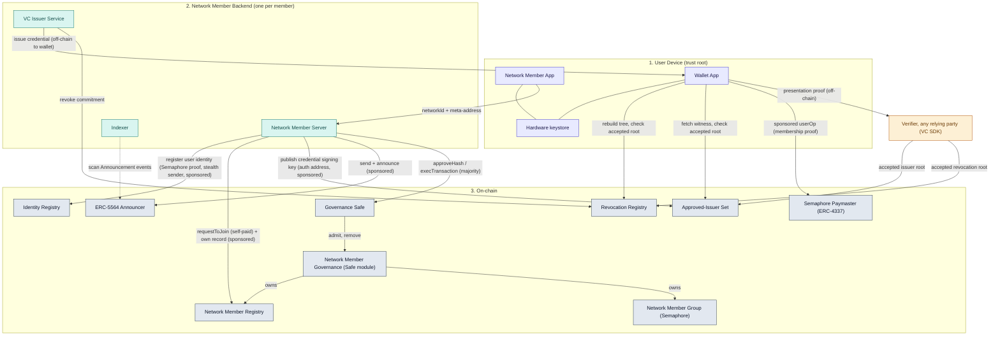
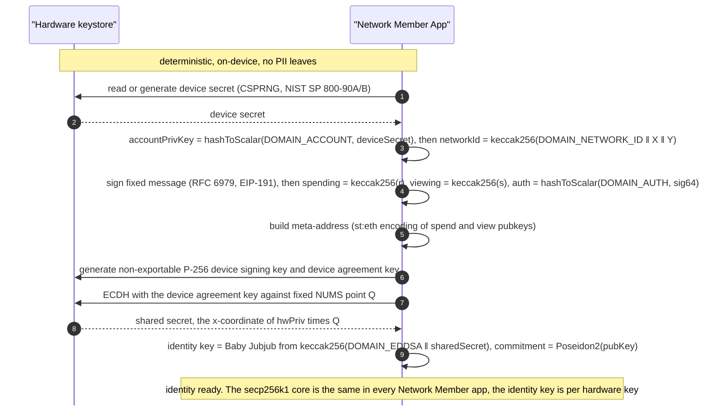
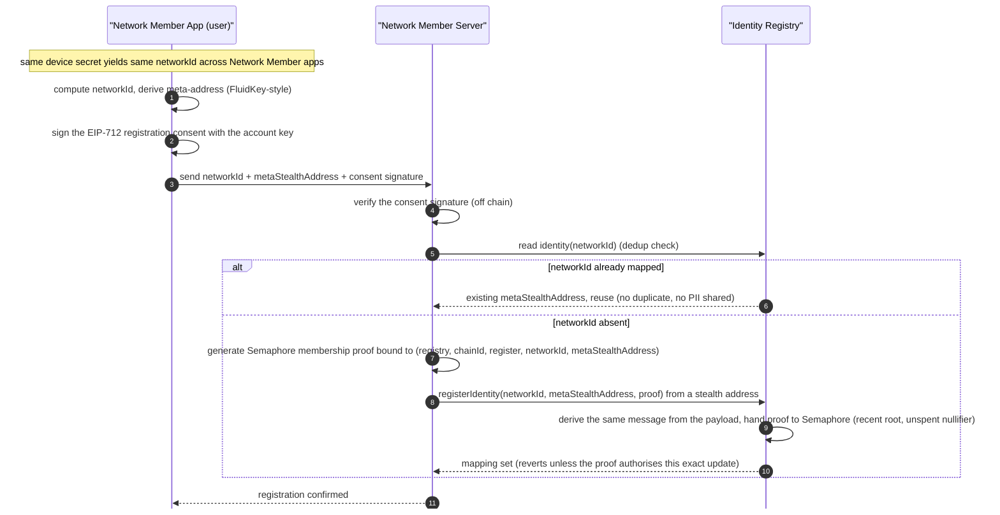
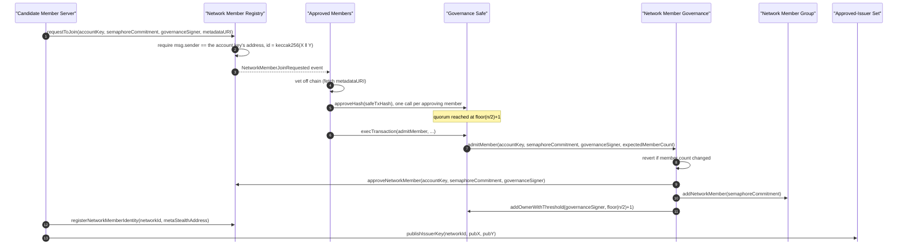
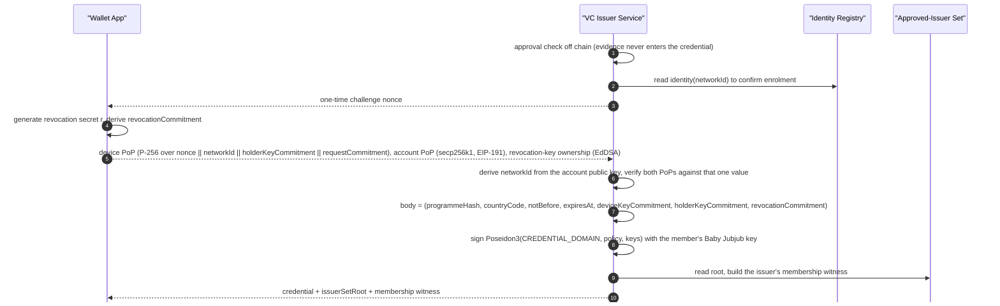
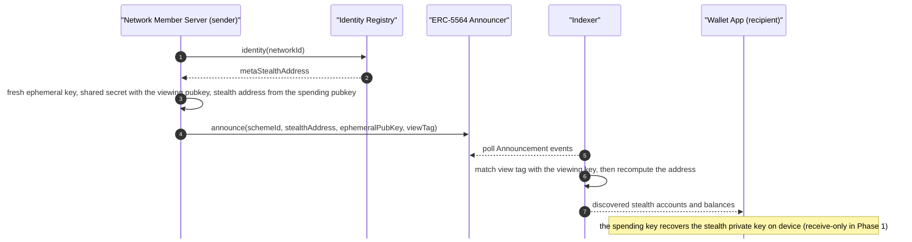
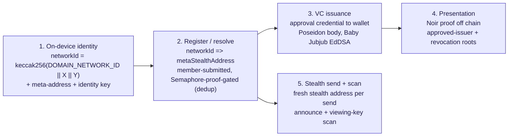

# Full Architecture Phase 1

**Self-Sovereign User Identity, Verifiable Credentials, On-chain Resolution, and Stealth Address Obfuscation**

## 1. Scope and Objectives

Phase 1 establishes the identity and privacy foundation for the coordination network, proven first at the User tier. It delivers five capabilities:

1. **Self-sovereign network identity for Users.** A User derives a deterministic identity from a device secret, with no PII ever leaving the device. Its `networkId`, meta-address, account public key and device and identity public keys do go to every Network Member the User enrolls with or receives a credential from, a cross-member linkability accepted in [01 · Self-Sovereign User](01-self-sovereign-user.md#limitations).
2. **Verifiable credential (VC) issuance to Users.** A Network Member certifies a User's approval to participate, issued to the User's wallet off chain, with an on-chain approved-issuer set and on-chain revocation.
3. **Network ID to wallet resolution.** A public on-chain mapping from `networkId` to a stealth meta-address, registered by the Network Member server on an anonymous Semaphore membership proof (the user signs an off-chain EIP-712 consent that the Network Member verifies, the contract reads no user signature, and the user pays nothing), with cross-Network Member deduplication and no PII sharing.
4. **Unlinkable presentation and verification.** A User proves in zero knowledge that an approved Network Member issued a valid, non-revoked credential matching the scope a verifier asked about. The verifier learns neither which member issued it nor which credential was presented, and verification runs off chain, so a presentation costs no gas.
5. **Stealth address obfuscation.** All accounts use ERC-5564 stealth addresses so that neither the link between a User's meta-address and its stealth accounts, nor a Network Member's relationship to a User, is observable by third parties.

The purpose is to prove the identity-and-privacy pattern at the User tier so it can later extend to digital and financial inclusion of Delegated Users who acquire devices.

## 2. Components

Every component below is implemented in this repository, and the last column says where. The contracts are deployed per environment by `script/DeployAndConfigureAll.s.sol` and the local end-to-end runs; there is no canonical mainnet deployment yet.

| Layer                                   | Component                     | Responsibility in Phase 1                                                                                                                                                                                                                                                                                                                                                                                                                                                                                                                                                                                                                                                                                                   | Where it lives                                                                                                                  |
| --------------------------------------- | ----------------------------- | --------------------------------------------------------------------------------------------------------------------------------------------------------------------------------------------------------------------------------------------------------------------------------------------------------------------------------------------------------------------------------------------------------------------------------------------------------------------------------------------------------------------------------------------------------------------------------------------------------------------------------------------------------------------------------------------------------------------------- | ------------------------------------------------------------------------------------------------------------------------------- |
| Device (trust root)                     | **Network Member App**        | The identity and crypto engine. Derives the account keypair from the device secret and sets `networkId = keccak256(DOMAIN_NETWORK_ID ‖ X ‖ Y)` over the account public key; derives the spending, viewing and auth keys from one deterministic account signature; builds the ERC-6538 meta-address; generates the non-exportable P-256 device signing and agreement keys in the secure element and derives the Baby Jubjub identity key from a hardware ECDH against a fixed NUMS point. Hands `networkId`, the meta-address and a signed consent to the Network Member server, which registers them on its membership proof. The same device secret re-derives the same secp256k1 identity in every Network Member's app.  | `packages/identity`, `apps/identity-testbed`                                                                                    |
| Device                                  | **Wallet App**                | The credential holder. Stores the credential the issuer signed, holds the per-credential revocation secret, rebuilds the revocation tree and refreshes its approved-issuer witness, and builds the presentation proof.                                                                                                                                                                                                                                                                                                                                                                                                                                                                                                      | `packages/credential`, `packages/revocation-registry`, `packages/issuer-set`, `apps/user-web-app`                               |
| Device                                  | **Hardware keystore**         | Secure Enclave (iOS) / Android Keystore holding the device secret and the P-256 device key, which is two keys: a device signing key (signing only) and a device agreement key (key agreement only).                                                                                                                                                                                                                                                                                                                                                                                                                                                                                                                         | `apps/identity-testbed/modules/identity-keystore`                                                                               |
| Network Member backend (one per member) | **Network Member Server**     | The Network Member's submitter. Proves membership in the approved-member Semaphore group and submits user registrations on that authority, requests its own admission and maintains its own registry record, publishes its credential signing keys into the approved-issuer set, and sends and announces deliveries. Its Identity Registry and Network Member Registry transactions are paid for by the Semaphore paymaster, so the member funds no gas balance on the account it writes from, which is what lets an Identity Registry write come from a fresh stealth address not traceable back to it. A sponsored sender has to be an ERC-4337 account or a 7702-delegated key, because a plain EOA cannot be sponsored. | `packages/network-member-client`, `packages/network-member-proof`, `packages/network-member-governance`                         |
| Network Member backend                  | **VC Issuer Service**         | Runs the approval check, verifies the issuance proofs, assembles the seven-field credential body, signs its versioned Poseidon commitment with the member's Baby Jubjub EdDSA key, and revokes on chain. Requires an EdDSA (Baby Jubjub) signer.                                                                                                                                                                                                                                                                                                                                                                                                                                                                            | `apps/issuer-service`                                                                                                           |
| Network Member backend                  | **Indexer**                   | Polls the announcer for ERC-5564 `Announcement` events and checks each against the viewing keys registered over `POST /keys`, surfacing the stealth accounts addressed to a given User. Discovered accounts and per-key scan progress persist in Postgres and are served back over `/accounts` and `/balances`; viewing keys are encrypted at rest. Each Network Member runs its own, because a shared indexer would hold every member's viewing keys and could link Users across members. Only that member's backend calls it, with one bearer token on every route including `/health`, and it may query any of the member's Users and delegated Users.                                                                   | `apps/indexer`                                                                                                                  |
| Verifier (any relying party)            | **VC SDK verifier**           | Checks a presentation. It verifies with the circuit artifact its deployment supplies, rebuilds the public inputs it expects (time, challenge, audience, required programme and country) and rejects any mismatch, verifies the UltraHonk proof off chain, then accepts the approved-issuer and revocation roots the proof outputs only if the chain still accepts them. It never learns which member issued the credential or which credential was presented.                                                                                                                                                                                                                                                               | `packages/credential` (`zk-proof.ts`, `registry-client.ts`)                                                                     |
| On-chain                                | **Identity Registry**         | Maps a User's `networkId` to a meta-stealth address. Reads are public and ungated. Registration, update and removal are each gated on an anonymous Semaphore membership proof from an approved Network Member, bound to that exact update, so the chain records that an approved member made the change but not which one. No write path reads `msg.sender`, and there is no owner, allowlist or override into the mapping.                                                                                                                                                                                                                                                                                                 | `packages/contracts/src/IdentityRegistry.sol`                                                                                   |
| On-chain                                | **Network Member Registry**   | Per-member record: the auth address (the address of the member's account key, from which the registry derives its `networkId`), the member's own meta-stealth address (members resolve here, not in the Identity Registry), the Semaphore identity commitment and the governance signer. Also the entry point for permissionless join requests: `requestToJoin` stores nothing, confers nothing, and only emits `NetworkMemberJoinRequested`. Owned by the Safe, and wired once to the approved-issuer set so a removal retires that member's signing keys.                                                                                                                                                                 | `packages/contracts/src/NetworkMemberRegistry.sol`                                                                              |
| On-chain                                | **Network Member Group**      | Owns the on-chain Semaphore group of approved members. Created on the Semaphore deployment in this contract's constructor with this contract as admin, so admission and removal only add or remove a leaf.                                                                                                                                                                                                                                                                                                                                                                                                                                                                                                                  | `packages/contracts/src/NetworkMemberGroup.sol`                                                                                 |
| On-chain                                | **Network Member Governance** | Safe module, one call per governance operation: `admitMember`, `removeMember`, `exitNetwork`. It computes the majority threshold `floor(n/2)+1` itself rather than taking it as an argument, pins the member count each operation was built against, takes no arbitrary calldata, and refuses to shrink the set below `MIN_MEMBERS = 1`. The registry and the group stay owned by the Safe, so this contract is purely additive.                                                                                                                                                                                                                                                                                            | `packages/contracts/src/NetworkMemberGovernance.sol`                                                                            |
| On-chain                                | **Governance Safe**           | The member-controlled multisig. Every approved member holds exactly one owner seat; a majority of member signatures is what authorises any governance action.                                                                                                                                                                                                                                                                                                                                                                                                                                                                                                                                                               | A Safe created by `script/DeploySafe.s.sol` and checked against the majority rule by `script/DeployNetworkMemberRegistry.s.sol` |
| On-chain                                | **ERC-5564 Announcer**        | Emits stealth-payment announcements (ephemeral public key, view tag), scanned by the Indexer. One deployment per chain, shared by every member. There is a canonical deployment at `0x55649E01B5Df198D18D95b5cc5051630cfD45564`.                                                                                                                                                                                                                                                                                                                                                                                                                                                                                            | `packages/contracts/src/ERC5564Announcer.sol`                                                                                   |
| On-chain                                | **Approved-Issuer Set**       | LeanIMT accumulator over Network Members' Baby Jubjub credential signing keys, leaf `Poseidon3(ISSUER_LEAF_DOMAIN, x, y)`, built as in [03 · VC Issuance and Verification](03-vc-issuance.md#approved-issuer-root). Keys are published and retired by the member's own auth address or by governance, capped at eight live keys per member. A superseded root stays acceptable for one hour by default, and retiring a stolen key with `retireIssuerKeyImmediately`, or removing a member that ever held one, closes off every root superseded before it. The proof shows membership against the root, so a verifier learns that an approved member signed without learning which one.                                      | `packages/contracts/src/ApprovedIssuerSet.sol`, `packages/issuer-set`                                                           |
| On-chain                                | **Revocation Registry**       | One LeanIMT+ tree and one root history for every issuer, held by `CredentialRevocationRegistry` on a `Revocation` deployment. Every write takes an anonymous membership proof, so the chain does not record which issuer revoked. An issuer inserts a credential's revocation commitment; the holder proves that commitment is absent off chain, and the verifier checks the root it proved against with `isValidRoot`. No PII and no credential identifier on chain.                                                                                                                                                                                                                                                       | `packages/contracts`, `packages/revocation-registry`                                                                            |
| On-chain                                | **Semaphore Paymaster**       | ERC-4337 paymaster that sponsors an operation on a Semaphore membership proof carried in `paymasterAndData`, with the proof's message and scope both pinned to the sender so it cannot be lifted onto another account. A per-operation cost cap bounds each operation.                                                                                                                                                                                                                                                                                                                                                                                                                                                      | `packages/contracts/src/SemaphorePaymaster.sol`                                                                                 |

A **VC Schema Registry** is not deployed yet. It is planned as the first step of putting this system into production, so that credential layouts are published and resolvable on chain rather than fixed by the software. Until then the credential body is the fixed seven-field layout defined by [03 · VC Issuance and Verification](03-vc-issuance.md) and reconstructed by the circuit, and no component resolves a schema at issuance or verification.

### 2.1 Layered architecture (component view)

## 3. Identity and Key Model

Phase 1 derives its secp256k1 core from the persisted device secret with domain separation, so a leak of one derived key does not reveal the others. The hardware P-256 signing and agreement keys and the Baby Jubjub identity and paymaster keys sit outside that core. Both Baby Jubjub keys are rooted in the device agreement key rather than in the device secret. The normative derivation, with constants, edge cases and conformance vectors, is [`packages/identity/DERIVATION.md`](../packages/identity/DERIVATION.md) (scheme `v2`); the table below is its summary.

| Key / value                          | Derivation                                                                                                                                                                                                                                                                                        | Purpose                                                                                                                                                                                                                                                                                                                                          |
| ------------------------------------ | ------------------------------------------------------------------------------------------------------------------------------------------------------------------------------------------------------------------------------------------------------------------------------------------------- | ------------------------------------------------------------------------------------------------------------------------------------------------------------------------------------------------------------------------------------------------------------------------------------------------------------------------------------------------ |
| **Device secret**                    | 32 bytes from the device CSPRNG / OS secure RNG (NIST SP 800-90A/B), persisted keystore-gated. Deterministically reproducible per device, so each Network Member's app reads the same secret.                                                                                                     | Root of the whole secp256k1 core. Never leaves the device.                                                                                                                                                                                                                                                                                       |
| **Account key** (secp256k1)          | `accountPrivKey = hashToScalar("coordination-network/identity/v1/account", deviceSecret)`, where `hashToScalar` is tagged keccak256 with a single-byte counter and reject-and-retry into `[1, n)`.                                                                                                | The root of the derived layer: `networkId` and the one derivation-message signature both come from it, and it signs the account proof of possession at issuance. Its address is the member's auth address in the Network Member Registry.                                                                                                        |
| **`networkId`**                      | `networkId = keccak256(DOMAIN_NETWORK_ID ‖ X ‖ Y)` over the account public key's raw 64-byte uncompressed coordinates (no `0x04` prefix), where `DOMAIN_NETWORK_ID` is a fixed domain-separation tag.                                                                                             | The cross-Network Member pseudonym and the Identity Registry key. The tag keeps it from being linkable to the account's Ethereum address until the account public key is published. A network member's own id is the plain `keccak256(X ‖ Y)`, whose low 20 bytes are its auth address. The same device secret regenerates the same `networkId`. |
| **Derivation-message signature**     | RFC 6979 deterministic ECDSA over the EIP-191 digest of the fixed message `"coordination-network/identity/v1"`, low-`s`, no extra entropy; taken as the 64-byte compact `r ‖ s`. Never persisted.                                                                                                 | The single entropy source for the spending, viewing and auth keys.                                                                                                                                                                                                                                                                               |
| **Spending key**                     | `spendingPrivKey = keccak256(r)`, untagged and with no retry, byte-for-byte FluidKey's `generateKeysFromSignature`.                                                                                                                                                                               | Recovers stealth private keys (dormant in Phase 1's receive-only posture).                                                                                                                                                                                                                                                                       |
| **Viewing key**                      | `viewingPrivKey = keccak256(s)`, same construction as the spending key.                                                                                                                                                                                                                           | Detects incoming stealth payments and announcements; the key the Indexer scans with.                                                                                                                                                                                                                                                             |
| **Auth key**                         | `authPrivKey = hashToScalar("coordination-network/identity/v1/auth", sig64)`.                                                                                                                                                                                                                     | Authenticates as the device, kept separate from the account and receiving keys.                                                                                                                                                                                                                                                                  |
| **Stealth meta-address**             | `st:eth:0x<spendingPubKey><viewingPubKey>`, 66 bytes on chain (ERC-6538 scheme 1 encoding).                                                                                                                                                                                                       | The long-lived public handle senders derive fresh stealth addresses from, and the value both registries store.                                                                                                                                                                                                                                   |
| **Hardware P-256 device key**        | Generated in the secure element (Secure Enclave / StrongBox), non-exportable, as two keys: the device signing key (signing only, user authentication for every use) and the device agreement key (key agreement only, user authentication within 10 seconds). Not derived from the device secret. | The device signing key signs device possession at issuance and again at presentation, committed in the credential body as `deviceKeyCommitment = Poseidon5(DEVICE_KEY_DOMAIN, …)`; the device agreement key performs the ECDH that roots the identity key below.                                                                                 |
| **Baby Jubjub identity key**         | `eddsaSeed = keccak256("coordination-network/identity/v1/eddsa" ‖ X(hwPriv · Q))`, where `Q` is a fixed NUMS P-256 point from RFC 9380 hash-to-curve; then zk-kit's `deriveSecretScalar` / `derivePublicKey`.                                                                                     | The device's zero-knowledge identity. Its Semaphore v4 commitment is `Poseidon2(publicKey)`, and the credential body commits to it as `holderKeyCommitment`.                                                                                                                                                                                     |
| **Paymaster sponsorship key**        | Baby Jubjub keypair derived from the device ECDH shared secret with the distinct `coordination-network/identity/v1/paymaster` tag.                                                                                                                                                                | Its Semaphore commitment may be a public paymaster group leaf. The credential holder commitment must never be used as that leaf.                                                                                                                                                                                                                 |
| **Per-credential revocation key**    | Baby Jubjub keypair from a per-credential random secret `r` (32 bytes, wrapped storage). Unrelated to the identity key.                                                                                                                                                                           | Its `Poseidon2(publicKey)` is the credential's `revocationCommitment`, the leaf an issuer inserts to revoke and the value the holder proves absent.                                                                                                                                                                                              |
| **Issuer signing key (Baby Jubjub)** | Generated in and never leaving the Network Member's key service. **Open:** no commodity KMS or HSM signs this curve, so the custody model has no managed-vault answer.                                                                                                                            | Signs the versioned Poseidon commitment over each credential body it issues; its public key is published into the approved-issuer set.                                                                                                                                                                                                           |

Key properties:

- **No PII on-chain or off-device.** `networkId` commits to key material, not to any natural-person or business identifier. No name, biometric, or hashed PII touches the chain.
- **Cross-Network Member convergence with no coordination.** Because every Network Member's app reads the same device secret and applies the same derivation, a User enrolled across multiple Network Members resolves to a single `networkId` without any Network Member coordinating with another.
- **Single-curve account layer.** secp256k1 unifies identity, stealth (ERC-5564 scheme 1), the spending key, and EIP-7702 authorization, which simplifies the cryptography and tooling for everything that touches the chain. Network Members write from plain secp256k1 keys, including fresh stealth addresses, and the Semaphore paymaster pays the gas for their registry transactions. Two further curves sit outside that layer: Baby Jubjub, the credential layer's signing curve, and P-256, the hardware device curve the circuit verifies.
- **Store-then-rederive.** The device secret is the **only** persisted secret of the secp256k1 core (keystore-gated at rest). The account, spending, viewing and auth keys and the per-load stealth private keys are re-derived on demand, so the persisted-secret set does not grow as stealth accounts accumulate.
- **The identity key is the one exception, deliberately.** It is rooted in the hardware key, so it cannot be recomputed by software alone, and losing that hardware key permanently loses this device's Semaphore commitment. The secp256k1 core and `networkId` stay recoverable from the device secret. Rooting in hardware is also why the ECDH peer point `Q` must be a NUMS value: anyone knowing `dlog(Q)` could recompute the seed without the secure element.
- **Dual proof-of-possession at issuance.** The account key and the hardware key each sign a message naming the same session nonce and the same locally derived `networkId`, so neither signature can be lifted from one session and paired with the other, and the device's message also names the holder-key commitment being bound into the credential. The device MUST sign the `networkId` it derives itself, never one handed to it in the issuance request.
- **Versioning is explicit.** Every constant and formula above is frozen for as long as `KEY_DERIVATION_VERSION = "v2"`; a change ships as a new version, never as an in-place edit, and is graded against the committed conformance vectors rather than against prose.

## 4. Phase 1 Flows

### 4.1 Flow 1: Self-sovereign network identity generation

The Network Member App generates the identity entirely on-device. Nothing is sent to any backend at this stage. The device reads or generates the 32-byte device secret, derives the **account keypair over secp256k1** from it with a domain-tagged hash-to-scalar, and sets `networkId = keccak256(DOMAIN_NETWORK_ID ‖ X ‖ Y)` over the account public key. secp256k1 is the curve of Ethereum EOAs, ERC-5564 scheme 1, the stealth spending key, and the EIP-7702 authorization signature, so identity, stealth, and delegation share one curve. The spending, viewing and auth keys all come from one deterministic EIP-191 signature by the account key over a fixed message: the spending and viewing keys FluidKey-style from its `r` and `s` halves, the auth key through the scheme's own tagged hash-to-scalar. Separately, the app generates the non-exportable P-256 device signing and agreement keys in the secure element and derives the Baby Jubjub identity key from a hardware ECDH against the fixed NUMS point `Q`.

### 4.2 Flow 2: Network ID to wallet resolution (on-chain mapping) with deduplication

The User generates its `networkId` and meta-address on device. The Network Member server then registers the pair on-chain on the authority of a Semaphore membership proof against the approved-member group: the proof is bound to that exact update (registry address, chain id, action, `networkId`, meta-address), the contract derives that binding itself rather than accepting it from the caller, and Semaphore spends the proof's nullifier so it cannot be submitted twice. The registry never reads `msg.sender`, so the server submits from a fresh stealth address with the paymaster covering the gas, and the write is linkable neither to which member made it nor to an account that had to be funded first. `updateIdentity` and `removeIdentity` are gated the same way, which is the only correction path: there is no privileged owner. At enrollment the User signs only an off-chain EIP-712 consent, which the Network Member server verifies before submitting; the contract reads no user signature, and the User pays nothing. The mapping is public: any Network Member can resolve a `networkId` to a meta-address, but the linkage to a real-world identity is not exposed. A second Network Member querying the same User finds the existing entry and reuses it rather than creating a duplicate.

Deduplication is a single mapping read on `networkId`: present means already enrolled, absent means new. Because the same device secret yields the same `networkId`, a User cannot register twice for two accounts, and Network Members deduplicate without sharing any PII.

### 4.3 Flow 3: Network Member admission (governance)

Admission is permissionless to request and member-governed to grant. A candidate calls `requestToJoin` itself, so no one gates the queue; the registry takes the candidate's account key, checks it is a secp256k1 point, requires `msg.sender` to be that key's address, derives the `networkId` as `keccak256(X ‖ Y)`, and emits `NetworkMemberJoinRequested` with the key, the candidate's Semaphore commitment, governance signer, and a `metadataURI` pointing at whatever evidence the network wants vetted. The call stores nothing and confers nothing. Approved members watch that event, vet the request off chain, and each signals approval by calling `approveHash` on the Safe, which keeps the whole flow on chain with no relayer and no signature exchange. Once `floor(n/2)+1` members have approved, any of them executes `execTransaction`, and the Safe calls `admitMember` on the governance module, which in one transaction writes the registry record, inserts the Semaphore leaf, and adds the new member's governance signer as a Safe owner at the new threshold. The call pins the expected member count, so a set that changed while approvals were being collected reverts rather than executing at a stale threshold. Removal works the same way and reads the member's commitment and signer from the registry rather than taking them as arguments; a member may also leave unilaterally via `exitNetwork`, which only its own governance signer may call.

The credential signing key is **not** part of admission. Once approved, the member publishes its own Baby Jubjub signing keys into the approved-issuer set from its auth address (`publishIssuerKey`), up to eight live keys, and its removal retires all of them.

Gas divides along the same line as membership. `requestToJoin` is the one call a candidate makes before it is in the group, so it can prove no membership and is self-paid. Everything the member sends afterwards, its registry record, its signing keys and every Identity Registry write, is sponsored by the Semaphore paymaster on the proof it can now produce.

### 4.4 Flow 4: Credential issuance

Issuance is one challenge round trip. The device brings four keys: the hardware P-256 device key, the secp256k1 account key behind its `networkId`, the Baby Jubjub identity key, and a fresh per-credential Baby Jubjub revocation key. The device and account keys prove possession of the same session, the revocation key proves ownership of the commitment it wants embedded, and the issuer assembles a seven-field body and signs one versioned Poseidon commitment over it with its Baby Jubjub EdDSA key. Nothing is written on chain at issuance; the only chain touch is the cacheable enrolment read. The full procedure, including what the issuer stores, is [03 · VC Issuance and Verification](03-vc-issuance.md).

### 4.5 Flow 5: Presentation and revocation

A presentation is a single Noir proof, verified off chain, that reveals only the policy the verifier asked for and two roots. The circuit checks the issuer's EdDSA signature over the credential commitment and that the issuer key is in the approved-issuer set, through a LeanIMT membership path whose length is a private witness; the validity window and the required programme and country; a hardware P-256 signature, an identity-key signature and a revocation-key signature, all over `Poseidon4(PRESENTATION_DOMAIN, challenge, audience, credentialCommitment)`, each opening the matching commitment in the signed body; and a LeanIMT+ non-membership witness for the revocation commitment. It outputs the approved-issuer root and the revocation root it proved against, and nothing else. The verifier accepts those two roots only if the chain still accepts them (`isValidIssuerSetRoot`, `isValidRoot`). Revocation is the issuer inserting the credential's revocation commitment into its registry, after which no fresh non-membership proof exists and the pre-revocation root ages out of its window. Details are in [04 · Revocation](04-revocation.md).

### 4.6 Flow 6: Stealth send and scan

Every delivery goes to a fresh address, so nothing on chain links two deliveries to the same recipient or a recipient to a Network Member. The sender resolves the recipient's meta-address, derives a one-time stealth address from it with a fresh ephemeral key, sends there, and announces the ephemeral public key plus a one-byte view tag through the ERC-5564 announcer. The Indexer scans announcements with the recipient's viewing key: the view tag rejects almost every announcement in one hash, and only survivors get a full address recompute. Recovering the stealth private key needs the spending key and stays on the device, which is why Phase 1's posture is receive-only. The full construction, the execution model and the key-rotation and recovery paths are in [05 · Stealth Addresses](05-stealth-addresses.md).

## 5. End-to-end Phase 1 flow (overview)

## 6. Standards and Primitives

| Concern                      | Choice                                                                                                                                                                                                                                                                                                                                                                      | Reference                                                                                                                       |
| ---------------------------- | --------------------------------------------------------------------------------------------------------------------------------------------------------------------------------------------------------------------------------------------------------------------------------------------------------------------------------------------------------------------------- | ------------------------------------------------------------------------------------------------------------------------------- |
| Device identity              | ECDSA over secp256k1, account key domain-derived from the device secret; `networkId = keccak256(DOMAIN_NETWORK_ID ‖ X ‖ Y)` over its public key                                                                                                                                                                                                                             | [EIP-5564](https://eips.ethereum.org/EIPS/eip-5564) scheme 1 (secp256k1); [`DERIVATION.md`](../packages/identity/DERIVATION.md) |
| Device key                   | ECDSA over P-256 in the secure element, non-exportable, as a device signing key (signing only) and a device agreement key (key agreement only)                                                                                                                                                                                                                              | Secure Enclave / Android Keystore StrongBox; `deviceKeyCommitment` in the credential body                                       |
| Identity key                 | Baby Jubjub EdDSA with Poseidon, seeded from a hardware ECDH shared secret; Semaphore v4 identity commitment `Poseidon2(publicKey)`                                                                                                                                                                                                                                         | `@zk-kit/eddsa-poseidon@1.0.4`, `poseidon-lite@0.3.0`, cross-checked against `@semaphore-protocol/identity@4.14.5`              |
| Hash-to-curve for `Q`        | RFC 9380 `P256_XMD:SHA-256_SSWU_RO_` over a fixed domain tag, giving a NUMS ECDH peer point                                                                                                                                                                                                                                                                                 | [RFC 9380](https://www.rfc-editor.org/rfc/rfc9380)                                                                              |
| Credential-binding messages  | Dual proof-of-possession: the device signing key signs `nonce ‖ networkId ‖ holderKeyCommitment ‖ requestCommitment` with P-256, where `requestCommitment` commits to the issuer and scope shown at consent, the account key signs `nonce ‖ confirmationKeyHash ‖ networkId` as an EIP-191 digest, where `confirmationKeyHash` is the RFC 7638 thumbprint of the device key | [`DERIVATION.md`](../packages/identity/DERIVATION.md) §11; [03 · VC Issuance and Verification](03-vc-issuance.md)               |
| Credential format            | A fixed seven-field body over the BN254 scalar field, committed as `Poseidon3(CREDENTIAL_DOMAIN, Poseidon4(policy), Poseidon3(keys))`, with one EdDSA signature over that commitment. No claim tree, and no on-chain schema resolution yet (the schema registry is a production prerequisite, not a current dependency)                                                     | [03 · VC Issuance and Verification](03-vc-issuance.md)                                                                          |
| Issuer signing key           | EdDSA over Baby Jubjub, Poseidon-hashed, held in the Network Member's key service                                                                                                                                                                                                                                                                                           | `@zk-kit/eddsa-poseidon`                                                                                                        |
| Approved-issuer accumulator  | LeanIMT, leaf `Poseidon3(ISSUER_LEAF_DOMAIN, x, y)`, parent `Poseidon2(left, right)`, an unpaired node promoted unchanged, path length a private witness up to 20; root history with a one-hour default window                                                                                                                                                              | `zk-kit.noir` `binary-merkle-root`; `packages/issuer-set`                                                                       |
| Revocation                   | LeanIMT+, revocation commitment as leaf, non-membership by the commitment's predecessor; one registry and root history for every issuer                                                                                                                                                                                                                                     | [04 · Revocation](04-revocation.md); `packages/contracts`                                                                       |
| Proof system                 | Noir circuit (`packages/circuits`, Nargo 1.0.0-beta.22), proved and verified by Barretenberg UltraHonk over BN254 (`@aztec/bb.js@5.0.0`), off chain                                                                                                                                                                                                                         | [03 · VC Issuance and Verification](03-vc-issuance.md)                                                                          |
| Registry write authorisation | Semaphore v4 group membership proof against a governance-administered group of approved Network Member commitments, created outside the registry, bound to the exact update, nullifier spent per proof                                                                                                                                                                      | `@semaphore-protocol/contracts@4.14.5`; `@coordination-network/network-member-proof`                                            |
| Governance                   | Safe multisig plus a Safe module, majority threshold `floor(n/2)+1` computed on chain, member count pinned per operation, floor of one member                                                                                                                                                                                                                               | [Network Member Onboarding](../packages/contracts/docs/configuration/network-member-onboarding.md)                              |
| Stealth addresses            | ERC-5564 (scheme 1: secp256k1, keccak256) with ERC-6538 meta-address encoding, 66 bytes on chain                                                                                                                                                                                                                                                                            | [EIP-5564](https://eips.ethereum.org/EIPS/eip-5564); [BaseSAP (arXiv 2306.14272)](https://arxiv.org/pdf/2306.14272)             |
| Spending / viewing keys      | FluidKey-compatible derivation from one deterministic secp256k1 signature, byte-for-byte with `generateKeysFromSignature`                                                                                                                                                                                                                                                   | [FluidKey](https://github.com/fluidkey/fluidkey-stealth-account-kit)                                                            |
| Delegation                   | EIP-7702 authorization signature (same secp256k1 curve), user side only, for sponsored sends                                                                                                                                                                                                                                                                                | EIP-7702                                                                                                                        |
| Device randomness            | Device CSPRNG / OS secure RNG                                                                                                                                                                                                                                                                                                                                               | NIST SP 800-90A / 800-90B / 800-90C                                                                                             |
| Gas abstraction              | The Semaphore paymaster pays for the Network Member server's Identity Registry and Network Member Registry transactions, on an ERC-4337 EntryPoint and capped per operation. The one exception is `requestToJoin`, which a candidate sends before it is in the group and therefore cannot prove membership for, so it is self-paid                                          | ERC-4337; [05 · Stealth Addresses](05-stealth-addresses.md) §Gas sponsorship                                                    |
| Contracts toolchain          | Solidity `^0.8.34`, Foundry pinned at `v1.8.5`                                                                                                                                                                                                                                                                                                                              | `packages/contracts`                                                                                                            |

## 7. Component specifications

This is the Phase 1 overview: it defines the components, the key model, and the flows, but not each component's detailed flow and implementation. For those, see the owning spec below. Some of these specs also cover Phase 2 topics; here, take only the parts relevant to Phase 1.

| Component                                                                   | Specification                                                                                      |
| --------------------------------------------------------------------------- | -------------------------------------------------------------------------------------------------- |
| Self-sovereign identity, the device-secret key model, and key derivation    | [01 · Self-Sovereign User](01-self-sovereign-user.md)                                              |
| Wallet: credential storage, binding, presentation, recovery, offline use    | [02 · Wallet](02-wallet.md)                                                                        |
| Verifiable-credential issuance and the verifier-side verification procedure | [03 · VC Issuance and Verification](03-vc-issuance.md)                                             |
| Credential revocation mechanism and non-revocation checking                 | [04 · Revocation](04-revocation.md)                                                                |
| Stealth-address construction, sending, scanning, and the execution model    | [05 · Stealth Addresses](05-stealth-addresses.md)                                                  |
| Adversaries, STRIDE analysis and residual risk across all five stages       | [Phase 1 Threat Model](threat-model-phase-1.md)                                                    |
| Network Member onboarding, governance threshold, and exit                   | [Network Member Onboarding](../packages/contracts/docs/configuration/network-member-onboarding.md) |
| Normative key derivation scheme `v2`, with conformance vectors              | [`packages/identity/DERIVATION.md`](../packages/identity/DERIVATION.md)                            |

## 8. Implementation map

Where each part of this architecture is implemented, so a reader can go from a component to the code that realises it.

| Area                   | Package or app                                                                                                                                                                                                                       | What it provides                                                                                                                                                                                         |
| ---------------------- | ------------------------------------------------------------------------------------------------------------------------------------------------------------------------------------------------------------------------------------ | -------------------------------------------------------------------------------------------------------------------------------------------------------------------------------------------------------- |
| Identity and stealth   | [`packages/identity`](../packages/identity)                                                                                                                                                                                          | Scheme `v2` derivation, `networkId`, the four secp256k1 keys and the Baby Jubjub identity key, the dual-PoP binding, and the ERC-5564 / ERC-6538 stealth primitives                                      |
| Credentials            | [`packages/credential`](../packages/credential)                                                                                                                                                                                      | Credential issuance, parsing, circuit inputs, proof generation and verification, and the registry clients a verifier reads through                                                                       |
| Approved-issuer set    | [`packages/issuer-set`](../packages/issuer-set)                                                                                                                                                                                      | The LeanIMT accumulator in TypeScript, capped at depth 20, as the set itself or as a mirror of the on-chain one, and the witnesses the circuit consumes                                                  |
| Revocation             | [`packages/revocation-registry`](../packages/revocation-registry), [`packages/contracts`](../packages/contracts)                                                                                                                     | The LeanIMT+ registry off chain and on chain, with cross-language root tests pinning them to each other                                                                                                  |
| Member server          | [`packages/network-member-client`](../packages/network-member-client)                                                                                                                                                                | The two things a member app does: issue a UserApproval credential with a fresh issuer witness, and deliver to a stealth address                                                                          |
| Registry authorisation | [`packages/network-member-proof`](../packages/network-member-proof)                                                                                                                                                                  | The Semaphore proof that authorises an Identity Registry write, bound to that exact update                                                                                                               |
| Governance             | [`packages/network-member-governance`](../packages/network-member-governance)                                                                                                                                                        | Building, approving and executing the Safe transaction that admits or removes a member                                                                                                                   |
| Core contracts         | [`packages/contracts`](../packages/contracts)                                                                                                                                                                                        | Identity Registry, Network Member Registry / Group / Governance, Approved-Issuer Set, ERC-5564 Announcer, Semaphore Paymaster, and the deployment script                                                 |
| Circuit                | [`packages/circuits`](../packages/circuits)                                                                                                                                                                                          | The Noir presentation circuit: issuer signature and set membership, policy, three possession signatures, and revocation non-membership                                                                   |
| Issuer service         | [`apps/issuer-service`](../apps/issuer-service)                                                                                                                                                                                      | The member backend that verifies issuance proofs and signs credentials                                                                                                                                   |
| Indexer                | [`apps/indexer`](../apps/indexer)                                                                                                                                                                                                    | Announcement scanning against encrypted viewing keys, with Postgres-backed progress                                                                                                                      |
| On-device testbed      | [`apps/identity-testbed`](../apps/identity-testbed)                                                                                                                                                                                  | The native app exercising the hardware keystore module, the derivation and the conformance vectors on a real device                                                                                      |
| End-to-end demos       | [`apps/integration-testbed`](../apps/integration-testbed), [`apps/user-web-app`](../apps/user-web-app), [`apps/network-member-web-app`](../apps/network-member-web-app), [`apps/stealth-address-demo`](../apps/stealth-address-demo) | Local end-to-end runs over Anvil, Postgres, the circuit and the paymaster, plus the user/member browser demo and the stealth-flow walkthrough. Flow 6 remains an automated integration-testbed scenario. |
